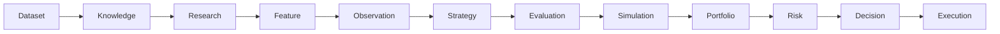

# TIM Constitution Band 3 — System Architecture

Version: **TIM Constitution Band 3**
Status: **Authoritative System Architecture**

Dieses Dokument beschreibt die vollständige Architektur des TIM-Systems:
Plattformen, Datenflüsse, Verantwortlichkeiten, Verträge, Abhängigkeiten,
Kommunikationsregeln und Sicherheitsgrenzen. Es beschreibt ausschließlich die
Architektur, nicht die konkrete Implementierung.

Die Präzedenz lautet:

1. TIM Constitution Band 1
2. TIM Constitution Band 2
3. TIM Constitution Band 3
4. Master Prompts
5. Implementierung

## Leitbild

TIM ist ein deterministisches Analyse- und Entscheidungssystem aus unabhängigen
Plattformen. Jede Plattform besitzt eine klare Verantwortung, öffentliche
Verträge, keine versteckten Seiteneffekte, eigene Tests, Dokumentation,
Versionierung und klar definierte Schnittstellen.

Plattformen kennen keine internen Implementierungsdetails anderer Plattformen.
Sie kommunizieren ausschließlich über definierte Verträge.

## Layer Architecture

| Layer | Plattform |
|---:|---|
| 0 | Foundation |
| 1 | Dataset Platform |
| 2 | Knowledge Platform |
| 3 | Research Platform |
| 4 | Feature Platform |
| 5 | Observation Platform |
| 6 | Strategy Platform |
| 7 | Evaluation Platform |
| 8 | Simulation Platform |
| 9 | Portfolio Platform |
| 10 | Risk Platform |
| 11 | Decision Platform |
| 12 | Execution Platform |
| 13 | Agent Platform |
| 14 | LLM Platform |
| 15 | RAG Platform |
| 16 | Monitoring Platform |
| 17 | Security Platform |
| 18 | Production Platform |

## Platform Responsibilities

### Foundation

Projektstruktur, Governance, Schemas, Standards, Versionierung und
Entwicklungsregeln.

### Dataset Platform

Einzige Quelle für Datensatzdefinitionen: Registry, Manifeste, Versionen,
Lineage, Hashes, Zeitvalidierung und Quarantäne. Keine Datenanalyse.

### Knowledge Platform

Knowledge Objects, Registry, Graph, Quellen, Zitationen und Versionierung.
Keine Forschung.

### Research Platform

Research Sessions, Jobs, Evidence, Reports, Replay und Provenance. Keine
Featureberechnung.

### Feature Platform

Feature Registry, Definitionen, Berechnung, Versionierung, Replay und Hashes.
Keine Interpretation.

### Observation Platform

Marktbeobachtungen, Pattern Detection, Evidence Aggregation, Timeline und
Observation Confidence. Keine Handelsentscheidungen.

### Strategy Platform

Strategien, Regelsätze, Signaldefinitionen, Strategieparameter und
Signalvalidierung. Keine Risikoentscheidungen.

### Evaluation Platform

Bewertung, Backtests, Walk Forward, Cross Validation, Kennzahlen und
Regressionserkennung.

### Simulation Platform

Replay, Execution Simulation, Gebühren, Slippage, Funding und PnL-Simulation.

### Portfolio Platform

Portfolio State, Kapitalstruktur, Allokation, Snapshots und Historie. Keine
Brokerkommunikation.

### Risk Platform

Exposure, Limits, Drawdown, Kill Switch, Circuit Breaker und Positionsgrenzen.

### Decision Platform

Finale Entscheidungen, Evidence Fusion, Konfliktauflösung, Confidence, Replay
und Provenance.

### Execution Platform

Paper Execution, Shadow Execution, Order Simulation, Exchange Interfaces und
Execution Logging. Keine Live Orders ohne explizite Freigabe.

### Agent Platform

Agent Registry, Task Queue, Scheduler, Inter-Agent-Kommunikation, Rollen und
Koordination.

### LLM Platform

Model Registry, Prompt Registry, Routing, Fallback, Prompt-Versionierung und
Evaluation.

### RAG Platform

Embeddings, Chunking, Retrieval, Ranking, Citation Building und Context
Construction.

### Monitoring Platform

Logging, Tracing, Health, Performance, Telemetry und Metriken.

### Security Platform

Secrets, RBAC, Audit, Permissions, Policies und Sandboxing.

### Production Platform

Deployment, Docker, CI/CD, Releases, Rollback, Migration und Backups.

## Data Flow

Informationen fließen ausschließlich vorwärts:

Rückkopplungen erfolgen ausschließlich über explizite Replay- oder
Feedback-Mechanismen.

## Contract Principle

Zwischen Plattformen werden ausschließlich öffentliche Verträge ausgetauscht.
Keine Plattform darf:

- interne Klassen einer anderen Plattform verwenden;
- deren interne Datenstrukturen lesen;
- private Implementierungen kennen;
- deren interne Datenbanken manipulieren.

Kommunikation erfolgt über Schemas, versionierte Records und deterministische
APIs.

## Determinism

Jede Plattform garantiert für identische Eingaben identische Ausgaben und
unterstützt Replay, Hashing, Versionierung, Lineage und Serialisierung.

## Canonical Event Model

Jedes Plattformereignis besitzt mindestens:

- Event ID;
- Timestamp;
- Source Platform;
- Entity Type;
- Entity ID;
- Version;
- Schema Version;
- Hash;
- Correlation ID;
- Payload;
- Lineage Reference.

## Canonical Record Model

Jedes zentrale Objekt besitzt:

- `id`;
- `version`;
- `schema_version`;
- `created_at`;
- `updated_at`;
- `hash`;
- `status`;
- `lineage`;
- `metadata`;
- `payload`.

Kein neues Plattformobjekt darf diese Struktur verletzen. Abweichungen in
bereits existierenden, abgenommenen Plattformen werden als explizite
Kompatibilitäts- und Migrationsschuld behandelt; sie autorisieren keine stille
rückwirkende Änderung.

## Trust Boundaries

- Dataset darf niemals Execution steuern.
- Research darf niemals Orders erzeugen.
- Knowledge darf niemals Portfolio verändern.
- Feature darf niemals Trades eröffnen.
- Risk darf niemals Dataset manipulieren.
- Execution darf niemals Schemas verändern.

## Extensibility

Neue Plattformen sind unabhängig, dokumentiert, getestet und versioniert. Sie
sind rückwärtskompatibel oder dokumentieren Breaking Changes und folgen allen
Architekturprinzipien dieser Constitution.

## Failure Model

Fehler dürfen niemals stille Datenverluste erzeugen, Hashes verändern, Lineage
zerstören, Replay unmöglich machen oder Versionen überschreiben.

Bei Fehlern gilt:

1. Stop
2. Diagnose
3. Dokumentation
4. Korrektur
5. Regressionstest

## Architecture Change Control

Architekturänderungen erfordern Design Review, dokumentierte Begründung,
Kompatibilitätsanalyse und Aktualisierung dieses Dokuments.
# Mission orchestration addendum

`src/orchestration` is the fail-closed control plane above existing headless
ingestion, recovery, validation, and collection components. Its persistent state
machine owns mission ordering and per-process locking; read-only health probes
provide facts, deterministic gates authorize transitions, and append-only
receipts/reports provide auditability. AI helpers and Graphify are advisory
observers and never authorize a state transition or trading action. See
`docs/TIM_ORCHESTRATOR.md` for the operational contract.
