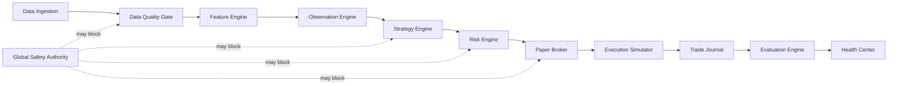

# TIM Additive Target Architecture

## Status

Planning only. No component in this document is implemented or authorized.
TIM Core 1.0 remains frozen and OBSERVE-only.



There is no Strategy → live exchange edge. L4–L6 remain separately gated and
disabled.

## Component contracts

| Component | Responsibility | Explicit non-responsibility | Inputs → outputs | Blocking conditions |
|---|---|---|---|---|
| Data Ingestion | acquire and persist versioned public data | interpretation and decisions | source events → immutable records | identity conflict, invalid schema/time |
| Data Quality Gate | coverage, freshness, sequence, provenance and replay verdict | repair or reconstruction | persisted window → signed quality verdict | any unknown/failed mandatory check |
| Feature Engine | deterministic versioned arithmetic and hashes | semantic setup or trade | quality-approved data → features | failed quality/version/hash |
| Observation Engine | evidence-based descriptive events | prediction or order | features → observations | insufficient evidence or quality |
| Strategy Engine | later transform approved observations into a versioned paper decision | risk approval or execution | context + evidence → decision proposal | incomplete contract, version mismatch |
| Risk Engine | independent deterministic allow/deny and sizing bounds | market prediction | decision + limits + health → authorization/denial | any safety or limit failure |
| Paper Broker | lifecycle-manage virtual orders only | exchange connectivity | authorized paper decision → simulated order | mode not PAPER, kill switch, stale data |
| Execution Simulator | deterministic fills, fees, slippage, latency, rejects | real order submission | paper order + market data → simulated events | incomplete data/model version |
| Trade Journal | append-only correlated evidence | decision modification | events → tamper-evident journal | missing correlation/hash |
| Evaluation Engine | forward-only descriptive performance | strategy mutation | journal → reports | look-ahead or version mixing |
| Health Center | expose operational/scientific/governance status | authorize trading | persisted health → read-only UI/API | stale/missing evidence shown explicitly |

Every contract must carry UTC timestamps, schema version, generator version,
provenance, correlation ID and relevant input/output hashes.

## Mode state machine

```text
OBSERVE → RESEARCH → SIMULATE → PAPER
```

L4–L6 (`SHADOW`, `LIMITED_LIVE`, supervised autonomy) are not valid initial
runtime states. Unknown, missing or malformed mode = **DENY**. Mode promotion
requires an external, versioned governance approval; it is never inferred from
configuration or documentation.

## Global Safety Authority

The future authority owns:

- global kill switch;
- protected-path registry;
- mode validation;
- data-quality and freshness gate;
- replay/version gate;
- strategy-version allowlist;
- risk-limit contract;
- credential boundary;
- immutable decision/audit correlation.

Its denial has priority over every strategy decision. Safety failures are
blocking, never warnings.

## Required safety invariants

1. Live trading disabled by default.
2. No order without explicit allowed mode and risk authorization.
3. No decision under stale, incomplete, unknown-provenance or replay-mismatched data.
4. No unknown strategy or schema version.
5. No averaging down, martingale or unbounded leverage.
6. Enforced position, trade-count, daily-loss and leverage limits.
7. Cooldown after configured loss sequence.
8. Kill switch blocks new work and cancels only in a separately authorized
   future execution design.
9. Strategy cannot import or call an exchange adapter directly.
10. Every decision and denial is hash-correlated and tamper-evident.

## Failures, metrics and health

Each component emits state (`GREEN/YELLOW/RED/UNKNOWN`), freshness, reason code,
evidence path, version and correlation ID. RED/UNKNOWN on a mandatory input
blocks downstream decisions. Metrics include input lag, queue depth, rejected
records, coverage, gaps, hash mismatches, decision denials, limit utilization
and audit-chain continuity.

## Required tests

- contract/schema and canonical serialization;
- deterministic replay and cross-version isolation;
- negative mode and bypass tests;
- kill-switch dominance;
- risk-limit boundary/property tests;
- bad quality/freshness/provenance/replay denial;
- paper lifecycle with partial fills/rejections;
- audit-chain tamper detection;
- no Strategy → Exchange dependency test.

## Integration risks

- introducing strategy semantics into the frozen research Core;
- mixing Core 1.0 data with later versions;
- local model resource contention causing capture gaps;
- using documentation as a substitute for runtime enforcement;
- adding credentials before protected paths and audit controls exist.

