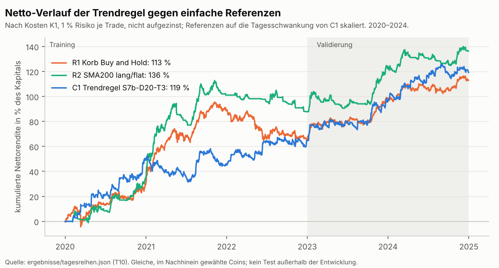
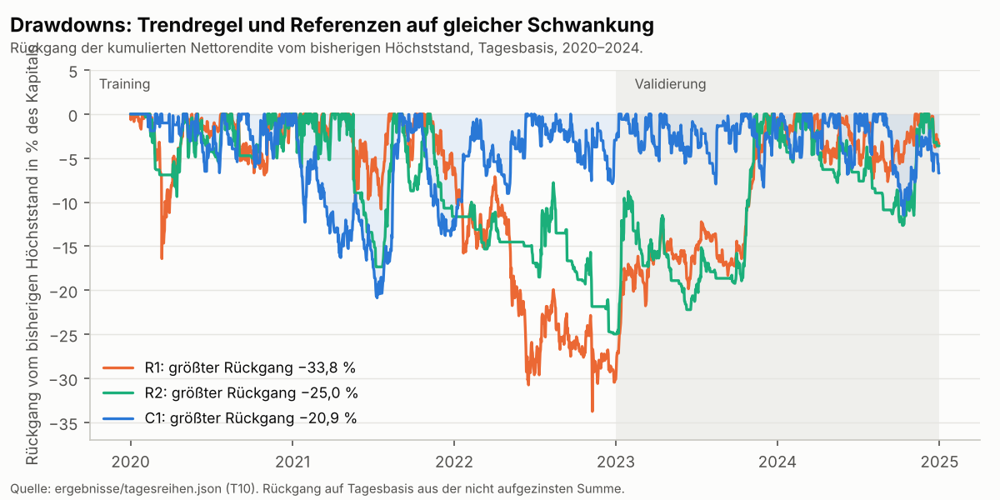
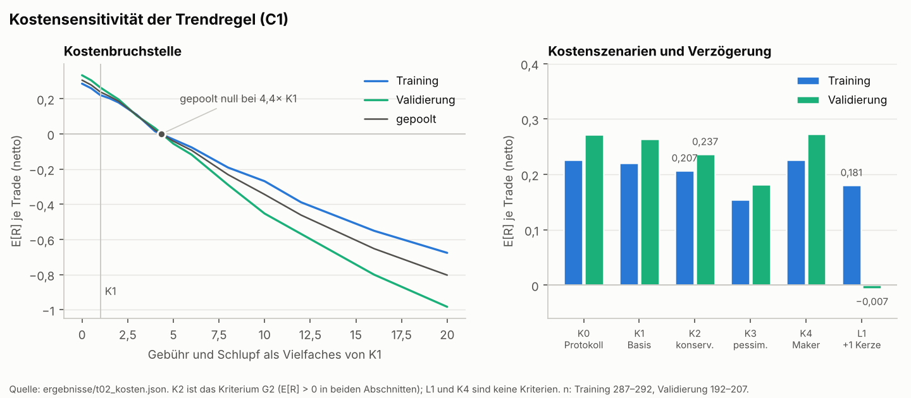
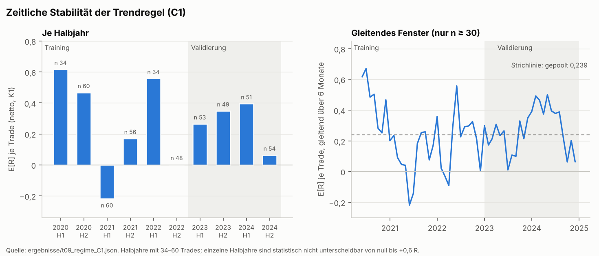
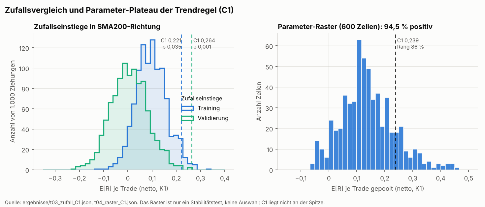
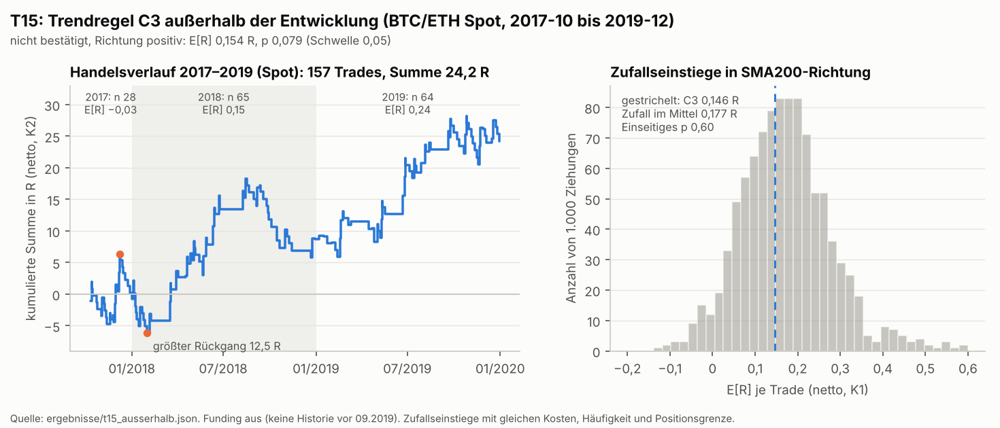

# Konsolidierte Studie: Gibt es bei TIM einen nach realistischen Kosten belastbaren Handelsvorteil?

Stand 16.11.2026. Auftrag von Uzi (Konsolidierung aller TIM-Studien). Nur Analyse und Papier; **keine Echtgeld-Freigabe**, `TRADING_AUTHORIZED=NO` bleibt, kein Live-Eingriff, kein Merge ohne Uzis Wort. Zeitangaben in diesem Dokument sind UTC (deutsche Winterzeit = UTC + 1 Stunde), damit sie mit den Prüfprotokollen übereinstimmen.

Protokolle: `PROTOKOLL_KONSOLIDIERUNG.md` 1.0 (eingefroren im Commit `1e9270a`, SHA-256 `e82a31f060c2…`, 2026-11-16 13:16 UTC) und Zusatzprotokoll `PROTOKOLL_KONSOLIDIERUNG_T15.md` 1.1-T15 (Commit `ceed9f9`, vor dem Laden der Daten). Stand des Codes beim Lauf von T1 bis T13: Commit `f1c3940`; beim Lauf von T15: Commit `3fb2198` (der T15-Code selbst wurde im Commit `b0e8575` festgehalten, vor dem Datenbericht und vor dem Lauf). Wiederholung: `README.md` in diesem Ordner.

## 1. Kurzzusammenfassung und belastbares Gesamturteil

> **Gesamturteil: INTERESSANTE HYPOTHESE, EVIDENZ UNZUREICHEND.** Das gilt für genau eine Familie: die Trendregel S7b-D20-T3 (Donchian-20-Ausbruch in Richtung SMA200, 4h-Kerzen, ATR-Stop, Ziel 3 R; Kandidaten C1 = BTC/ETH/SOL und C3 = BTC/ETH). Für alle übrigen untersuchten Familien (Orderflow, Indikator-Merkmale, Level-Reaktion, frühe Regelfamilien, Plan-Journale, Carry als Handelsvorteil) gilt: **KEIN BELASTBARER VORTEIL**. Keines dieser Urteile autorisiert Echtgeldhandel oder eine Live-Aktivierung.

Warum nicht mehr: C1 besteht die Reproduktion, die Kostenprüfung, den Zufallsvergleich, das Parameter-Plateau, die Konzentrations- und die Unsicherheitsprüfung (G1 bis G6, G11); C3 (ohne SOL) verfehlt zusätzlich den Zufallsvergleich im Training (G3: p 0,087). Beide scheitern an der Mehrfachtest-Korrektur (G7: Deflated Sharpe 0,42 / 0,43 bei Schwelle 0,95; schon bei N = 58 nur 0,44 / 0,45) und an der Übertragung auf andere Coins (G8: −0,0255 R bei n 3.311). Der einzige Test außerhalb des Entwicklungszeitraums (T15, C3 auf BTC/ETH 2017 bis 2019, ein Lauf, vorab eingefroren) ging in die richtige Richtung, verfehlte aber die Schwelle: +0,154 R je Trade, p 0,079 (Schwelle 0,05). Zufällige Einstiege in SMA200-Richtung mit gleicher Ausstiegsregel erreichten dort unter denselben Kosten (K1) im Mittel +0,177 R gegen +0,146 R der Regel (p 0,60). Gleiche Basis im Entwicklungszeitraum (C3, K1): Zufall +0,116 / −0,017 R gegen +0,203 / +0,271 R der Regel (Training / Validierung, p 0,087 / 0,001). Ein positiver Netto-Erwartungswert ist damit **plausibel, aber nicht nachgewiesen**.

Der stärkste Einwand gegen die Regel: Ein Vorteil, falls es ihn gibt, kommt vor allem aus der Trendseite (SMA200-Richtung) und der Auszahlungsgeometrie (Ziel 3 R), nicht aus dem Ausbruchszeitpunkt. Dafür sprechen T15 (kein Vorsprung gegenüber zufälligen Einstiegen), der kleine und im Training nicht signifikante Abstand bei C3 und die einfache Referenz R2 (SMA200 lang/flat) mit dem höheren Sharpe (1,55 gegen 1,36). Dagegen spricht, dass T15 wenig Aussagekraft hat (n 157, kleinste bei 80 % Power nachweisbare Erwartung +0,35 R): p 0,079 und der fehlende Vorsprung vor dem Zufall sind dort keine Widerlegung. Beide Lesarten bleiben offen (Abschnitt 9.3).

### Die acht Fragen des Auftrags

1. **Wie viele Studien wurden gefunden und geprüft?** 69 Studien und Berichte im durchsuchten Umfang (dazu 5 eigene Nachrechnungen, Register: 74 Einträge). Prüftiefe: A (Regelcode und Rohdaten unabhängig neu gerechnet) 2, B (Handelsliste neu ausgewertet) 8, C+ (Zahlen in der Ergebnisdatei wiedergefunden) 23, C (Bericht gelesen) 29, D (nur Logbuchzeile) 7. Aus Rohdaten neu gerechnet sind 2 Studien (die Trendregel S7 und S7b); weitere 8 wurden aus den Handelslisten oder Rohergebnissen des Labors neu ausgewertet, darunter Fälle mit sehr kleinem n (S7b-Forward 4 Trades, S37 höchstens 5 je Variante). Alle übrigen sind nur auf Konsistenz geprüft oder gelesen und tragen entsprechend weniger Gewicht (Abschnitt 2). „Gefunden“ gilt nur für den durchsuchten Umfang.
2. **Was besteht nach der Prüfung?** (a) Eine Hypothese: Trendfolge mit Ausbruchseinstieg in SMA200-Richtung hatte 2020 bis 2024 nach Kosten eine positive Erwartung (+0,239 R je Trade unter K1, 95-%-Band +0,080 bis +0,415 R), reproduziert bit-genau aus den Laborlisten. (b) Belastbare Negativbefunde: Level-, Orderflow- und Indikatorfamilien tragen nach Kosten keine Regel (S34, S35a, S36, S38 aus den Handelslisten neu ausgewertet; OFX: 0 von 8,1 Mio. Varianten nach den Bestenlisten des Labors). (c) Die Kostenarithmetik: Je enger der Stop, desto mehr verbrauchen Kosten den Vorteil (E5).
3. **Welche vermeintlichen Erfolge waren methodisch nicht belastbar?** Unter anderem: das Carry-Ergebnis mit verdecktem Hebel, das OF2-Training (n 56, beste 5 % der Trades = 108 % der Summe), der S7b-Makrofilter F5 (nach fünf Versuchen, Glückstest p 0,066), der Sortiereffekt von S24 (verliert nach Kosten), die Plan-Journale (Vorzeichen hängt an 27 Ausschlüssen), der OF-Schatten (Regel nach Ansicht der Zwischenstände) und hohe Trefferquoten ohne Vorteil (S6: 72 bis 82 % bei negativer Erwartung; S4 erreichte sein 75-%-Ziel nicht einmal, höchstens 52,5 %). Tabelle in Abschnitt 4.
4. **Was lässt sich zusammenführen?** Alle Studien zur Trendregel sind **eine** Evidenzquelle (derselbe Datencluster TREND-4H), nicht fünf; die Negativbefunde der Level-, Orderflow- und Indikatorfamilien bilden gemeinsam das Bild „Kosten schlucken den Vorteil kurzer Regeln“; Trefferquote ist Auszahlungsgeometrie, nicht Qualität des Einstiegs (S6). Ergebnis: drei im Protokoll festgelegte Kandidaten C1, C2, C3 (Abschnitt 7); als Beobachtungsportfolios für das Papier-Vorwärtsjournal werden C1 und C3 vollständig spezifiziert (Abschnitt 11), C2 (Carry-Anteil) wird nicht weiterverfolgt.
5. **Ist ein positiver Netto-Erwartungswert nachgewiesen?** Nein. Für die Trendregel ist er **plausibel** (reproduziert, kosten- und parameterrobust im Entwicklungszeitraum, gleiche Richtung in T15), aber **nicht nachgewiesen** (G7, G8, T15 p > 0,05, keine unabhängige prospektive Bestätigung). Für alle anderen Familien ist er **nicht erkennbar** (negativ oder nicht testbar).
6. **Unsicherheit und Drawdown?** C1 gepoolt 2020 bis 2024: größter Rückgang 21,0 R (etwa 21 % bei 1 % Risiko je Trade); im Monatsblock-Bootstrap Median 19,3 R, 95. Perzentil 33,3 R. C3 in T15: 12,5 R über 316 Tage. Die Streuung je Trade ist etwa 1,72 R: Bei einer wahren Erwartung von 0,24 R wären für einen Nachweis (einseitig 5 %, Power 80 %) rund 318 Trades nötig, bei 0,20 R rund 458 (Abschnitt 10).
7. **Was fehlt bis zu einem belastbaren prospektiven Nachweis?** Mindestens eine unabhängige Stichprobe ohne Versuchsverbrauch: der einmalige Holdout 2025-01 bis 2026-06 (nur mit Uzis ausdrücklichem Wort und Bartis Zustimmung; etwa 153 Trades, Power nur etwa 53 %) und/oder rund 318 vorwärts beobachtete Trades (etwa 3,1 Jahre). Außerdem Bitunix-Gebühren, Funding und Ausführung als bestätigte Zahlen (Abschnitt 10, offene Voraussetzungen).
8. **Wo liegen Studie und Artefakte?** `docs/research_lab/konsolidierung/` im Repo `tim-ai-platform` (Branch `claude/project-thread-iky0o0`): `KONSOLIDIERTE_STUDIE.md` (dieses Dokument), `STUDIENREGISTER.md`, `EVIDENZMATRIX.md`, `ergebnisse/` (JSON je Test), `grafiken/` (8 Bilder, reproduzierbar aus den JSON), `TESTLOG.md`, `TESTLOG_T15.md`, `README.md` (Reproduktion), Code in `src/research_lab/konsolidierung/`. Die Originalstudien bleiben unverändert.

Die gewünschte Trefferquote von 75 % ist keine Anforderung und kein Beleg für Profitabilität: Die Trendregel gewinnt nur etwa 38 % ihrer Trades und verdient dennoch über asymmetrische Gewinne (Ø +2,28 gegen −1,03 R). Umgekehrt erreichte S6 im Training Trefferquoten von 72 bis 82 % bei negativer Erwartung (−0,07 bis −0,11 R), während S4 sein Ziel von 75 % mit höchstens 52,5 % nicht annähernd erreichte und ebenfalls nach Kosten verlor.

### Die vier Evidenzstufen der Trendregel

| Stufe | Stand | Beleg |
|---|---|---|
| Historisch gut ausgesehen | **ja** | 2020 bis 2024: +0,239 R je Trade (K1), n 499; S7 und S7b im Labor. |
| Korrigiert reproduziert | **ja** | Unabhängige Nachrechnung reproduziert 4.879 gespeicherte Trades ohne Abweichung (T1); Kostenpuffer, Plateau, Bootstrap-Band über 0. |
| Außerhalb der Entwicklung bestätigt | **nein** (getestet) | T15 (BTC/ETH 2017 bis 2019): +0,154 R, p 0,079, nicht bestätigt, Richtung positiv. S32 (137 andere Coins): −0,0255 R, nicht bestanden. Der Holdout ab 2025-01-01 ist unberührt. |
| Prospektiv beobachtet | **zu wenig** | S7b-Forward: 4 geschlossene Papier-Trades der Regel D20-T3 (alle Short; die Variante D20-T4 mit 3 Trades ist kein Kandidat). S7b-Sonde Juli bis Oktober 2026: 35 Trades, −5,8 R, versehentlich gesehen, nicht aufbewahrt und nicht vorab ausgewertet (NUR BERICHTET). |

### Kriterien des eingefrorenen Protokolls (Ergebnis je Kandidat)

| Kriterium | C1 (BTC/ETH/SOL) | C2 (C1 + Carry) | C3 (BTC/ETH) |
|---|---|---|---|
| G1 | bestanden | bestanden | bestanden |
| G2 | bestanden | bestanden | bestanden |
| G3 | bestanden | bestanden | **nicht bestanden** |
| G4 | bestanden | bestanden | bestanden |
| G5 | bestanden | bestanden | bestanden |
| G6 | bestanden | bestanden | bestanden |
| G7 | **nicht bestanden** | **nicht bestanden** | **nicht bestanden** |
| G8 | **nicht bestanden** | **nicht bestanden** | **nicht bestanden** |
| G11 | bestanden | bestanden | bestanden |
| CG1 | – | bestanden | – |
| CG2 | – | bestanden | – |
| G10 | – | bestanden | – |

Stufe nach Protokoll: C1, C2 und C3 jeweils Stufe 2. Das Protokoll verlangt dafür: G1 und G2 bestanden, aber nicht alle Kriterien von G3 bis G8 und G11 erfüllt (für C2 zusätzlich CG1, CG2, G10). Nicht bestanden sind bei C1 G7, G8, bei C2 G7, G8, bei C3 G3, G7, G8. Das Gesamturteil ist die höchste erreichte Stufe: **Stufe 2**. T15 ändert weder ein Kriterium noch die Stufe (Zusatzprotokoll Abschnitt 1 und 6).

Zu G11: Das Teilergebnis zu den Bitunix-Kerzen (Abweichung des E[R] −0,027 R gegen die Toleranz von 0,05 R) lag vor dem Einfrieren vor; das Protokoll weist es selbst als berichtet, nicht als vorab festgelegt aus. Die Stufe hängt nicht daran, denn G7 und G8 scheitern unabhängig davon.

## 2. Suchumfang und vollständiges Studienregister

**Durchsucht wurden:** das Studienarchiv des Labors im Repo (`docs/research_lab/`: Logbuch, Präregistrierungen, Berichte, Ergebnisdateien), die Ergebnisordner unter `/mnt/project-files/analysen/` (die studienrelevanten Unterordner), Kopien der PS5/PS4-Ergebnisse (S19 bis S38, OF2, OFX), die Berichte in `tim-master` und im privaten Repo, das Überzeugungsregister (12.11.2026) und die Papier-Journale. Stand des durchsuchten Repos: `platform-main` am 16.11.2026 um 12:46 UTC (Commit `3799781`, Merge von PR #282). Danach sind weitere Änderungen gemergt worden (Orderbuch-Anzeige im Dashboard, Twelve-Data-Schlüssel, OF2-Bausteine bis zum Modell M8); sie enthalten Programmcode und Tests, keine neuen Studienergebnisse, und sind nicht im Register. **Vollständigkeit gilt nur für diesen Umfang.** Nicht zugänglich oder nicht auswertbar waren:

| Quelle | Grund |
|---|---|
| Mac-Dateien außerhalb des Repos | ~/Documents/TIM/evidence/S33-*.md und E0E1-2026-11-12.md (Entwürfe und Bericht zu S30/S33-Carry), ~/TIM-live/data/journal/ (Roh-Journale, auto.jsonl), Hermes-Evals; nur über Berichte des Labors bekannt, nicht selbst gelesen. |
| Kraken-Echtgeldtest und Bitunix-Konto | Kontoauszüge, Orderlisten und Journal des Live-Traders nicht zugänglich; nur Berichte (Kraken-Kosten 04.11., Kapitalrechnung 12.11.). |
| PS5/PS4-Rohdaten | S8-Minutenbalken und die vollen OFX-Läufe sind nur als Ergebnisdateien kopiert (OFX: Suchprotokoll vollständig gezählt); keine eigene Neuberechnung der Orderflow-Studien. |
| V2-Archiv und Hermes | V2-Kampagnenseiten (System → Archiv V2) und Hermes-Evals nicht im Repo; ohne Handelsbezug laut Gedächtnis. |
| Repos tim-ai-platform-private und tim-master | Dateilisten verglichen und die einschlägigen Berichte gelesen (V1-Juli, Plan-Journal-Evidenz); keine vollständige Durchsicht der 2.041 bzw. 23 Dateien. Das private Repo enthält die Forschungsdateien ebenfalls (94 Dateien nur dort, überwiegend Infrastrukturbelege). |
| GitHub-Issues und Pull-Request-Diskussionen | nicht gelesen; Studienstände nur aus Repo, Logbuch und Ergebnisdateien. |
| Holdout ab 2025-01-01 | bewusst nicht geladen (versiegelt; Freigabe nur durch Uzi, bei S7b auch Barti). |
| S29, S12, S18, S8, L1, KI1, GEX-Wand, S33-Optionsflow, S23 | kein Ergebnis vorhanden oder noch nicht ausgewertet; Status nicht prüfbar. |
| Projektordner /mnt/project-files/analysen | rund 70 Unterordner; die studienrelevanten (Bitunix-Edge, Ziel 50 USDT, Indikator-/Orderflow-Prüfung, Läufer, VWAP, OF2-Kostengrenze, Stop-Analyse, Kraken-Kosten) wurden gelesen, Chart-/Layout-/Control-Center-Ordner nicht. |
| Externe Quellen | Reels, Videos und Bootcamp-Material sind keine Messungen und wurden nur über TIMs Auswertungen (Bewertungsberichte) einbezogen. |

Wo Daten, Rechenleistung oder Zugriff fehlten, wurde das als Grenze der jeweiligen Aussage vermerkt und mit den vorhandenen Mitteln weitergearbeitet (zum Beispiel S32 nur berichtet, weil die Kerzen der 137 Coins nicht im Container liegen).

### Einordnung der Registereinträge

74 Einträge: 69 gefundene Studien und Berichte, 5 eigene Nachrechnungen. Vollständiges Register mit Quellen, Daten, Aufteilung, Kosten, Stichprobe, Mängeln und Aussagen: `STUDIENREGISTER.md` und `studienregister.json`.

**Prüftiefen:** A = Regelcode und Rohdaten unabhängig neu gerechnet, Handelsliste des Labors reproduziert; B = Handelsliste oder Rohergebnis neu ausgewertet; C+ = Zahlen des Logbuchs in der Ergebnisdatei wiedergefunden (Konsistenz, keine Neuberechnung); C = Präregistrierung oder Bericht gelesen; D = nur Logbuchzeile.

**Klassen:** BELASTBAR (Rechnung unabhängig bestätigt, Regel vorab festgelegt; sagt nichts über die Richtung), BEDINGT VERWERTBAR (Methode im Kern sauber, benannte Einschränkung), EXPLORATIV (Hinweis ohne vorab festgelegte Bestehensregel oder zu wenige Fälle), UNGÜLTIG (methodischer Fehler), NICHT REPRODUZIERBAR (Ergebnis nicht nachvollziehbar). Ein fehlerhaftes Ergebnis zählt nie als positive Evidenz.

| Klasse | Anzahl (gefundene Studien und Berichte) |
|---|---:|
| BEDINGT VERWERTBAR | 31 |
| EXPLORATIV | 30 |
| NICHT REPRODUZIERBAR | 4 |
| BELASTBAR | 4 |

Die Zählung gilt für die 69 gefundenen Studien und Berichte; die 5 eigenen Nachrechnungen sind nicht mitgezählt (mit ihnen: BEDINGT VERWERTBAR 36, EXPLORATIV 30, NICHT REPRODUZIERBAR 4, BELASTBAR 4). Keine Studie ist als UNGÜLTIG eingestuft: Das Labor kennzeichnet eigene Mängel (Gate gescheitert, Regel nach Ansicht geschrieben) selbst im Bericht; solche Studien sind EXPLORATIV oder nicht bestanden. Kein Eintrag ist **BELASTBAR und positiv** (`belastbar_positiv` ist leer): Die vier BELASTBAREN Einträge (S34, S35a, S36, S38) sind Negativ- oder Nullbefunde.

BELASTBAR heißt hier nur: Die Kennzahlen wurden aus den Handelslisten des Labors neu berechnet (Prüftiefe B, nicht aus Rohdaten neu erzeugt), die Regel war vorab festgelegt, und die Richtung ist eindeutig. Zwei Einschränkungen: S34 hatte mit n 53 weniger als die vorab verlangten 60 Trades; sein „nicht bestanden“ beruht deshalb auf der Kostenarithmetik (Kosten 1,2 R je Trade bei einem mittleren Stop von 0,20 %), nicht auf einem Test mit ausreichender Fallzahl. Bei S36 wurden Konfigurationen nach dem ergebnisblinden Zähllauf und vor jedem R-Wert angepasst (Änderungen 0.2 und 0.3 der Präregistrierung). Beide Befunde sagen nichts über andere Regeln.

**Kennzeichnung der Aussagen:** Jede Aussage im Register trägt eine von vier Kennzeichnungen: VERIFIZIERT (in einer eigenen Rechnung oder im gelesenen Bericht wiedergefunden), NUR BERICHTET (Zahl aus einem Bericht übernommen, nicht nachgerechnet), ANNAHME (für die Rechnung gesetzt, nicht belegt) und NICHT PRÜFBAR (Quelle oder Daten nicht zugänglich). Zählung der 106 Aussagen zu den gefundenen Studien: VERIFIZIERT 57, NUR BERICHTET 39, ANNAHME 2, NICHT PRÜFBAR 8; mit den eigenen Nachrechnungen insgesamt 115: VERIFIZIERT 64, NUR BERICHTET 39, ANNAHME 4, NICHT PRÜFBAR 8. VERIFIZIERT bedeutet bei Prüftiefe C+ und C nur, dass die Zahl im Bericht steht, nicht dass sie neu berechnet wurde; die Prüftiefe je Eintrag steht in der Tabelle unten. Die tragenden Aussagen dieser Studie stehen mit Kennzeichnung in Abschnitt 3.

| Datencluster | Einträge | Beschreibung (gleiche Daten: keine unabhängige Evidenz) |
|---|---:|---|
| TREND-4H | 6 | Binance USD-M 4h BTC/ETH/SOL 2020–2024, Donchian/SMA200-Regel (S7, S7b). S7b-Makro und S25 verwenden dieselbe Handelsliste, S32 dieselbe Regel auf anderen Märkten. Eine Evidenzquelle für die Regel, nicht fünf. |
| BTC-1H | 9 | BTC 1h, S8-Minutenbalken-Datensatz (SHA-256 9083b6ae…), Standard-Trades. Die Validierung 2023–2024 wurde von S20–S28 wiederholt verwendet; die Studien sind nicht unabhängig voneinander. |
| OF-MIN | 10 | S8-Minutenbalken (Orderflow/Footprint, BTC 2020–2024). OF2, S31 (B1–B5 sind OF2-Modelle), OFX, S19, S17 und die Move-Kalibrierung teilen dieselben Daten. |
| LEVEL-INTRADAY | 7 | BTC/ETH/SOL 1m–15m aus Binance-Archiven, Training 2020–2022/23; S30, S34–S38 und die VWAP-Beschreibung testen Level-Ideen auf überlappenden Zeiträumen. |
| FRÜH | 8 | Frühe Studien (Sept.–Nov. 2026) auf BTC/ETH/SOL 2020–2024 mit Protokoll 1.x: R4 (48 Varianten), S4, S6, S9, S10, S13, S14. |
| CARRY | 2 | Funding-Carry: S5 (nicht testbar), S33-Carry (nur Training), eigene Prüfung T11. |
| PROSPEKTIV | 9 | Papier-Journale, Schatten und Echtgeld-Mini-Test: einzelne Beobachtungsfenster ab Oktober/November 2026, kleine Stichproben. |
| OPTIONEN | 2 | Deribit-Optionen/Gamma: Entwürfe, nur vorwärts; keine Historie. |
| PROGNOSE | 10 | Prognose-, Verteilungs- und KI-Studien ohne oder mit Papiertrades: Risiko- und Anzeigebausteine, keine Gewinnaussage. |
| INFRA | 6 | Plattform-, Daten- und Software-Abnahmen: prüfen Pipeline und Governance, nicht Profitabilität. |
| EIGEN | 5 | Eigene Nachrechnungen dieser Konsolidierung (Protokoll 1.0, eingefroren). |

### Alle Registereinträge

| Id | Titel | Cluster | Tiefe | Klasse | Richtung |
|---|---|---|---|---|---|
| R4 | 48 Orderflow- und Struktur-Varianten mit Glückstest (SPA/StepM) | FRÜH | C+ | Bedingt verwertbar | negativ |
| S1 | BTC-Schwankung an CPI-Terminen | FRÜH | C+ | Bedingt verwertbar | keine Handelsaussage |
| S2 | TIMs Live-Orderflow-Regeln als Hypothese | OF-MIN | C | Explorativ | keine Aussage |
| S4 | Trefferquote 75 % mit Ziel 0,75 R (Sweep, Delta, Regime) | FRÜH | C+ | Bedingt verwertbar | negativ |
| S5 | Trefferquote 95 % mit Funding-Carry (Perp-Wechsel) | CARRY | C+ | Explorativ | keine Aussage |
| S6 | Trefferquote 95 % mit Maker-Limits an der VWAP-Abweichung | FRÜH | C+ | Bedingt verwertbar | negativ |
| S7 | Trendfolge-Ausbruch 3–4 R (Donchian, SMA200), BTC/ETH/SOL 4h, Positionen je Sy… | TREND-4H | A | Bedingt verwertbar | positiv (Erwartung), Risikokriterium verfehlt |
| S7b | Trendfolge-Ausbruch 3–4 R mit höchstens einer Position (BTC > ETH > SOL) | TREND-4H | A | Bedingt verwertbar | positiv (Kandidat) |
| S7b-Makro | S7b-Makrofilter F1–F5 (Realzins, Dollar, Liquidität u. a.) als Filter auf S7b-… | TREND-4H | C | Explorativ | unklar (Mehrfachtest nicht bestanden) |
| S7b-Forward | S7b Papier-Vorwärtsjournal auf Live-Kerzen ab 01.11.2026 (D20-T3, D20-T4) | PROSPEKTIV | B | Explorativ | positiv (n viel zu klein) |
| S7b-Sonde | S7b Sondenlauf 04.07.–01.11.2026 (zufällig gesehen, in der Präregistrierung ve… | TREND-4H | C | Explorativ | negativ (n klein) |
| S25 | Positionsgröße nach GARCH-4h-Prognose für S7b-D20-T3 | TREND-4H | C+ | Bedingt verwertbar | negativ |
| S32 | Korb-Trendfolge: S7b-D20-T3 unverändert auf Top-25-Perps ohne BTC/ETH/SOL, 4h | TREND-4H | C+ | Bedingt verwertbar | negativ |
| S15 | GARCH(1,1)-Volatilitätsprognose gegen 14-Tage-Varianz, BTC/ETH/SOL, 4h und 1d | PROGNOSE | C+ | Bedingt verwertbar | keine Handelsaussage (Risikoschicht) |
| S9 | CHoCH, Retest-Band, Reaktionsschluss auf 15m (GoatHub-Lernheft) | FRÜH | C | Explorativ | keine Aussage |
| S10 | IB-Ausbruch New York mit Retest an POC/Value-Kante | FRÜH | C+ | Explorativ | keine Aussage |
| S13 | Noise-Band-Ausbruch (Intraday-Momentum nach Zarattini/Aziz/Barbon 2024), NY-Si… | FRÜH | C+ | Bedingt verwertbar | negativ |
| S14 | Paar-Handel (Statistical Arbitrage) ETH/BTC, SOL/BTC, SOL/ETH, 1h | FRÜH | C+ | Bedingt verwertbar | negativ |
| K1 | Kosten-Schwelle 0,25 R für Plan-Journal-Pläne | PROSPEKTIV | C | Explorativ | keine Aussage |
| V2 | V2-Qualifizierungskampagne (1000 unabhängige Fälle) | INFRA | D | Nicht Reproduzierbar | keine Aussage |
| F4 | Perp-Daten: 48-h-Probe der Futures-Trades neben Spot | INFRA | D | Explorativ | keine Aussage |
| S20 | Flip-Wahrscheinlichkeit aus der Kerzenstruktur, BTC 1h, Bruch von Swing-Linien | BTC-1H | C+ | Bedingt verwertbar | negativ |
| S21 | Orderflow und Funding am Flip (CVD, Volumentrend, Footprint, Funding gegen den… | BTC-1H | C+ | Bedingt verwertbar | negativ |
| S22 | Chart-Urteil im Rückblick: sortieren die Kerzen-Regeln R1–R5 Standard-Trades, … | BTC-1H | C+ | Bedingt verwertbar | negativ |
| S23 | Open Interest am Flip: hält ein Bruch besser mit OI als mit dem Abstand allein… | BTC-1H | D | Explorativ | keine Aussage |
| S24 | Alle Indikatoren mit Historie zusammen (C/K/F/G/T/V, M1 Stimmen, M2 Logit) auf… | BTC-1H | C+ | Bedingt verwertbar | negativ (sortiert, aber nach Kosten verlustreich) |
| S26 | Aufwand gegen Ergebnis: Absorption, Initiative und Book Sweep je 1h-Kerze, BTC | BTC-1H | C+ | Bedingt verwertbar | negativ |
| S27 | Alle Indikatoren (S24) auf größeren Trades: Stop 3 ATR, Ziel 6 ATR, 168 h, BTC… | BTC-1H | C+ | Bedingt verwertbar | negativ |
| S28 | Positionierung aus dem Binance-Metrics-Archiv (OI, Top-Trader, Taker-Verhältni… | BTC-1H | C+ | Bedingt verwertbar | negativ |
| S8 | Orderflow-KI: Richtung der nächsten 5 Minuten aus Orderflow-Merkmalen (prospek… | OF-MIN | D | Explorativ | keine Aussage |
| S19 | Orderflow-Schwellen BTC (Imbalance, Auktionsrand, Absorption, dünnes Extrem, E… | OF-MIN | C | Bedingt verwertbar | negativ / ohne Nachweis |
| OF2 | Orderflow-Engine nach Broncx-Modellen M1–M7, jede Session handelbar (Training … | OF-MIN | B | Bedingt verwertbar | positiv (Training, n 56, nicht belegt) |
| OFX | PS5-Dauerforschung: Suche nach besseren OF2-Varianten mit Sieb und Reality-Che… | OF-MIN | B | Bedingt verwertbar | negativ (Suche ohne Ergebnis) |
| S31 | Broncx-Bootcamp-Orderflow-Regeln B1–B8, BTCUSDT 15m/1h | OF-MIN | C+ | Explorativ | keine Aussage |
| S31b | Orderflow-Regeln M1–M7 (OF2) und B6/B7 auf 1h- und 4h-Kerzen, BTC | OF-MIN | C+ | Explorativ | keine Aussage |
| S29 | Nachspielen der Journal-Regel (Setup-Pfad-Planer rückwirkend), BTC | OF-MIN | D | Nicht Reproduzierbar | keine Aussage |
| L1 | Lernschleife Champion/Herausforderer für die Orderflow-KI (Prognosegüte) | PROGNOSE | C | Explorativ | keine Aussage |
| S12 | Trifft die geschätzte Liquidations-Heatmap echte Liquidationen? (Kalibrierung … | PROGNOSE | C | Explorativ | keine Aussage |
| S30 | Level-Reaktion am Kerzen-Level: Fade-Raster (12 Regeln) und Ausbruch, BTC 4h | LEVEL-INTRADAY | C+ | Explorativ | negativ |
| E0/E1 | E0 Kosten-Zerlegung der BTC-1h-Studien (S22, S24, S27) und E1 Zählung von Leve… | BTC-1H | C+ | Bedingt verwertbar | negativ |
| S34 | LVN am Wochen-VAH/VAL plus ≥ 2 σ vom Tages-VWAP, Rückkehr zum VWAP, BTC 5m | LEVEL-INTRADAY | B | Belastbar | negativ |
| S35a | Level plus Orderflow-Bestätigung, Rückprall und Ausbruch (Extrem, VWAP-Band, V… | LEVEL-INTRADAY | B | Belastbar | negativ |
| S36 | SFP mit Orderflow-Konfluenz, HTF→Exec, Varianten M (Markt) und L (Limit), BTC/… | LEVEL-INTRADAY | B | Belastbar | negativ |
| S37 | Fade-Checkliste (Flowread) Teil a ohne Gamma: Fade zum Tages-VWAP mit Vortags-… | LEVEL-INTRADAY | B | Explorativ | keine Aussage |
| S38 | Enger Vortag, danach Ausbruch am Folgetag (T-045/T-060/T-075), BTC/ETH/SOL 1m | LEVEL-INTRADAY | B | Belastbar | knapp positiv, nicht von null unterscheidbar |
| S33-Carry | Funding-Carry BTC (Perp short gegen Spot long), Training | CARRY | C+ | Explorativ | positiv (Kapitalrendite, kein Handelsvorteil) |
| S33 | Optionsflow als Filter auf S27-Trades (R1–R6) und Spannenprognose (V1–V2), BTC… | OPTIONEN | C | Explorativ | keine Aussage |
| GEX-Wand | Reaktion an Call Wall und Put Wall (Gamma, BTC) | OPTIONEN | C | Explorativ | keine Aussage |
| S16 | Funding-Extreme als Kontraindikator (Verteilung) | PROGNOSE | C | Bedingt verwertbar | negativ |
| S17 | Kosten in R nach Tageszeit (UTC-Stunden, Wochentage) | PROGNOSE | C | Bedingt verwertbar | keine Handelsaussage |
| S18 | Kronos-Pfadfächer für BTC: Trifft die 24-Stunden-Spanne so oft, wie sie verspr… | PROGNOSE | C | Explorativ | keine Aussage |
| KI1 | KI-Filter vor TIM-Trades (NEHMEN/AUSLASSEN durch ein lokales Sprachmodell) | PROGNOSE | C | Explorativ | keine Aussage |
| T07 | KI-Zusatznutzen gegen einfache Alternativen messen (Benchmark-Spezifikation) | PROGNOSE | C | Explorativ | keine Aussage |
| Move-Kalibrierung | Kalibrierung des Bewegungs-Detektors (move-context 0.2): wie oft schlägt er an | PROGNOSE | C | Bedingt verwertbar | keine Handelsaussage |
| S39 | Preisbewegungen erklären: Ergebnis nach Marktereignis-Typ (Etikett am Papier-T… | PROGNOSE | C | Explorativ | keine Aussage |
| Plan-Journale | Plan-Journale (Papier) 30m/15m/1h/level/perp: Journal-Prüfung 1 (12.11.2026) | PROSPEKTIV | C | Explorativ | unklar (Intervalle schließen null ein) |
| OF-Schatten | Orderflow-Schatten (Gate und Orderflow-Ausstieg) auf den Plänen 15m/1h | PROSPEKTIV | C | Explorativ | unklar (n 25, eine Marktphase) |
| Exit-Schatten | Läufer statt festem TP3 (Schatten-Journal Exit-Varianten), Papier | PROSPEKTIV | C | Explorativ | unklar (n 7) |
| Stop-Analyse-30m | Stop-Analyse der 30m-Testtrades (11 geschlossene Trades) | PROSPEKTIV | C | Explorativ | negativ (n 11) |
| VWAP-1W-2sigma | 1W VWAP −2σ: Wie oft wird das Band getroffen und was folgt (BTC 1h, Beschreibu… | LEVEL-INTRADAY | C | Explorativ | negativ vor Kosten |
| OF2-Kostengrenze | OF2: Wie viele Trades am Tag sind am profitabelsten (Kostengrenze max_cost_r v… | OF-MIN | C | Explorativ | positiv knapp / sinkend mit n |
| Bitunix-Edge | Bitunix-Edge Phasen 1–6: Fähigkeits-Audit, API-Prüfung, Hebel, 50-USDT-Modell … | OF-MIN | C | Bedingt verwertbar | keine Edge belegt |
| Kraken-Kosten | Echte Handelskosten bei Kraken (Messung 01.–04.11.2026, 22 Füllungen) | PROSPEKTIV | C | Bedingt verwertbar | keine Handelsaussage |
| Bitunix-Konto | Bitunix-Konto von Uzi, letzte 365 Tage (nur berichtet) | PROSPEKTIV | D | Nicht Reproduzierbar | negativ (nur berichtet) |
| Kraken-Echtgeldtest | Kraken-Live-Trader (Echtgeld-Test) und Journal auto.jsonl | PROSPEKTIV | D | Nicht Reproduzierbar | keine Aussage |
| V1-Juli | TIM V1 Juli 2026: Wissenschaftliche Validierung, 72h-Abnahme, Abgleichsbericht… | INFRA | C | Bedingt verwertbar | keine Handelsaussage |
| tim-master-P1 | tim-master: P1 Plan-Journal mit Evidenz-Gate (Software, 23.10.2026) | INFRA | C | Bedingt verwertbar | keine Handelsaussage |
| Prüfberichte-Chart | Indikator-Prüfung (31.10./04.11.), Orderflow-Kontrolle (06.11.), Master-Analys… | INFRA | C | Bedingt verwertbar | keine Handelsaussage |
| Überzeugungsregister | TIM-Gedächtnis: Überzeugungsregister v0 (253 Aussagen, 12.11.2026) und Aussage… | INFRA | C | Bedingt verwertbar | keine Handelsaussage |
| K-C1 | Konsolidierung C1: S7b-D20-T3 unverändert (BTC/ETH/SOL 4h), unabhängig neu ger… | EIGEN | A | Bedingt verwertbar | positiv (historisch), G7 und G8 verfehlt |
| K-Carry | Konsolidierung T11: Funding-Carry BTC+ETH (Spot long, Perp short) nach Protoko… | EIGEN | A | Bedingt verwertbar | positiv aber Kapitalrendite (nicht Edge) |
| K-Ref | Konsolidierung T10: risikogleiche einfache Referenzen R1 (Korb Buy&Hold) und R… | EIGEN | A | Bedingt verwertbar | kein Vorsprung gegen einfache Referenz |
| K-Bitunix | Konsolidierung T13: Bitunix-Kerzen und Kontraktdaten gegen Binance (Übertragba… | EIGEN | A | Bedingt verwertbar | kein Unterschied zu Binance |
| K-T15 | Konsolidierung T15: Trendregel C3 (S7b-D20-T3 auf BTC/ETH) außerhalb des Entwi… | EIGEN | A | Bedingt verwertbar | positiv, nicht signifikant |

## 3. Daten- und Methodikprüfung

**Geltungsbereich der eigenen Rechnungen:** Eigene Rechnungen verwenden ausschließlich Daten vor 2025-01-01 (Binance-USD-M-Archiv 2020 bis 2024; die Bitunix-Kerzen für G11 reichen von 2022-04-17 bis 2024-12-31) und für T15 Binance-Spot-Kerzen 2017-08 bis 2019-12. Der Holdout ab 2025-01-01 wurde nie geladen (der Lader verweigert ihn, das Datenaudit hält `holdout_geladen` als falsch fest). Informationen aus der Zeit danach (S7b-Sonde Juli bis Oktober 2026, Vorwärtsjournal ab 2026-11-01) stammen aus Berichten des Labors und sind **NUR BERICHTET**; sie fließen in keines der Kriterien G1 bis G11 ein. Die Bitunix-Orderbuch-Momentaufnahme von 2026 dient nur der Ausführungsrealität (Abschnitt 10).

### Daten

| Prüfpunkt | Ergebnis | Beleg |
|---|---|---|
| Holdout (ab 2025-01-01) | nicht geladen; der Lader verweigert Daten ab 2025-01-01 | `ergebnisse/datenaudit.json`, `daten.py` |
| Manifest Binance-Archive 2020 bis 2024 | 1093 Einträge: 861 Prüfsummen stimmen, 0 weichen ab, 232 nicht bereitgestellt (1m/15m-Serien, für die 4h-Konsolidierung nicht gebraucht) | `datenaudit.json` |
| 4h-Kerzen USD-M BTC/ETH | je 10.962 von 10.962 erwarteten Kerzen, keine Lücken, keine Duplikate, keine ungültigen Kerzen | `datenaudit.json` |
| 4h-Kerzen USD-M SOL | 9.389 von 9.419 (30 fehlen, 0,32 %); die Engine setzt nach einer Lücke 200 Kerzen Vorlauf voraus | `datenaudit.json` |
| Funding BTC/ETH | 5.481 Abrechnungen je Symbol, keine Duplikate, keine unregelmäßigen Abstände, Rate zwischen −0,30 % und 0,30 %; 88 % der Abrechnungen positiv (BTC) | `datenaudit.json` |
| Plausibilität 4h gegen 1h | Aus 1h-Kerzen gebaute 4h-Kerzen stimmen bis auf einzelne Ausreißer (höchstens 0,6 % bei einzelnen Preisen) überein | `datenaudit.json` |
| Spot 2017 bis 2019 (nur T15) | 5.185 Kerzen je Symbol, 0,31 % fehlen, acht Lücken (längste 7 Kerzen), Prüfsummen stimmen (58 Dateien), davon nur 3.623 Kerzen mit 200 lückenlosen Vorlaufkerzen | `T15_DATENBERICHT.md`, `t15_datenaudit.json` |
| Bitunix-Kerzen | Kerzen ab 2022-04-17 verglichen; vor dem Kontraktstart (2024-06-26) vermutlich Index-Kerzen (ANNAHME) | `t13_bitunix.json` |

### Methodik

| Prüfpunkt | Vorgehen und Ergebnis |
|---|---|
| Rechenkern | Eigene, vom Laborcode unabhängige Nachrechnung der Regel (`s7b_nachrechnung.py`). Reproduktion der gespeicherten S7- und S7b-Handelslisten: 4.879 Trades, 4.879 gemeinsam, größte Abweichung 0,0 R (T1, bestanden). T1 zeigt die Übereinstimmung zweier Rechenwege mit derselben Regelbeschreibung, nicht die Richtigkeit der Beschreibung selbst: Ein gemeinsamer Fehler in der Spezifikation würde T1 nicht finden. Deshalb prüfen Einheitstests den Simulationskern zusätzlich an handgerechneten Beispielen (Reihenfolge innerhalb der Kerze, Lücken, Zeitstopp, Kosten; `tests/test_konsolidierung_simulation.py`). |
| Look-ahead | Signale nur aus geschlossenen Kerzen; Einstieg zur Eröffnung der Folgekerze; Stop gewinnt vor Ziel innerhalb derselben Kerze; Lücken füllen zum Eröffnungskurs. Eine Kerze Einstiegsverzögerung (L1) wird als Stress gerechnet. T9 ordnet jeden Trade über die Eröffnungszeit der Signalkerze der BTC-Schwankung am Schluss genau dieser Kerze zu (kein Blick nach vorn); das setzt lückenlose BTC-4h-Kerzen voraus, die das Datenaudit bestätigt (eine Lücke würde die Zuordnung verschieben). |
| Aufteilung und Holdout | Das Protokoll folgt der Aufteilung des Labors: Training bis 2022, Validierung 2023 bis 2024, Holdout ab 2025 versiegelt. Handelsabschnitte nach Regel 1.2 (Signal im Abschnitt, Ausstieg spätestens am Abschnittsende). Die Validierung wurde vom Labor schon mehrfach verbraucht und ist **keine** unberührte Schlussprüfung. Der Auftrag nennt Training 2020 bis 2023 und Validierung 2024; diese Aufteilung ist im Nachtrag N3 (unten) als zusätzliche Ansicht gerechnet und ändert kein Urteil. |
| Mehrfachtest | Deflated Sharpe nach Bailey und López de Prado, eigene Rechnung mit der vereinfachten Nullfall-Varianz 1/(n−1) (Protokoll, wie im Laborbericht), für N = 58, 64 (G7, Konvention des Labors), 100, 200 und 26.707 Versuche. 26.707 ist die Zahl der OFX-Konfigurationen beim Einfrieren des Protokolls; die später kopierte Ergebnisdatei zählt 27.023. Gegenprobe mit der empirischen Streuung der Sharpes im Parameter-Raster (T4, 600 Zellen): DSR bei N = 64 dann 0,28 / 0,71 / 0,66 (Training / Validierung / gepoolt). G7 scheitert schon bei N = 58 (0,44 / 0,45); das Urteil hängt an keiner der genannten Zahlen. |
| Kosten | Szenarien K0 (Protokoll), K1 (Bitunix-Basis, Gebühr 0,06 % je Seite, unbestätigt), K2 (konservativ: Schlupf 0,06 %, Stop-Schlupf 0,10 %, Funding ohne Gutschrift), K3 (pessimistisch), K4 (Maker-Ziel, optimistisch), L1 (eine Kerze Verzögerung). Unbekannte Gebühren sind nie null. |
| Statistik | Monatsblock-Bootstrap (10.000 Ziehungen, Seed 20261116, Trades gehören dem Monat ihres Signals), Newey-West für Wochenreihen, Wilson-Intervalle, Zufallseinstiege in SMA200-Richtung (1.000 Ziehungen), Parameter-Raster nur als Stabilitätsprüfung (Optimierungsbudget null). Der Bootstrap zieht nur Monate mit Trades (Abweichung und Größe: Nachtrag N1); das Perzentil des größten Rückgangs wird aus 2.000 der Ziehungen berechnet. In T15 ist p der Anteil der 10.000 Ziehungen mit Mittel ≤ 0 (vorab so festgelegt, ein Perzentil-Bootstrap, kein Test gegen eine Nullverteilung). Das Raster (8 × 5 × 5 × 3 = 600 Zellen) ist im Code festgelegt; das Protokoll nennt die Werte der 81 Nachbarzellen von C1, die übrigen Werte sind eine beschreibende Erweiterung im Code. |
| Gemeinsame Kennzahlenbasis | Alle Handelslisten werden gleich gemessen (Abschnitt 5): E[R] netto, Trefferquote mit Wilson-Intervall, Ø Gewinn und Verlust, Profitfaktor, größter Rückgang in R und Tagen, Rendite mit ausdrücklicher Kapital- und Risikobasis. Nicht berechenbare Kennzahlen stehen als Strich, nie als Ersatzwert; unvereinbare Kennzahlen werden nicht gemittelt. |
| Logbuch gegen Ergebnisdateien | Von 168 Zahlen im Logbuch (29 Studien) wurden 159 in den Ergebnisdateien wiedergefunden; der Rest (Rundung, Textverweise, nicht kopierte Datei) ist in `logbuch_abgleich.json` einzeln benannt. |
| Unabhängigkeit der Studien | Studien mit denselben Daten gelten als eine Evidenzquelle (Cluster, Abschnitt 2); es gibt keine Doppelzählung in der Evidenzmatrix. |

### Kennzeichnung der tragenden Aussagen

Jede Aussage, auf der das Urteil beruht, mit ihrer Kennzeichnung: VERIFIZIERT (eigene Rechnung oder im gelesenen Bericht wiedergefunden), NUR BERICHTET (übernommen, nicht nachgerechnet), ANNAHME (für die Rechnung gesetzt, nicht belegt), NICHT PRÜFBAR (nicht zugänglich).

| Aussage | Kennzeichnung | Grundlage |
|---|---|---|
| Die gespeicherten Handelslisten von S7 und S7b (4.879 Trades) lassen sich aus Rohkerzen ohne Abweichung reproduzieren | VERIFIZIERT | T1, eigene Rechnung; Rohdaten gegen das Manifest geprüft |
| Erwartung nach Kosten, Bänder, Kostenszenarien, Zufallsvergleich, Raster, Konzentration, Regime und Referenzen von C1 und C3 (2020 bis 2024) | VERIFIZIERT | T2 bis T10, eigene Rechnung auf den Rohdaten |
| Alle bereitgestellten Archivdateien stimmen mit den Prüfsummen des Manifests überein; BTC/ETH-4h-Kerzen sind lückenlos, SOL hat wenige Lücken | VERIFIZIERT | `datenaudit.json`, `t15_datenaudit.json` |
| T15 wurde vor dem Laden der Daten eingefroren und einmal gerechnet | VERIFIZIERT (Commit-Reihenfolge); Einmaligkeit nur verfahrensmäßig | Protokoll-Commit `ceed9f9` vor dem Datenbericht, dem Code und dem Lauf (siehe Grenzen der Prüfung) |
| S32: Übertragung auf andere Coins −0,0255 R bei n 3.311 | NUR BERICHTET | Ergebnisdatei gelesen, SHA-256 festgehalten; Kerzen der 137 Coins nicht im Container, nicht neu gerechnet |
| Laborbericht Deflated Sharpe 0,81 (N = 64, beide Abschnitte gemeinsam) | NUR BERICHTET | `deflated_sharpe_2026-11-11.md`; die eigene Rechnung (gepoolt 0,78, VERIFIZIERT) ersetzt den Wert |
| Mehr als 150 Prüfungen auf BTC 2020 bis 2024 ohne Gesamtzähler | NUR BERICHTET | Überzeugungsregister vom 12.11.2026, nicht nachgezählt; das Urteil hängt nicht daran (G7 scheitert schon bei N = 58) |
| OFX: 27.023 Konfigurationen × 300 Filter, 0 Varianten bestehen das Sieb | NUR BERICHTET | Suchumfang und Siebergebnis aus den Laborfassungen; die Bestenlisten (135.100 Einträge) wurden neu ausgewertet (Prüftiefe B) |
| S7b-Sonde Juli bis Oktober 2026: 35 Trades, −5,8 R | NUR BERICHTET | versehentlich gesehen, nicht aufbewahrt, nicht reproduzierbar |
| S7b-Vorwärtsjournal: 4 geschlossene Trades der Regel D20-T3 | VERIFIZIERT | Hash-Kette lückenlos, Zahlen nachgerechnet (Kopie des Journals mit SHA-256) |
| Bitunix-Gebühren VIP0: Taker 0,06 %, Maker 0,02 % | ANNAHME | von Uzi genannt, im Code `FEES_VERIFIED = False`; ohne Konto nicht prüfbar. K1 und K2 rechnen mit 0,06 % je Seite |
| Bitunix-Funding entspricht dem Binance-Funding | ANNAHME | keine öffentliche Funding-Historie von Bitunix; Einheit der Rate unklar |
| Bitunix-Kerzen vor dem Kontraktstart (2024-06-26) sind Index-Kerzen | ANNAHME | Vermutung aus dem Kerzenvergleich |
| Geldmarktzins im Carry-Vergleich | ANNAHME | aus dem Gedächtnis gesetzt, nicht aus TIM-Daten |
| Spread und Marktorder-Schlupf von Bitunix | VERIFIZIERT für eine Momentaufnahme von etwa 90 Sekunden in ruhigem Markt; nicht repräsentativ | Rohproben in `eingaben/bitunix/bitunix_depth_samples.json` (Abschnitt 10) |
| Kraken-Echtgeldtest, Bitunix-Konto, V2-Archiv, Mac-Journale | NICHT PRÜFBAR | nicht zugänglich (Abschnitt 2) |

### Nachtrag: Gegenprüfung nach dem Einfrieren

Nach einer unabhängigen Gegenprüfung wurden vier Fragen nachgerechnet (`nachtrag_gegenpruefung.py`, `ergebnisse/nachtrag_gegenpruefung.json`; Holdout nicht geladen). Das ist Diagnose: Sie ändert kein Kriterium und kein Urteil, die ursprünglichen Ergebnisse stehen unverändert daneben.

| Nr | Frage | Ergebnis | Wirkung |
|---|---|---|---|
| N1 | Der Monatsblock-Bootstrap des Protokolls zieht nur Monate mit Trades. Was ändert sich, wenn alle 60 Kalendermonate ein Los bekommen (C1 gepoolt; 59 haben Trades)? | Untere 95-%-Grenze von E[R] +0,080 → +0,071 R, obere +0,415 → +0,414 R; 95. Perzentil des größten Rückgangs 33,3 → 34,2 R | G6 bleibt bestanden (untere Grenze über 0) |
| N2 | Das Labor belastet Funding-Abrechnungen ab dem Einstiegszeitpunkt (bei 226 von 497 Trades fällt der Einstieg mit einer Abrechnung zusammen). Was ändert sich, wenn nur spätere Abrechnungen zählen? | C1 K2 gepoolt +0,220 → +0,222 R (Training +0,207 → +0,210, Validierung +0,237 → +0,238) | Die Laborkonvention ist die vorsichtigere; kein Urteil ändert sich |
| N3 | Aufteilung des Auftrags (Training 2020 bis 2023, Validierung 2024) statt der Aufteilung des Protokolls | C1 K1: +0,243 R (n 394) / +0,224 R (n 105); C1 K2: +0,225 / +0,200 R; C3 K1: +0,234 (n 341) / +0,213 R (n 84); C3 K2: +0,216 / +0,186 R | Gleiches Bild: positiv in beiden Abschnitten. Zufalls- und Mehrfachtest-Prüfungen wurden für diese Aufteilung nicht wiederholt |
| N4 | T15: Warum ist der Nettoertrag auf das Nominal (7,7 bp je Trade) so viel kleiner als E[R] mal mittlerer Stop-Abstand (64 bp)? | Mittlerer Stop-Abstand 4,18 %; Mittel von R × Stop 7,1 bp; Korrelation von R und Stop-Abstand −0,13. Je Jahr: 2017 −204 bp bei Stop 5,9 %, 2018 54 bp, 2019 51 bp. Stop unter 4 %: n 95, E[R] +0,33; ab 4 %: n 62, E[R] −0,12 | Weite Stopps verlieren, enge gewinnen: Die Erwartung in R lässt sich nicht einfach auf das Nominal übertragen (nachträglich, beschreibend) |

### Grenzen der Prüfung

- **Einmaligkeit von T15:** Der Lauf verweigert den Start, wenn eine Vorbedingung fehlt oder schon ein Ergebnis vorliegt. Das ist eine Schranke im Code, kein technischer Zwang. Dass es genau einen Lauf mit echten Daten gab, belegen die Reihenfolge der Commits (Protokoll, Datenbericht, Code, Lauf) und der Zeitpunkt der Daten; davor liefen nur Tests mit künstlichen Daten.
- **Seltene Zweige im Simulationskern:** Der Zweig „Stop vor dem Einstieg“ kam in der Hauptrechnung (C1 gepoolt, K1) nicht vor (Ausstiegsgründe nur Stop, Ziel und Zeitstopp); er ist nur durch Einheitstests abgedeckt.
- **Art der Gegenprüfung:** Sie erfolgte durch zwei nur lesende Prüfer (KI-Subagenten mit frischem Kontext), die Code und Text gelesen haben; ihre Befunde wurden einzeln gegen die Quellen geprüft, bestätigte Fehler korrigiert und Fehlalarme verworfen. Eine Prüfung durch Dritte oder mit unabhängig von Dritten geschriebenem Code gab es nicht.

## 4. Fehler, ausgeschlossene Ergebnisse und Begründungen

**Ausgeschlossen wurde nichts**: Alle gefundenen Studien stehen im Register, auch gescheiterte; korrigierte Ergebnisse stehen neben den ursprünglichen. Folgende vermeintliche Erfolge zählen **nicht** als positive Evidenz:

| Vermeintlicher Erfolg | Warum nicht belastbar | Konsequenz |
|---|---|---|
| Carry „formal bestanden“ (T11/S33): konstante Stückzahl 84,4 % je Jahr im Training, 13,9 % in der Validierung | Die konstante Stückzahl erzeugt verdeckten Hebel: Das Nominal wächst mit dem Kurs bis zum etwa 14-Fachen (BTC) und 37-Fachen (ETH) des Anfangskapitals (Grenze in `t11_carry.json`). Bei konstantem Nominal monatlich neu abgesichert: 11,3 % und 5,3 % je Jahr (Training / Validierung); der angenommene Geldmarkt liegt bei 0,8 % und 5,1 % (ANNAHME aus dem Gedächtnis). In der Validierung ist der Carry also kein Mehrertrag gegenüber dem Geldmarkt. | Kapitalrendite mit Gegenparteirisiko, kein Handelsvorteil; C2 wird nicht gegenüber C1 bevorzugt. |
| OF2-Training: n 56, +0,27 R je Trade, Labor-p 0,006 | Weit unter jeder tragfähigen Mindestzahl; beste 5 % der Trades = 108 % der Summe; Median −0,35 R; eigenes 95-%-Band −0,20 bis +0,66 R; Deflated Sharpe (N = 64) etwa 0,06. | Nur Hypothese; die Kostengrenze (Bitunix-Edge) sinkt mit wachsendem n. |
| OFX: 27.023 Konfigurationen × 300 Filter | 135.100 Bestenlisten-Einträge, Median n = 5; 0 Varianten bestehen das Sieb; bestes t bei n ≥ 130 ist 2,66, ein Zufallsmaximum von etwa 3 ist bei Millionen Varianten zu erwarten. | Suche ohne Ergebnis; keine weitere Suche auf demselben Training ohne Zählung der Versuche. |
| S24-M2: Sortiereffekt 0,135 R (p 0,004) | Echter Unterschied zwischen Gruppen, aber NEHMEN verliert nach Kosten −0,378 R (n 11.181). | Sortiert, nicht handelbar. |
| S7b-Makro: Filter F5 besteht | Fünf Filter getestet, nur F5 besteht; Glückstest über fünf Filter p = 0,066, F1 bis F4 bestehen nicht. | Nicht an die Regel hängen; als Vorwärts-Log beobachten. |
| Plan-Journale (84 Pläne): ohne das Level-Journal +8,39 R | Gesamt −9,32 R; laut Überzeugungsregister kippen 27 Ausschlüsse das Vorzeichen des Hauptjournals von −27,6 R auf +0,9 R; alle Pläne Grade C, Score streut nicht, vier Wochen. | Keine Aussage; Auswahl bestimmt das Vorzeichen. |
| OF-Schatten: Orderflow-Ausstieg −0,23 R gegen Journal −11,44 R | Regel nach Ansicht von 25 Zwischenständen geschrieben, nur Long in fallendem Markt, Pläne überlappen, Kosten ungleich. | Nur Beobachtung. |
| Hohe Trefferquoten (S6: 72 bis 82 % im Training; S4 verfehlte sein 75-%-Ziel) | S6: Erwartung −0,07 bis −0,11 R; Zufallseinstiege mit gleicher Geometrie treffen genauso oft (82,0 % gegen 81,9 %): Die Trefferquote kommt aus dem Verhältnis von Ziel zu Stop, nicht aus dem Einstieg. S4: höchste Trefferquote 52,5 %, Erwartung −0,12 bis −0,23 R. | Trefferquote ist kein Gütekriterium; maßgeblich ist E[R] nach Kosten. |
| S7b-Forward: 4 und 3 Trades, +3,8 R und +6,8 R | n viel zu klein, alle Short, ein Marktabschnitt; die Summe liegt im Rahmen von Glück. Die S7b-Sonde Juli bis Oktober 2026 (35 Trades, −5,8 R) wurde versehentlich gesehen, nicht aufbewahrt und nicht vorab ausgewertet. | Weder Beleg noch Gegenbeleg; beide zählen nicht. |
| Trendregel unter K1: +0,239 R, Band über 0 | Nach der Zählung der Versuche kein Nachweis: DSR 0,42 / 0,43 (N = 64), Beste 5 % der Trades = 62,6 % der Summe, 2020 liefert 49 von 119 R, 2021 −0,03 R je Trade; eine Kerze Verzögerung ergibt in der Validierung −0,007 R. | Plausible Hypothese, kein Nachweis (Stufe 2). |
| T15: +0,154 R außerhalb der Entwicklung | p 0,079 (Schwelle 0,05 verfehlt); Zufallseinstiege in SMA200-Richtung im Mittel +0,177 R gegen +0,146 R der Regel (beide K1, p 0,60); beste 5 % der Trades = 98,3 % der Summe. | Positive Richtung, aber kein Nachweis und kein Vorsprung des Einstiegs gegenüber der Trendseite. |

### Korrekturen gegenüber ursprünglichen Ergebnissen (getrennt ausgewiesen)

- **Carry:** ursprüngliche Rechnung (konstante Stückzahl) und Rechnung mit konstantem Nominal stehen nebeneinander (`t11_carry.json`); die Kriterien des Protokolls wurden dadurch nicht geändert.
- **S32 (Übertragung auf 137 Coins):** nur berichtet (Ergebnisdatei gelesen, SHA-256 festgehalten); die Kerzen liegen nicht im Container und konnten nicht neu gerechnet werden.
- **T15:** Der Zeitraum mit Signalmöglichkeit ist wegen acht Datenlücken kürzer als im Zusatzprotokoll geschätzt (etwa 19,8 statt 27 Monate); das wurde vor dem Lauf festgehalten (`T15_DATENBERICHT.md`), Regel und Kriterien blieben unverändert.
- **Logbuch-Zahlen:** Wo das Logbuch Zahlen nennt, die in den Ergebnisdateien nicht stehen, steht das einzeln in `logbuch_abgleich.json`; keine dieser Zahlen wird als Evidenz verwendet.

### Korrekturen an dieser Studie nach der Gegenprüfung

Die unabhängige Gegenprüfung hat in einer ersten Fassung dieser Studie Fehler gefunden; sie wurden einzeln gegen die Quellen geprüft und vor der Abgabe korrigiert (die Fehlalarme sind hier nicht aufgeführt):

- Die Trefferquoten von 72 bis 82 % gehören zu S6, nicht zu S4 (S4: höchstens 52,5 %).
- Die Stichprobengröße 318 gilt für eine wahre Erwartung von 0,24 R (bei 0,20 R sind es 458), nicht für 0,2 R.
- Eine Kerze Verzögerung halbiert die Erwartung im Training nicht (+0,221 → +0,181 R, etwa −18 %); sie löscht sie in der Validierung (+0,264 → −0,007 R).
- Der Zufallsvergleich in T15 (C3) wurde zuerst mit den Zahlen von C1 verglichen; verglichen wird jetzt mit C3 auf derselben Basis (Abschnitt 1 und 9.3).
- Evidenzmatrix E1: T15 wurde doppelt gezählt (als Beleg und als Gegenbeleg) und „7 geschlossene Papier-Trades“ stimmte nicht (4 der Regel D20-T3).
- Register: S7-Werte (Training / Validierung getrennt), S9 (nur BTCUSDT 15m, Prüftiefe C), K1 (Prüftiefe C) und der Zufallswert von S7b (+0,097 R eigene Rechnung statt eines nicht auffindbaren Laborwerts +0,095 R).

## 5. Vergleichbare neu berechnete Resultate

Alle Zahlen aus der eigenen Nachrechnung, in R-Vielfachen des Anfangsrisikos je Trade (1 R = Abstand Einstieg bis Stop), netto nach Kosten. Die Rendite hat eine ausdrückliche Basis: 10.000 USDT, 1 % Risiko je R, nicht aufgezinst. „–“ bedeutet: in diesem Test nicht berechnet (nicht ersetzt).

### 5.1 Trendregel: Entwicklungszeitraum und Test außerhalb

| Kennzahl | C1 K1 gepoolt 2020–24 | C1 K2 gepoolt 2020–24 | C3 K2 gepoolt 2020–24 | C3 K2 T15 2017–19 (Spot) |
|---|---:|---:|---:|---:|
| Trades n | 499 | 497 | 422 | 157 |
| Trades je Monat | 8,5 | – | – | 5,9 |
| E[R] je Trade | +0,239 | +0,220 | +0,210 | +0,154 |
| 95-%-Band (Monatsblock-Bootstrap) | +0,080 bis +0,415 | – | – | −0,056 bis +0,391 |
| Summe R | +119,1 | +109,1 | +88,5 | +24,2 |
| Streuung je Trade (R) | 1,72 | 1,72 | 1,73 | 1,75 |
| Trefferquote | 38,3 % | 38,2 % | 37,9 % | 34,4 % |
| Wilson-Intervall der Trefferquote | 34,1 % bis 42,6 % | – | – | 27,4 % bis 42,1 % |
| Ø Gewinn / Ø Verlust (R) | +2,28 / −1,03 | – | – | +2,43 / −1,04 |
| Profitfaktor | 1,38 | 1,34 | 1,32 | 1,23 |
| Größter Rückgang (R) | 21,0 | 22,0 | 12,9 | 12,5 |
| Dauer des längsten Rückgangs (Tage) | 239 | – | – | 316 |
| Kosten je Trade (R) / Stop-Abstand | 0,041 / 3,85 % | – | – | 0,038 / 4,15 % |
| Netto je Trade in Basispunkten des Nominals | 57,9 | – | – | 7,7 |
| Anteil der besten 5 % der Trades an der Summe | 63 % | – | – | 98 % |
| Zeit im Markt | 59 % | – | – | 37 % |
| Rendite nicht aufgezinst (1 % Risiko, 10.000 USDT) | 119 % | – | – | 24 % |

C1 enthält SOL, C3 nicht; K1 und K2 sind Kostenszenarien (Abschnitt 3). T15 läuft ohne Funding (keine Historie) auf Spot-Kerzen; die Spalten sind deshalb nicht streng vergleichbar. Aufteilung nach Instrument und Jahr: Abschnitt 9.

Zur Zeile „Netto je Trade in Basispunkten des Nominals“: Sie ist der Mittelwert von R × Stop-Abstand je Trade, nicht E[R] mal mittlerer Stop-Abstand. Bei T15 liegt sie mit 7,7 bp weit unter dem Produkt der Mittelwerte (64 bp), weil weite Stopps verlieren und enge gewinnen (Korrelation von R und Stop-Abstand −0,13; 2017 bei mittlerem Stop 5,9 % −204 bp, 2019 bei 3,0 % 51 bp; Nachtrag N4, nachträglich und beschreibend). Das passt zum Befund aus T9, dass C1 im oberen Schwankungsterzil (weite Stopps) nur +0,00 R je Trade bringt.

### 5.2 Kostenempfindlichkeit (E[R] je Trade, Training / Validierung)

| Szenario | C1 | C3 |
|---|---|---|
| K0 Protokoll | +0,227 / +0,272 | +0,209 / +0,281 |
| K1 Bitunix-Basis | +0,221 / +0,264 | +0,203 / +0,271 |
| K2 konservativ | +0,207 / +0,237 | +0,188 / +0,243 |
| K3 pessimistisch | +0,154 / +0,182 | +0,144 / +0,195 |
| K4 Maker-Ziel (optimistisch) | +0,226 / +0,273 | +0,209 / +0,282 |
| L1 eine Kerze Verzögerung | +0,181 / −0,007 | +0,142 / −0,043 |

Die Erwartung von C1 erreicht null erst bei etwa dem 4,4-Fachen der K1-Kosten (Gebühr und Schlupf skaliert); die Empfindlichkeit liegt woanders: eine Kerze Verzögerung des Einstiegs senkt die Erwartung im Training um 18 % (von +0,221 auf +0,181 R) und löscht sie in der Validierung (+0,264 → −0,007 R).

### 5.3 Andere Handelslisten (Training, einheitliche Kennzahlen)

Aus den rohen Handelslisten neu ausgewertet. Je Studie sind die Varianten mit höchstem und niedrigstem E[R] gezeigt (Spannweite, keine Auswahl); alle Werte in `studien_kennzahlen.json`. Nur Training, keine Validierung geöffnet (außer wo das Register es nennt).

| Studie | Variante | n | E[R] | PF | Treffer | Rückgang R | Kosten R/Trade |
|---|---|---:|---:|---:|---:|---:|---:|
| S34 | S34 | 53 | −1,213 | 0,29 | 25 % | 65,2 | 1,20 |
| S35a | E-break-15m (höchster E[R] von 12) | 3.353 | −0,253 | 0,69 | 36 % | 852,3 | 0,32 |
| S35a | V-bounce-5m (niedrigster E[R] von 12) | 4.817 | −0,414 | 0,54 | 32 % | 1.999,1 | 0,36 |
| S36 | SFP-alle-M (höchster E[R] von 2) | 425 | −0,051 | 0,94 | 27 % | 73,6 | 0,15 |
| S36 | SFP-alle-L (niedrigster E[R] von 2) | 438 | −0,094 | 0,89 | 24 % | 77,6 | 0,10 |
| S37 | alle 4 Varianten mit n < 30 (größtes n 5): nicht auswertbar | – | – | – | – | – | – |
| S38 | T-045 (höchster E[R] von 4) | 191 | +0,087 | 1,20 | 48 % | 13,6 | 0,08 |
| S38 | T-alle (niedrigster E[R] von 4) | 2.399 | +0,005 | 1,02 | 45 % | 61,8 | 0,04 |
| OF2 | OF2 | 56 | +0,269 | 1,54 | 39 % | 7,9 | – |

Varianten mit n unter 30 sind nicht auswertbar und fehlen in dieser Tabelle; sie stehen vollständig in `studien_kennzahlen.json`.

### 5.4 Einfache Referenzen und Carry (risikogleich, 2020 bis 2024, gepoolt)

| Strategie | Summe in % | Sharpe je Jahr | Größter Rückgang in % |
|---|---:|---:|---:|
| C1 (Trendregel) | 119 | 1,36 | 20,9 |
| R1 Kaufen und Halten (BTC/ETH/SOL gleichgewichtet) | 113 | 1,28 | 33,8 |
| R2 SMA200 lang/flat (gleicher Korb) | 136 | 1,55 | 25,0 |

Alle auf die Tagesschwankung von C1 skaliert (Hebel höchstens 3). Gegen die einfache Referenz R2 liegt die Trendregel bei Rendite und Sharpe zurück. Carry (BTC+ETH, Spot long / Perp short), Rendite je Jahr auf das gebundene Kapital (Training / Validierung): konstante Stückzahl 84,4 % und 13,9 % (verdeckter Hebel, siehe Abschnitt 4), konstantes Nominal monatlich neu abgesichert 11,3 % und 5,3 %; Geldmarkt (ANNAHME) 0,8 % und 5,1 %.

## 6. Evidenzmatrix der tragfähigen Erkenntnisse

Erzeugt aus den Ergebnisdateien und dem Register: 18 Erkenntnisse, alle 69 gefundenen Studien und Berichte sind mindestens einer Erkenntnis zugeordnet. Je Erkenntnis: unterstützende Studien, Gegenbelege, Datenüberschneidung, Unsicherheit, praktische Konsequenz und Evidenzstand in den vier Stufen. Volltext: `EVIDENZMATRIX.md`, Maschinenlesbar: `evidenzmatrix.json`.

| Nr | Erkenntnis | Richtung | Evidenzstand |
|---|---|---|---|
| E1 | Die Trendregel S7b-D20-T3 (Donchian-20-Ausbruch in Richtung SMA200, 4h, Ziel 3 R, ATR-Stop, höchstens eine Position) hatte 2020–2024 auf BTC, ETH und SOL nach Kosten eine positive Erwartung. | positiv (Hypothese) | historisch gut ausgesehen: ja. Korrigiert reproduziert: ja (Prüftiefe A). Außerhalb der Entwicklung bestätigt: nein (S32 negativ; T15 auf BTC/ETH 2017–2019 positiv, aber p 0,079, siehe E1b; kein ungesehener Abschlusstest). Prospektiv beobachtet: 4 geschlossene Papier-Trades der Regel D20-T3 (alle Short; die Variante D20-T4 ist kein Kandidat), zu wenig. |
| E1b | Außerhalb des Entwicklungszeitraums (BTC/ETH Spot, 2017-08 bis 2019-12, T15) zeigt die Trendregel C3 eine positive, aber nicht belegte Erwartung nach Kosten. | positiv, nicht signifikant | Außerhalb der Entwicklung getestet: ja (T15 und S32). Bestätigt: nein (P1 nicht erfüllt); das Merkmal „außerhalb der Entwicklung bestätigt“ bleibt unbesetzt. |
| E2 | Die Trendregel überträgt sich nicht auf andere Coins: Auf dem einzigen Universum außerhalb von BTC/ETH/SOL (137 Coins, monatlich nach Handelsvolumen neu bestimmt) ist die Erwartung nach Kosten nicht von null verschieden. | negativ | Außerhalb der Entwicklung getestet: ja (negativ). Korrigiert reproduziert: nein (nur berichtet). |
| E3 | Orderflow-Regeln (OF2, OFX-Suche, S19, S31/S31b, S2) haben keinen belegten Vorteil. | negativ / nicht belegt | historisch gut ausgesehen: OF2 ja (n 56). Korrigiert reproduziert: Kennzahlen ja (Prüftiefe B), Vorteil nein. Außerhalb der Entwicklung: nein. Prospektiv: OF-Schatten n 25, Regel nachträglich, keine Aussage. |
| E4 | Indikator-Merkmale (Kerzen, Orderflow, Funding, Open Interest, Positionierung) sortieren BTC-1h-Trades zum Teil, tragen aber nach Kosten keine Handelsregel. | negativ | historisch gut ausgesehen: Sortiereffekt ja, Gewinn nein. Korrigiert reproduziert: Zahlen im Logbuch in den Ergebnisdateien gefunden (Prüftiefe C+). Außerhalb der Entwicklung: nein. |
| E5 | Kosten dominieren kurzfristige Regeln mit engen Stops: Je kleiner der Stop-Abstand, desto größer die Kosten in R, bis sie jeden Brutto-Vorteil verbrauchen. | negativ | Korrigiert reproduziert: Prüftiefe B (S34–S38) und C+ (Rest). Außerhalb der Entwicklung: nein (gleiche Daten, gleiche Kostenannahme). |
| E6 | Frühe Regelfamilien (R4: 48 Varianten, S4, S6, S13, S14) haben keinen Vorteil; S9 und S10 sind am Zähl-Gate gescheitert. | negativ | Außerhalb der Entwicklung: Validierungsabschnitt (negativ). Prospektiv: nein. |
| E7 | Funding-Carry (Spot long, Perp short) ist eine Kapitalrendite mit Basis-, Liquidations- und Gegenparteirisiko, kein Handelsvorteil. In der Validierung liegt sie bei konstantem Nominal im Bereich eines Geldmarktzinses. | keine belastbare Aussage | historisch gut ausgesehen: ja (Training). Korrigiert reproduziert: Prüftiefe A für K-Carry (eigene Rechnung). Außerhalb der Entwicklung: Validierung schwach. Prospektiv: nein. |
| E8 | Die Kombination von Trend (C1) und Carry (C2) bringt formal einen Diversifikationsgewinn (Korrelation um null), ändert aber nichts an der Beweislage des Trendanteils. | keine belastbare Aussage | Korrigiert reproduziert: ja (eigene Rechnung). Außerhalb der Entwicklung: nein. |
| E9 | Gegenüber einfachen, auf gleiche Schwankung skalierten Referenzen zeigt die Trendregel keinen Vorsprung: Ihr Vorteil kann Trendexposure auf im Nachhinein gewählten Coins sein. | negativ | Korrigiert reproduziert: ja (Prüftiefe A, eigene Tagesreihen). Außerhalb der Entwicklung: nein. |
| E10 | Prospektive Beobachtungen (Papier-Journale, Schatten, Mini-Test) erlauben bisher keine belastbare Aussage, weder für noch gegen eine Regel. | keine Aussage | Prospektiv beobachtet: ja, aber n 2–35 je Fenster. Keine andere Stufe erreicht. |
| E11 | Ein Tagesziel von 50 USDT im Durchschnitt würde selbst bei unterstellter Gültigkeit der besten Erwartung (C1, K1) viel Kapital brauchen. Das Ziel ist ein Richtwert, keine Pflicht. | Konsequenzrechnung | Rechnung, keine Evidenzstufe. |
| E12 | Die Kerzen und Kontrakte von Bitunix stimmen für BTC, ETH und SOL mit Binance überein; die Regel ist dort technisch ausführbar. Gebühren, Funding-Einheit und Verhalten bei Stress sind unbestätigt. | Voraussetzung offen | Korrigiert reproduziert: ja (Kerzen). Gebühren: Annahme. |
| E13 | Level-, Volumenprofil- und VWAP-Regeln auf BTC/ETH/SOL zwischen 1m und 4h haben keinen Vorteil nach Kosten. | negativ | Korrigiert reproduziert: Prüftiefe B (S34, S35a, S36, S38). Außerhalb der Entwicklung: nicht erreicht. |
| E14 | Prognose- und Risikobausteine (GARCH, Verteilungs- und Kalibrierstudien, KI-Pläne) sind brauchbar als Anzeige- und Risikoschicht, aber keine Quelle eines Handelsvorteils. | keine Handelsaussage | Korrigiert reproduziert: Prüftiefe C/C+. |
| E15 | Makrofilter (Realzins, Dollar, Liquidität u. a.) auf die Trendtrades sind nicht belegt. | keine belastbare Aussage | historisch gut ausgesehen: nur F5. Korrigiert reproduziert: nein. Außerhalb der Entwicklung: nein. |
| E16 | Studien ohne Ergebnis (Entwürfe, laufende Läufe, nicht zugängliche Dateien) liefern keine Evidenz und zählen weder für noch gegen eine Regel. | keine Aussage | Keine Evidenzstufe erreicht. |
| E17 | Plattform-, Abnahme- und Governance-Berichte belegen Datenqualität und Verfahren, nicht Profitabilität. Der Stand der Live-Regeln ist: keine einzige stützt sich auf eine bestandene Studie. | keine Handelsaussage | Keine Evidenzstufe; Verfahren. |

Lesehilfe: Die einzige Erkenntnis mit positiver Richtung und eigener Nachrechnung ist E1 (Trendregel). Sie ist **eine** Evidenzquelle; E1b (T15) und E2 (S32) sind ihre beiden Prüfungen außerhalb der Entwicklung mit gemischtem Ergebnis. Alle anderen Zeilen mit eigener Rechnung sind negativ (E3 bis E6, E9, E13) oder ohne Handelsaussage.

## 7. Herleitung der konsolidierten Kandidaten

**Regel der Auswahl (vor jeder Auswertung festgelegt):** Es kommen nur Regeln in Frage, die (1) eine Handelsliste mit ausreichend Trades haben, (2) vorab mit Bestehensregel geprüft wurden, (3) nicht schon an ihrem eigenen Gate oder in der Validierung gescheitert sind und (4) vollständig spezifizierbar sind. Von allen Familien erfüllt nur die Trendregel S7b-D20-T3 diese Bedingungen; die Level-, Orderflow-, Indikator- und frühen Familien sind gescheitert, am Gate hängen geblieben oder haben n < 100. Höchstens drei Kandidaten, Hebel ist kein Vorteil:

| Kandidat | Inhalt | Herkunft und Grund |
|---|---|---|
| **C1** | S7b-D20-T3 unverändert auf BTC, ETH, SOL (4h), höchstens eine Position, Vorrang BTC > ETH > SOL | Kern des Trend-Datenclusters; die Regel, die im Labor als Kandidat läuft und im Vorwärtsjournal beobachtet wird. |
| **C2** | C1 plus 50 % des Kapitals im Funding-Carry (BTC+ETH, Spot long / Perp short) | Einziges weiteres Ergebnis mit positiver Kapitalrendite. Carry ist Kapitalrendite mit Basis- und Gegenparteirisiko, kein Vorteil; wird getrennt bewertet (CG1, CG2, G10). |
| **C3** | C1 nur auf BTC und ETH | Weniger Auswahl im Nachhinein (SOL fehlt); die einzige Variante, die außerhalb der Entwicklung getestet werden kann, weil SOL 2017 bis 2019 nicht existierte (T15). |

**Nicht ausgewählt und warum:** OF2 (n 56, nicht belegt, Tiefe B), S31-Regeln (n < 100), OFX (kein Kandidat), S34/S35a/S36 (negativ nach Kosten), S38 (knapp positiv, Band über null nicht erreicht), S7b-Makro F5 (Mehrfachtest nicht bestanden), Plan-Journale und Schatten (Auswahleffekte, n klein), GARCH und KI (Anzeige, kein Handelsvorteil). Es gab keine Optimierung: Parameter von C1 bis C3 sind die der ursprünglichen Präregistrierung (S7b), das Raster in T4 dient nur der Stabilitätsprüfung.

**Spezifikation:** vollständig in Abschnitt 11 (Parameter, Kosten, Datenbedarf).

## 8. Vorab festgelegtes Validierungsprotokoll

`PROTOKOLL_KONSOLIDIERUNG.md` Version 1.0 wurde im Commit `1e9270a` eingefroren (2026-11-16 13:16 UTC, SHA-256 `e82a31f060c20651d9502f390b8fa317c03e0687b9baf234ee912262f6d759a2`), **bevor** die Tests T2 bis T13 liefen. Vor dem Einfrieren gerechnet und deshalb als berichtet, nicht als vorab festgelegt ausgewiesen: T1 Reproduktion S7/S7b; Datenaudit; Bitunix-Kerzenvergleich inkl. S7b auf Bitunix-Kerzen; Bitunix-Orderbuch-Momentaufnahme. Das Ergebnis von G8 (S32 negativ) lag ebenfalls vor und wurde als bekannt in das Protokoll geschrieben.

| Teil | Festlegung |
|---|---|
| Kandidaten | C1, C2, C3 (Abschnitt 7); keine Auswahl nach Ergebnis, alle drei werden mit denselben Kriterien berichtet. |
| Optimierungsbudget | null; kein Parameter wird angepasst. |
| Kosten | K0 bis K4 und L1; G2 prüft K2. |
| Kriterien | G1 Reproduktion; G2 E[R] > 0 unter K2 in Training und Validierung; G3 Zufallsvergleich p ≤ 0,05 in beiden; G4 mindestens 70 % der 81 Nachbarzellen positiv; G5 positiv bei Weglassen jedes Jahres und Instruments; G6 untere 95-%-Grenze des gepoolten Monatsblock-Bootstraps über 0; G7 Deflated Sharpe (N = 64) mindestens 0,95; G8 Übertragung auf unabhängiges Universum (S32); G11 Bitunix-Übertragbarkeit; für C2 CG1, CG2, G10. |
| Stufen | 1 Kein belastbarer Vorteil; 2 Interessante Hypothese, Evidenz unzureichend; 3 Historisch robust, prospektiver Test ausstehend; 4 Für begrenztes Paper-Trading geeignet: Stufe 3 und eine vorab festgelegte Vorwärts-Mindestzahl (mindestens 30 geschlossene Papier-Trades mit E[R] > 0 unter K2 und Zahl der Stopps im erwarteten Bereich) oder ein einmaliger, von Uzi und Barti freigegebener Holdout-Lauf mit vorab festgelegten Kriterien (so im Wortlaut des Protokolls). |
| Statistik | Monatsblock-Bootstrap 10.000 Ziehungen, Seed 20261116; Zufallsvergleich 1.000 Ziehungen; eigene DSR-Rechnung; keine p-Wert-Korrektur über T2 bis T14, weil die Kriterien eine Schnittmenge bilden. |
| Abbruch | Reproduktion weicht ab oder Datenintegritätsfehler: Auswertung der betroffenen Reihe stoppt, Befund wird berichtet. Ein Test, der den Holdout bräuchte, wird nicht gerechnet. |
| Nicht entfernt | Fehlgeschlagene Studien und Varianten bleiben im Register und in der Matrix. |

**Zusatzprotokoll T15 (1.1-T15)**, eingefroren im Commit `ceed9f9` am 16.11.2026 um 14:10 UTC, **vor dem Laden** der Spot-Daten 2017 bis 2019 (Dateizeit im Container 14:13 UTC): ein Lauf, Kandidat C3, primäre Kosten K2 ohne Funding, einziges Bestehenskriterium P1 (E[R] > 0 und einseitiges Monatsblock-p ≤ 0,05), berichtet P2 bis P8, Einordnung in drei Klassen vorab. Der Datenbericht (Commit `3fb2198`) und der Code (Commit `b0e8575`) wurden vor dem Lauf festgehalten; der Lauf verweigert den Start, wenn eine Vorbedingung fehlt und wenn schon ein Ergebnis vorliegt. T15 ändert keines der Kriterien G1 bis G11 und keine Stufe.

**Grenzen des Protokolls:** Die Entwicklungsdaten 2020 bis 2024 waren dem Labor und uns aus S7b und S32 bekannt; die Validierung 2023 bis 2024 ist mehrfach verbraucht. Das Protokoll prüft deshalb Robustheit (G2 bis G7), nicht Neuheit. Als Bestätigung außerhalb der Entwicklung zählen nur T15 (Spot 2017 bis 2019) und ein künftiger, einmaliger Holdout; bisher ist keines davon bestanden.

## 9. Ergebnisse inklusive negativer und widersprüchlicher Befunde

### 9.1 Trendregel im Entwicklungszeitraum 2020 bis 2024 (T1 bis T9)

| Test | Befund | Wertung |
|---|---|---|
| T1 Reproduktion | 4.879 Trades, Abweichung 0,0 R | positiv, G1 bestanden |
| T2 Kosten | K2 Training +0,207 / Validierung +0,237; K3 +0,154 / +0,182; Nullpunkt beim 4,4-Fachen der K1-Kosten | positiv, G2 bestanden |
| T3 Zufallseinstiege (C1) | p 0,035 / 0,001; Zufallsmittel Training +0,097 R (Regel +0,221), Validierung +0,006 R (Regel +0,264), alle unter K1. **C3:** Training Zufall +0,116 R gegen Regel +0,203 R, p 0,087; Validierung −0,017 R gegen +0,271 R, p 0,001 | positiv für C1; für C3 G3 im Training nicht bestanden |
| T4 Raster | 97,5 % / 100,0 % der Nachbarzellen positiv, 94,5 % aller 600 Zellen; C1 liegt bei Rang 86 %, nicht an der Spitze | positiv, G4 bestanden |
| T5 Komponenten | Ohne SMA200-Filter +0,177 R (n 594), nur long +0,197, nur short +0,237, nur SOL +0,154, gespiegelte Reihenfolge der Instrumente +0,180 | gemischt: der Ausbruch trägt allein, die Positionsreihenfolge verschiebt das Ergebnis um 0,06 R |
| T6 Konzentration | Beste 5 % der Trades = 62,6 % der Summe; ohne die besten 10 Trades +0,182, ohne die besten 25 +0,094 R; 2020 liefert 49 von 119 R, 2021 −3,5 R; 38 von 59 Monaten positiv | G5 bestanden (jedes Jahr und Instrument weglassbar), aber stark konzentriert |
| T7 Unsicherheit | Band +0,080 bis +0,415 R (Monatsblock); Newey-West t 2,92 | positiv, G6 bestanden |
| T8 Mehrfachtest | DSR (N = 64) Training 0,42, Validierung 0,43, gepoolt 0,78; bei N = 26.707 0,15. Der Laborbericht `deflated_sharpe_2026-11-11.md` nennt 0,81 (N = 64, beide Abschnitte gemeinsam; nur berichtet); keine Rechnung erreicht 0,95 | **nicht bestanden, G7** |
| T9 Regime | 2021 −0,03 R je Trade, hohes Volatilitätsterzil +0,00 R; Long +0,22, Short +0,27; schlechtestes gleitendes 6-Monats-E[R] −0,22 | beschreibend: nicht in jedem Regime wirksam |
| G8 Übertragung (S32) | −0,0255 R bei n 3.311, Zufalls-p 0,547, Band −0,150 bis +0,101 R; nur berichtet | **nicht bestanden** |
| T10 Referenzen | C1 Sharpe 1,36, R2 (SMA200 lang/flat) 1,55, R1 (Korb) 1,28 | kein Vorsprung gegen die einfache Referenz |
| T13 Bitunix (G11) | E[R] auf Bitunix-Kerzen +0,2194 gegen Binance +0,2460 (Δ −0,027 R); Mindestkontrakt bei 1.000 USDT ausführbar | bestanden; Gebühren, Funding, Stressausführung offen |

*Abb. 1: Kumulierter Nettoertrag von C1 und den risikogleichen Referenzen (gleiche Skalierung auf die Tagesschwankung).*

*Abb. 2: Rückgänge von der jeweiligen Spitze (Tagesreihe), C1 gegen Referenzen.*

*Abb. 3: E[R] je Trade bei steigenden Kosten und in den Szenarien K0 bis L1, Training und Validierung.*

*Abb. 4: E[R] und Summe je Jahr und im gleitenden 6-Monatsfenster; 2021 liegt unter null.*

*Abb. 5: Zufallseinstiege in SMA200-Richtung gegen die Regel (links) und Verteilung des E[R] über 600 Raster-Zellen (rechts).*

### 9.2 Test außerhalb der Entwicklung (T15, ein Lauf)

**Einordnung nach Zusatzprotokoll: nicht bestätigt, Richtung positiv.** E[R] > 0, p > 0,05: kein Nachweis, aber auch keine Widerlegung. Die Aussagekraft ist begrenzt (Abschnitt 7 des Zusatzprotokolls).

| Kriterium | Ergebnis |
|---|---|
| **P1** (einziges Bestehenskriterium) | E[R] unter K2 (Funding aus) +0,154 R > 0: **ja**; einseitiges Monatsblock-p 0,0793 ≤ 0,05: **nein** (793 von 10.000 Ziehungen mit Mittel ≤ 0). n 157, 95-%-Band −0,056 bis +0,391 R. **P1 nicht erfüllt.** |
| P2 andere Kosten | K1: +0,146 R (n 160); K0: +0,152 R (n 160) |
| P3 Zufallseinstiege in SMA200-Richtung | Regel (K1) +0,146 R, Zufall im Mittel +0,177 R (90-%-Spanne +0,012 bis +0,354), 96 % der Ziehungen positiv; p 0,595: die Regel schlägt zufällige Einstiege in Trendrichtung **nicht** |
| P4 je Jahr (Signaljahr) | 2017: −0,03 R (n 28); 2018: +0,15 R (n 65); 2019: +0,24 R (n 64) |
| P5 größter Rückgang | 12,5 R über 316 Tage; Bootstrap-Median 13,6 R, 95. Perzentil 24,3 R |
| P6 Funding-Sensitivität | Abzug des mittleren Funding-Kostenanteils der Regel 2020 bis 2024 (0,031 R je Trade, K2 ohne Gutschrift): E[R] +0,123 R; ergänzend (nicht vorab festgelegt) p 0,134. Abgleich der Quellrechnung mit T2: n 422, E[R] +0,2097, gleich: ja |
| P7 Trefferquote und Gewinnstruktur | Treffer 34,4 % (Wilson 27,4 % bis 42,1 %), Profitfaktor 1,23, Ø Gewinn +2,43 R, Ø Verlust −1,04 R, Median −1,04 R, beste 5 % der Trades = 98 % der Summe |
| P8 je Instrument und Seite | BTC +0,12 R (n 98), ETH +0,22 R (n 59); Long +0,07 R (n 88), Short +0,27 R (n 69); Ausstiege: Stop 100, Ziel 41, Zeitstopp 16 |
| Aussagekraft | n 157 (Zusatzprotokoll schätzte 195, der Datenbericht 143); kleinste bei 80 % Power nachweisbare Erwartung +0,35 R. Das Band enthält null **und** den Wert 0,21 aus 2020 bis 2024: kein Nachweis, keine Widerlegung. |

*Abb. 6: T15, kumulierte Nettosumme der 157 Trades 2017 bis 2019 (links) und Zufallseinstiege in SMA200-Richtung (rechts).*

### 9.3 Widersprüche und wie sie zu lesen sind

- **Positiv gegen negativ:** Im Entwicklungszeitraum schlägt C1 zufällige Einstiege in SMA200-Richtung mit gleicher Ausstiegsregel (p 0,035 / 0,001; Zufallsmittel +0,097 / +0,006 R gegen +0,221 / +0,264 R der Regel, alle unter K1). Auf derselben Basis wie T15 (C3, BTC/ETH): Training Zufall +0,116 R gegen Regel +0,203 R (p 0,087, knapp nicht signifikant), Validierung −0,017 R gegen +0,271 R (p 0,001). In T15 ist es umgekehrt: Zufall +0,177 R, Regel +0,146 R (K1, p 0,60). Mit den Daten vereinbar sind drei Lesarten: (a) der Wert des Ausbruchszeitpunkts hängt vom Marktabschnitt ab; (b) ein Teil des Entwicklungsvorteils ist Auswahl im Nachhinein (Coins, Zeitraum und Regelfamilie waren bekannt); (c) 2017 bis 2019 trugen Trendseite und Auszahlungsgeometrie allein, weil die Märkte stark trendeten. Die Daten entscheiden nicht zwischen ihnen; jede Lesart ist eine Hypothese, kein Beweis.
- **Stärkster Einwand und Gegenargument:** Die einfache Referenz R2 (SMA200 lang/flat) hat den höheren Sharpe (1,55 gegen 1,36 für C1): Die Trendseite allein erklärt auf Tagesbasis mindestens so viel wie die Regel, und in T15 liegt der Zufall vorn. Das spricht dafür, dass ein Vorteil vor allem Trendseite und Auszahlungsgeometrie ist. Dagegen steht die geringe Aussagekraft von T15: n 157, die 90-%-Spanne der Zufallsmittel reicht von +0,012 bis +0,354 R und enthält den Wert der Regel; die kleinste bei 80 % Power nachweisbare Erwartung ist +0,35 R. p 0,079 und der fehlende Vorsprung sind daher kein Beleg gegen die Regel; T15 hat zu wenig Aussagekraft, um zwischen den Lesarten zu entscheiden.
- **Plateau gegen Verzögerung:** Die Regel ist gegen Parameteränderungen robust, aber empfindlich gegen eine Kerze Verzögerung (Validierung −0,007 R). Für die Ausführung bedeutet das: Latenz und Schlupf beim Einstieg sind wichtiger als die Wahl der Parameter.
- **Mehrere Studien, eine Quelle:** S7, S7b, S25, S7b-Makro, S32 und T1 bis T15 nutzen denselben Trend-Datencluster; ihre Übereinstimmung ist keine unabhängige Bestätigung.
- **Gegen alle Erwartung nicht gefunden:** Weder bei Orderflow (OF2/OFX/S19/S31), Indikator-Merkmalen (S20 bis S28), Level-Regeln (S30, S34 bis S38) noch bei frühen Familien (R4, S4, S6, S13, S14) gab es nach Kosten einen belegten Vorteil. OF2 (n 56, +0,27 R) und S38 (+0,09 R, n 191) sind die einzigen positiven Zahlen und beide nicht von null unterscheidbar.

## 10. Unsicherheit, Robustheit und praktische Grenzen

### Statistische Unsicherheit

- **Erwartung je Trade:** C1 +0,239 R (95-%-Band +0,080 bis +0,415 R, K1); T15 +0,154 R (Band −0,056 bis +0,391 R, K2). Die Bänder überlappen zwischen +0,08 und +0,39 R: Eine gemeinsame wahre Erwartung in diesem Bereich ist mit beiden Stichproben vereinbar, für T15 allein auch eine Erwartung nahe null. (Die Stichproben unterscheiden sich in Daten, Kosten und Funding und sind nur bedingt vergleichbar.)
- **Stichprobengröße für einen Nachweis:** Bei Streuung 1,72 R je Trade braucht ein einseitiger Test zum Niveau 5 % mit 80 % Power für eine wahre Erwartung von +0,24 R rund 318 Trades (bei 8,5 Trades im Monat etwa 3,1 Jahre); für die in T15 beobachteten +0,15 R wären es rund 800 Trades (etwa 8 Jahre). 30 Trades haben nur etwa 19 % Power: die Mindestzahl 30 für Stufe 4 ist eine Plausibilitätsschranke, kein Nachweis.
- **Holdout:** Das Protokoll sieht 2025-01-01 bis 2026-09 vor; für die Aussagekraft zählt nur der bis dahin ungesehene Teil 2025-01 bis 2026-06 (18 Monate). Er ergäbe etwa 153 Trades (C1) und damit eine Power von nur etwa 53 % bei +0,24 R und 29 % bei +0,15 R; die kleinste bei 80 % Power nachweisbare Erwartung wäre etwa +0,35 R. Juli bis Oktober 2026 ist durch die S7b-Sonde schon gesehen und müsste getrennt ausgewiesen werden. Ein Fehlschlag widerlegte also kleinere Vorteile nicht.
- **Mehrfachtest:** Laut Überzeugungsregister (NUR BERICHTET, nicht nachgezählt) mehr als 150 Prüfungen auf BTC 2020 bis 2024 ohne fortlaufenden Gesamtzähler, dazu die Orderflow-Suche (26.707 Konfigurationen beim Einfrieren des Protokolls, 27.023 in der Kopie vom 16.11.) und die mehrfach verbrauchte Validierung: Das macht jede p-Aussage optimistisch; die Deflated-Sharpe-Werte bei N = 64 (0,42 / 0,43) sind die ehrlichere Zahl, und G7 scheitert schon bei N = 58 (0,44 / 0,45).

### Drawdown-Risiko

| Größe | Wert |
|---|---|
| C1 gepoolt 2020–24, größter Rückgang | 21,0 R, Dauer 239 Tage |
| C1 Monatsblock-Bootstrap | Median 19,3 R, 95. Perzentil 33,3 R (2.000 Ziehungen; wenn alle Kalendermonate ein Los bekommen: Median 19,8 R, 95. Perzentil 34,2 R, Nachtrag N1) |
| C3 T15 2017–19 | 12,5 R über 316 Tage; Bootstrap 95. Perzentil 24,3 R |
| In Prozent des Kontos bei 1 % Risiko je Trade | etwa 21 % historisch, etwa 33 % im 95. Perzentil |
| Verlustserien | Trefferquote nur 38 %: lange Serien von Stopps sind normal; der schlechteste Monat kostete 8,5 R |

### Das Ziel von 50 USDT je Tag

Das Ziel ist ein Richtwert, keine Pflicht; Tage ohne Setup bleiben Tage ohne Trade. Reine Arithmetik, **wenn** die jeweilige Erwartung wahr wäre (keine Prognose):

| Annahme | R je Jahr | USDT je R für 50 USDT/Tag | Kapital bei 1 % Risiko je Trade |
|---|---:|---:|---:|
| C1, E[R] +0,24 (K1, 8,5 Trades/Monat) | 24,3 | 751 | 75.101 USDT |
| C1 mit Untergrenze des Bandes +0,08 | 8,2 | 2.228 | 222.807 USDT |
| C3 wie in T15, E[R] +0,15 (K2, 5,9 Trades/Monat) | 10,9 | 1.674 | 167.401 USDT |

Auf einem Konto von 10.000 USDT wären dafür 7,5 % Risiko je Trade nötig; der historische Rückgang von 21 R entspräche dann 157 % des Kontos. Das Ziel ist mit der Trendregel und kleinem Kapital nicht erreichbar, auch wenn der Vorteil echt ist; Hebel erhöht das Risiko, nicht die Erwartung.

### Praktische Grenzen und offene Voraussetzungen für Bitunix

| Punkt | Stand |
|---|---|
| Gebühren | VIP0 Taker 0,06 %, Maker 0,02 % stammen von Uzi (10.11.2026), im Code `FEES_VERIFIED = False`; **keine Kontoprüfung möglich**. Unbekannt heißt hier nie null: K1 und K2 rechnen mit 0,06 % je Seite. |
| Funding | Bitunix liefert keine öffentliche Funding-Historie in den vorhandenen Daten; Binance dient als Stellvertreter. Einheit der Rate in der API unklar (Dezimal oder Prozent). Offene Voraussetzung. |
| Kerzen und Kontrakte | E[R] auf Bitunix-Kerzen +0,2194 gegen Binance +0,2460; Mindestkontrakt bei 1.000 USDT und 1 % Risiko ausführbar. Kerzen vor dem Kontraktstart (2024-06-26) vermutlich Index-Kerzen (ANNAHME). |
| Ausführung | Spread und Marktorder-Schlupf nur aus einer Momentaufnahme von etwa 90 Sekunden in ruhigem Markt (BTC 0,016 bp, ETH 0,056 bp, SOL 1,41 bp). Keine Messung zu Nachrichtenzeiten, Nacht, Wochenende, Stop-Marktorder bei Spitzen; Orderarten, Latenz, Teilfüllung und Reduce-only nicht geprüft. Da eine Kerze Verzögerung die Erwartung vernichtet, ist das die kritischste offene Frage. |
| Regime und Auswahl | Alle Instrumente im Nachhinein gewählt (BTC, ETH, SOL überlebten); BTC und ETH sind stark korreliert; 2021 negativ; 2020 trägt fast die Hälfte der Summe. |
| Spot gegen Perpetual (T15) | T15 läuft auf Spot-Kerzen; Basis, Funding, Leerverkauf und Liquidation sind nicht abgebildet. |

## 11. Vollständig spezifizierte bevorzugte Strategie, falls gerechtfertigt

**Rechtfertigung:** Als Handelsstrategie ist nichts gerechtfertigt (Stufe 2, kein Echtgeld). Als **Beobachtungskandidat** für das laufende Papier-Vorwärtsjournal ist C1 gerechtfertigt, weil die Strategie bereits vorab festgelegt ist, keine Entwicklungsfreiheitsgrade mehr hat und der Papierlauf nichts kostet. C3 wird als zweites virtuelles Portfolio aus denselben Kerzen mitgeführt, damit die Variante ohne SOL ohne neuen Test beurteilt werden kann. Die Spezifikation ist die der Präregistrierung S7b und des Protokolls 1.0; **kein Parameter darf geändert werden** (eine Änderung ist eine neue Version und beginnt die Zählung von vorn).

| Baustein | Festlegung |
|---|---|
| Version | S7b-D20-T3, Protokoll 1.0; Hash der Konfiguration wird im Journal festgehalten; Änderung = neue Version |
| Märkte | Bitunix USDT-M-Perpetuals BTCUSDT, ETHUSDT, SOLUSDT (C1); BTCUSDT, ETHUSDT (C3). Datenquelle zur Bewertung: Kerzen des Handelsplatzes, Referenz Binance USD-M |
| Zeitrahmen | 4h-Kerzen im UTC-Raster (00, 04, 08, 12, 16, 20 Uhr); Entscheidungen nur auf geschlossenen Kerzen |
| Indikatoren | SMA200 der Schlusskurse; ATR14 als einfacher Mittelwert der True Range über 14 geschlossene Kerzen; Donchian-Kanal 20 (höchstes Hoch und tiefstes Tief der 20 vorherigen Kerzen) |
| Signal | Long: Schluss(t) > höchstes Hoch der Kerzen t−20 bis t−1 **und** Schluss(t) > SMA200(t). Short spiegelbildlich. Kein Signal, wenn eine der letzten 200 Kerzen fehlt |
| Einstieg | Marktorder zur Eröffnung der Kerze t+1; die Verzögerung wird gemessen und berichtet (Stress L1: eine Kerze später) |
| Anfangsrisiko und Stop | R0 = max(1,5 × ATR14(t), 1 % × Schluss(t)); Stop = Schluss(t) ∓ R0, fest ab Signal; 1 R = |Einstiegskurs − Stop| |
| Ziel | Einstieg ± 3 R |
| Zeitstopp | Ausstieg zum Schluss der 30. Kerze (Einstiegskerze = 1), wenn weder Stop noch Ziel erreicht |
| Innerhalb einer Kerze | Stop vor Ziel (konservativ); Lücken über Stop oder Ziel füllen zum Eröffnungskurs |
| Positionsgrenze | Höchstens eine offene oder vorgemerkte Position über alle Märkte; bei gleichem Zeitstempel Vorrang BTC > ETH > SOL; Ausstiege vor Signalen derselben Kerze |
| Positionsgröße (nur Papier) | Virtuelles Kapital 10.000 USDT, 1 % Risiko je R, nicht aufgezinst; bei mittlerem Stop von 3,8 % ergibt das ein Nominal von etwa 26 % des Kapitals je Position (ohne Hebel ausführbar; Hebel ändert nur die Marge, nicht das Risiko je R) |
| Kostenmodell | K1 (Gebühr 0,06 % je Seite, Schlupf 0,03 % Einstieg/Ziel/Zeit, 0,05 % Stop) und K2 (Schlupf 0,06 %, Stop 0,10 %, Funding ohne Gutschrift) parallel; Gebühren und Funding sind **bis zur Bestätigung durch das Konto als unbestätigt gekennzeichnet** |
| Journal | Hash-Kette, Eintrag je Signal mit Kerzenzeit, Signalpreis, Stop, Ziel, tatsächlichem Fill-Modell, Kosten; Ausschlüsse nur mit vorab festgelegtem Grund |
| Nicht Teil der Strategie | Makrofilter (F5), GARCH-Größe, Orderflow-Filter, Parameteranpassung, Hebelerhöhung, Echtgeld |

## 12. Konkreter nächster Forschungs- oder Paper-Trading-Schritt

Kein Kandidat erreicht Stufe 4. Deshalb ist der Plan **kein Eignungsurteil**, sondern ein Beobachtungs- und Prüfplan, der klärt, was bisher nicht klärbar ist.

### 12.1 Papier-Vorwärtsjournal weiterführen (läuft seit 2026-11-01)

| Baustein | Festlegung |
|---|---|
| Strategieversion | unverändert S7b-D20-T3 (C1) und C3 als zweites virtuelles Portfolio (Abschnitt 11); kein Parameter, keine Kosten, kein Kriterium ändert sich während der Beobachtung |
| Datenumfang und Dauer | **Empfehlung für ein Zusatzprotokoll, das vor der ersten Auswertung einzufrieren ist** (nicht Teil von Protokoll 1.0): Auswertung genau einmal bei **318 geschlossenen Trades je Portfolio** (Power 80 % für +0,24 R bei Streuung 1,72 R), das sind bei 8,5 Trades im Monat (C1) etwa 3,1 Jahre, bei C3 (7,2 im Monat) etwa 3,7 Jahre. Zwischenstände dienen nur der Überwachung, nicht dem Urteil. Die Zahlen von Protokoll 1.0 (mindestens 30 Trades für Stufe 4) und der S7b-Präregistrierung (100 Trades für das endgültige Urteil) bleiben bestehen; sie sind Plausibilitätsschranken, keine Nachweisgrenzen (Stufe 4 braucht außerdem Stufe 3). |
| Warum nicht weniger | Mit 30 Trades beträgt die Power nur 19 %, mit 100 Trades (Mindestzahl der S7b-Präregistrierung für das endgültige Urteil) 40 %; für die in T15 beobachtete Erwartung wären rund 800 Trades nötig. Eine kürzere Beobachtung kann Vorteile weder belegen noch widerlegen. |
| Kostenmodell | K1 und K2 parallel; zusätzlich wird je Trade der tatsächlich gemessene Schlupf zwischen Signalkurs und Fill-Modell (Orderbuch des Handelsplatzes zum Zeitpunkt) festgehalten, um die Annahmen zu prüfen |
| Monitoring (wöchentlich, nur lesend) | Trades, E[R] mit Band, Rückgang, Kosten in R je Trade, Anzahl Stopps gegen Ziel gegen Zeitstopp, Lücken in den Kerzen, Journal-Hash-Kette; Abgleich der Signale mit der Nachrechnung (`s7b_nachrechnung.py`) auf denselben Kerzen |
| Abbruchregeln | (1) Abweichung zwischen Journal und Nachrechnung (Integritätsfehler); (2) tatsächlicher Kostenanteil über dem Doppelten der K1-Kosten (0,08 R je Trade; der Nullpunkt der Erwartung läge beim 4,4-Fachen) auf mindestens 20 Trades; (3) größter Rückgang über dem 95. Perzentil des Bootstraps (33 R): Stopp und Ursachenprüfung, kein Weiterlaufen mit geänderter Regel; (4) Datenlücken über 5 % der erwarteten Kerzen. |
| Abschlusskriterien (Vorschlag für das Zusatzprotokoll) | Nach der festgelegten Trade-Zahl einmalige Auswertung: E[R] unter K2 > 0 und einseitiges Monatsblock-p ≤ 0,05 und Zufallsvergleich in SMA200-Richtung p ≤ 0,05; Ergebnis wird berichtet wie ein Erfolg, auch bei Fehlschlag. Echtgeld bleibt ausgeschlossen, bis Uzi ausdrücklich anders entscheidet. |

### 12.2 Einmaliger Holdout-Lauf (braucht Uzis ausdrückliches Wort und Bartis Zustimmung)

Der einzige schnelle Weg zu neuen, unberührten Daten ist der Holdout (Protokoll 1.0: 2025-01-01 bis 2026-09; ungesehen sind nur 2025-01 bis 2026-06 mit etwa 153 Trades für C1, Juli bis Oktober 2026 ist durch die S7b-Sonde gesehen und müsste getrennt ausgewiesen werden). Vorab festzulegen: Kandidat C1 und C3 unverändert, Kosten K1/K2, Kriterien G2 und G6 sowie Zufallsvergleich, genau ein Lauf, Bericht in jedem Fall. Zur Aussagekraft: Power etwa 53 % bei +0,24 R; ein Fehlschlag widerlegt kleinere Vorteile nicht. **Dieser Schritt wird nicht ausgeführt, solange keine Freigabe vorliegt.**

### 12.3 Höchster Erkenntniswert der nächsten Untersuchung

Die Daten widersprechen sich an genau einer Stelle: Der Einstiegszeitpunkt (Donchian-Ausbruch) schlug zufällige Einstiege in Trendrichtung im Entwicklungszeitraum bei C1 deutlich (+0,097 / +0,006 R gegen +0,221 / +0,264 R, Training / Validierung) und bei C3 (der Variante aus T15) in der Validierung (−0,017 gegen +0,271 R), im Training aber nur knapp und nicht signifikant (+0,116 gegen +0,203 R, p 0,087) und in 2017 bis 2019 (C3) nicht (+0,177 R gegen +0,146 R). Die nächste Untersuchung mit dem höchsten Erkenntniswert ist deshalb, **vorab festzulegen und einmal zu prüfen, ob die Trendseite mit der Auszahlungsgeometrie allein (SMA200-Richtung, feste Ausstiegsregel, keine Einstiegssuche) denselben Vorteil trägt wie C1/C3**: weniger Freiheitsgrade und ein kleineres N für den Mehrfachtest. Sie muss auf Daten laufen, die weder zur Entwicklung noch zu T15 gehören (Holdout oder Vorwärtsjournal), und kann dort gemeinsam mit C1/C3 geprüft werden; auf den schon gesehenen Daten wäre sie nur eine weitere Auswahl nach Ergebnis. Parallel: Bitunix-Gebühren, Funding und Ausführung aus dem eigenen Konto und dem laufenden Recorder messen (kritisch, weil eine Kerze Verzögerung die Erwartung vernichtet), und eine **fortlaufende Versuchszählung** einführen, ohne die keine Signifikanzaussage glaubwürdig ist.

## Abschlussurteil und nächste Entscheidung

**INTERESSANTE HYPOTHESE, EVIDENZ UNZUREICHEND** (Trendregel S7b-D20-T3, Kandidaten C1/C2/C3). Alle anderen Familien: **KEIN BELASTBARER VORTEIL**. Keine Echtgeld-Freigabe.

- **Welche Annahme ist gescheitert?** Die Annahme, dass der Donchian-Ausbruch in SMA200-Richtung einen eigenständigen, übertragbaren Einstiegsvorteil trägt. Er überträgt sich nicht auf andere Coins (S32), schlägt in 2017 bis 2019 den Zufall nicht (T15) und übersteht weder die Mehrfachtest-Korrektur noch eine Kerze Verzögerung. Ebenso gescheitert: die Annahme, dass Orderflow-, Indikator- oder Level-Merkmale kurzfristiger Regeln nach Kosten tragen, und dass hohe Trefferquoten ein Qualitätsmerkmal sind.
- **Welche Ergebnisse bleiben nutzbar?** Die Trendseite plus Auszahlungsgeometrie als Hypothese mit positiver Richtung in zwei Zeiträumen; die unabhängige Nachrechnung, das eingefrorene Protokoll, der Datencluster-Ansatz und die Kostenarithmetik; belastbare Negativbefunde (S34 bis S36, OFX, S24, frühe Familien), die künftige Suchen sparen; die Kerzen- und Kontraktgleichheit von Bitunix; Anzeige- und Risikobausteine (GARCH, Kalibrierung).
- **Nächste Entscheidung (Uzi):** (1) Journal unverändert weiterlaufen lassen (kostet nichts, kein Echtgeld) – empfohlen; (2) den einmaligen Holdout-Lauf freigeben oder nicht (braucht auch Barti); (3) Bitunix-Gebühren und Funding aus dem Konto bestätigen lassen; (4) die vorab festzulegende Prüfung der einfachen Trendseiten-Regel beauftragen.

