# TIM V2 Architecture Baseline

Status: planning only
No V2 runtime component is implemented by this document.

## 1. System context

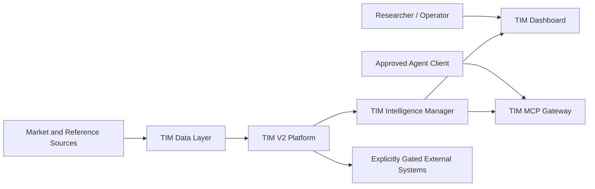

## 2. Container diagram

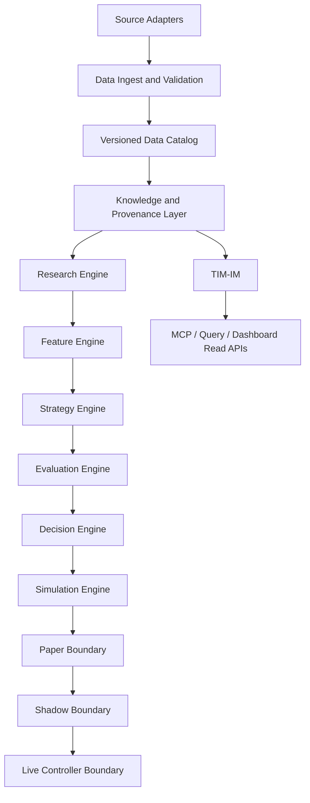

## 3. Module diagram

```mermaid
flowchart TB
    subgraph Foundation["Foundation"]
        Core["Core"]
        Infrastructure["Infrastructure"]
        Developer["Developer Platform"]
        Security["Security"]
        Governance["Governance"]
        Configuration["Configuration"]
    end
    subgraph KnowledgePlane["Knowledge Plane"]
        Knowledge["Knowledge"]
        RAG["RAG"]
        Memory["Memory"]
        TIMIM["TIM Intelligence Manager"]
    end
    subgraph Science["Science Plane"]
        Research["Research"]
        Datasets["Datasets"]
        Orderflow["Orderflow"]
        MarketStructure["Market Structure"]
        MMT["MMT"]
        Macro["Macro"]
        FeatureStore["Feature Store"]
        Signals["Signals"]
        Strategies["Strategies"]
        Evaluation["Evaluation"]
    end
    subgraph DecisionPlane["Decision and Execution Plane"]
        Risk["Risk"]
        Decision["Decision"]
        Simulation["Simulation"]
        Execution["Execution"]
        Paper["Paper"]
        Shadow["Shadow"]
    end
    subgraph Access["Access and Automation"]
        Agents["Agents"]
        Routing["Routing"]
        MCP["MCP"]
        Dashboard["Dashboard"]
    end
    Foundation --> KnowledgePlane
    KnowledgePlane --> Science
    Science --> DecisionPlane
    KnowledgePlane --> Access
    DecisionPlane --> Access
```

## 4. Data flow

```mermaid
flowchart LR
    Raw["Raw observations"] --> Validate["Schema and quality validation"]
    Validate --> Catalog["Dataset registry and lineage"]
    Catalog --> Claims["Evidence and claims"]
    Claims --> Research["Experiments"]
    Research --> Features["Versioned features"]
    Features --> Strategies["Candidate strategies"]
    Strategies --> Evaluation["Leakage-safe evaluation"]
    Evaluation --> Decisions["Decision records"]
    Decisions --> Simulation["Simulation outcomes"]
    Simulation --> Paper["Paper observations"]
    Paper --> Shadow["Shadow observations"]
    Shadow --> LiveGate{"Human and risk gate"}
    LiveGate -->|authorized| Live["Live Controller"]
    LiveGate -->|denied| Stop["No action"]
```

## 5. Dependency graph

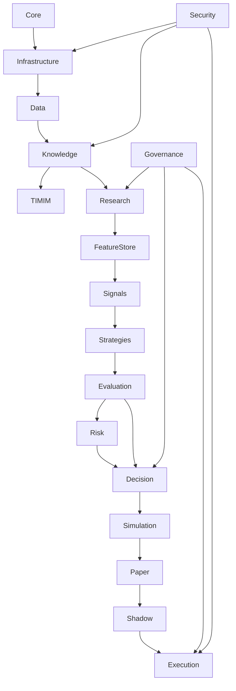

Dependencies must point downward toward more stable contracts. Execution may
not be imported by Research, Knowledge or TIM-IM.

## 6. Agent graph

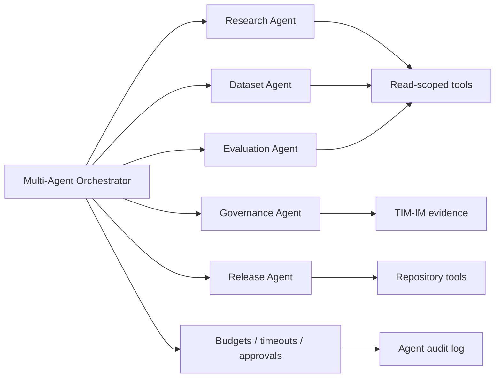

No agent receives execution authority through the read MCP gateway.

## 7. Storage graph

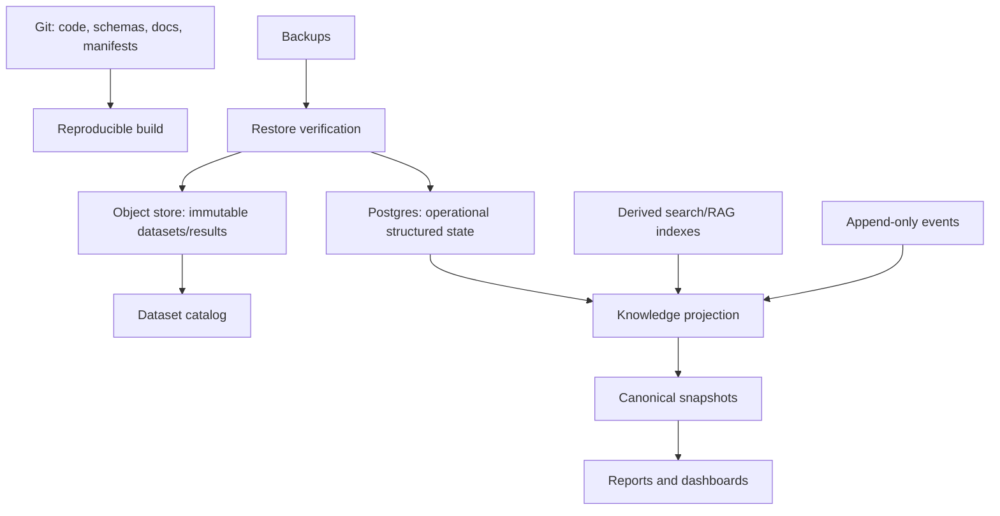

Derived indexes are replaceable. Git never stores secrets, live runtime state
or raw high-volume market data.

## 8. Configuration graph

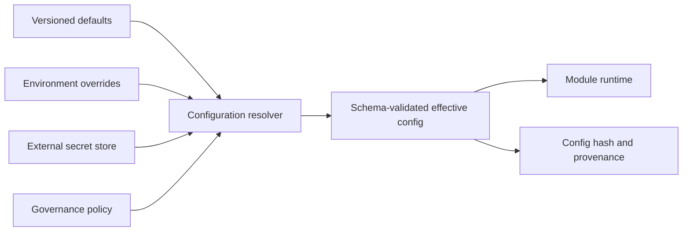

Effective configuration must be reproducible without committing secret values.

## 9. Security zones and trust boundaries

```mermaid
flowchart LR
    subgraph Z1["Zone 1: Untrusted Inputs"]
        Market["Market feeds"]
        Documents["External documents"]
        Models["Model outputs"]
    end
    subgraph Z2["Zone 2: Validation"]
        Parser["Passive parsers"]
        Quality["Schema / quality gates"]
        Redaction["Secret and sensitivity filters"]
    end
    subgraph Z3["Zone 3: Canonical Knowledge"]
        Evidence["Evidence store"]
        TIMIM["TIM-IM"]
    end
    subgraph Z4["Zone 4: Decision"]
        Evaluation["Evaluation"]
        Decision["Decision records"]
        Risk["Risk gates"]
    end
    subgraph Z5["Zone 5: Execution"]
        Paper["Paper"]
        Shadow["Shadow"]
        Live["Live Controller"]
    end
    Z1 --> Z2
    Z2 --> Z3
    Z3 --> Z4
    Z4 --> Z5
```

Every zone transition requires typed data, provenance and policy validation.

## 10. Observability layer

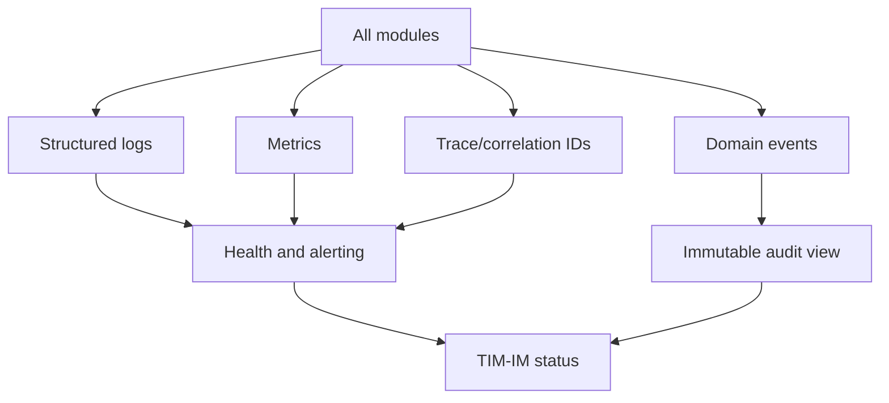

Observability data must not silently become scientific evidence; promotion
requires an explicit evidence record.

## 11. Failure domains

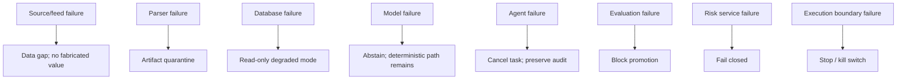

## 12. Recovery paths

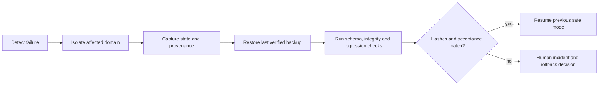

## 13. Package and lifecycle rules

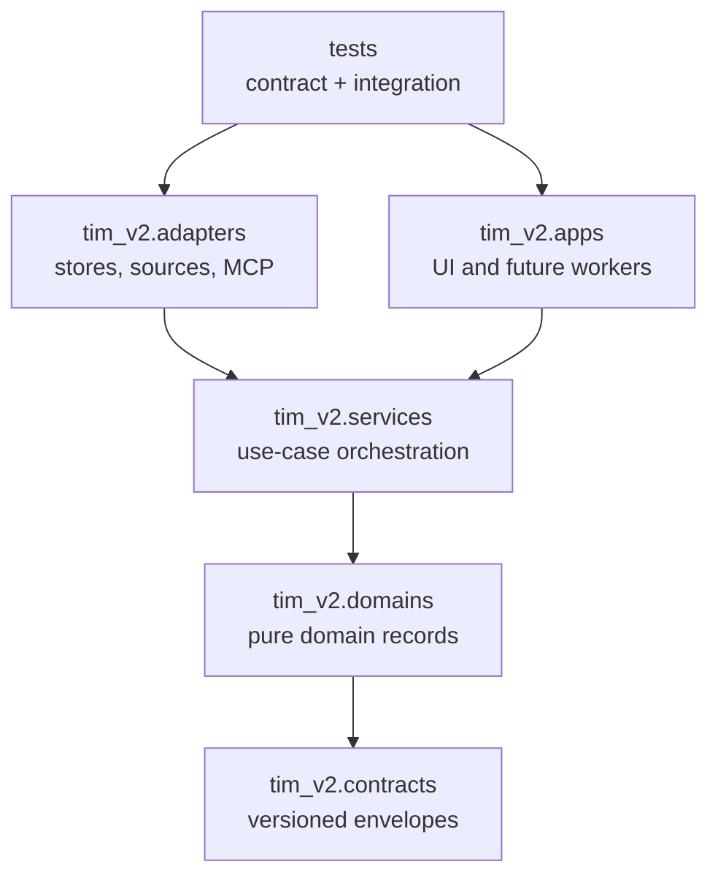

The diagram is a future package rule, not an instruction to create packages in
V2.0. Dependencies point toward contracts and domains; contracts do not import
adapters, applications or execution capabilities.

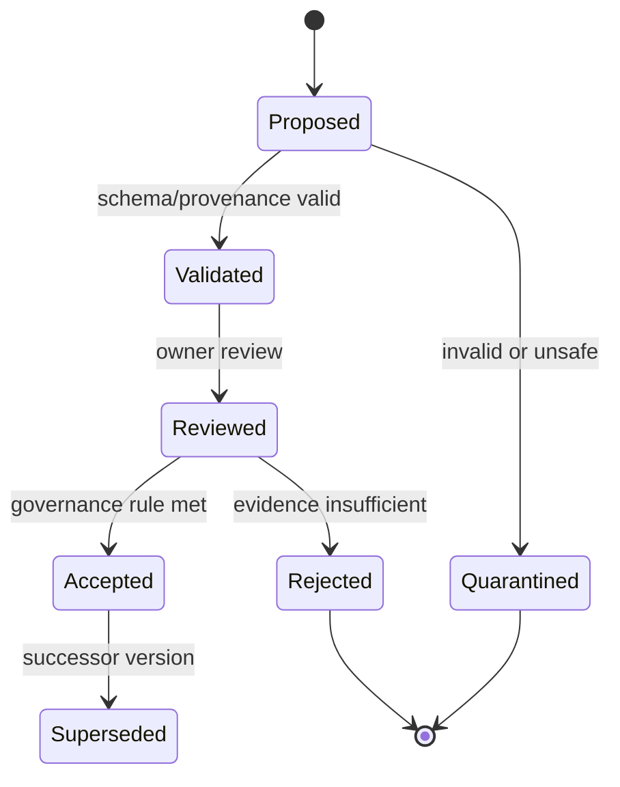

This lifecycle applies to versioned data, research and knowledge artifacts as
appropriate. Acceptance is not an execution authorization.

## Module registry baseline

| Module | Responsibility | May depend on | Must not do |
|---|---|---|---|
| Core | stable domain primitives | none | import execution |
| Infrastructure | runtime and shared adapters | Core | encode strategy logic |
| Knowledge | claims, evidence, provenance | Core, Data | execute trades |
| Research | hypotheses and experiments | Knowledge, Datasets | promote itself |
| Datasets | catalog, lineage, quality | Data, Governance | hide source identity |
| Orderflow | orderflow observations/features | Datasets, Research | place orders |
| Market Structure | structure observations | Datasets, Research | place orders |
| MMT | MMT research models | Research, Datasets | bypass validation |
| Macro | macro evidence | Research, Datasets | become canonical without evidence |
| Feature Store | versioned feature definitions | Research, Datasets | own strategy decisions |
| Signals | candidate signals | Feature Store | execute |
| Strategies | candidate decision policies | Signals, Risk | bypass evaluation |
| Risk | constraints and limits | Evaluation, Governance | silently approve |
| Execution | external order boundary | Decision, Risk, Security | accept ungated calls |
| Simulation | deterministic scenarios | Strategies, Risk | write live systems |
| Paper | isolated simulated execution | Simulation, Decision | submit real orders |
| Shadow | live-data observation, no orders | Paper, Decision | submit orders |
| Evaluation | scientific and operational gates | Research, Strategies | rewrite results |
| Decision | evidence-backed recommendations and approvals | Evaluation, Risk, Governance | call execution directly |
| Developer Platform | reproducible build, quality and release contracts | Core, Infrastructure, Governance | alter frozen behavior implicitly |
| RAG | derived retrieval indexes | Knowledge | become source of truth |
| Memory | scoped retained context | Knowledge, Governance | store secrets by default |
| Agents | bounded specialized workflows | TIM-IM, Routing | self-authorize |
| Routing | model/tool routing policy | Security, Governance | bypass budgets |
| MCP | typed external tool surface | TIM-IM, Security | expose mutation by default |
| Dashboard | human management UI | TIM-IM | directly mutate canonical state |
| Security | identity, secrets, policy | Infrastructure | depend on strategies |
| Governance | approvals, decisions, audit | Knowledge | infer approvals |
