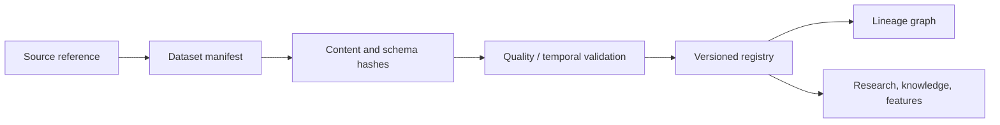

# TIM V2 Dataset Platform

The Dataset Platform is a catalog and contract system, not a data-ingestion
implementation and not a second copy of raw data.

Each `DatasetVersion` has a stable ID, semantic/schema version, content hash,
manifest hash, source locator/reference, schema, row/coverage quality metrics,
event-time range, observation-time range, publication-time range, lineage,
license/sensitivity, validation outcome and retention state. A dataset is
immutable after registration; corrections create a successor with explicit
supersession.

Required validations: schema compatibility, hash integrity, uniqueness,
temporal ordering, missingness/coverage disclosure, duplicate disclosure,
source authorization and lineage completeness. Invalid material is quarantined
with a reason; it is not silently repaired. Physical storage is referenced by
URI/object identity rather than duplicated into Git or TIM-IM.
