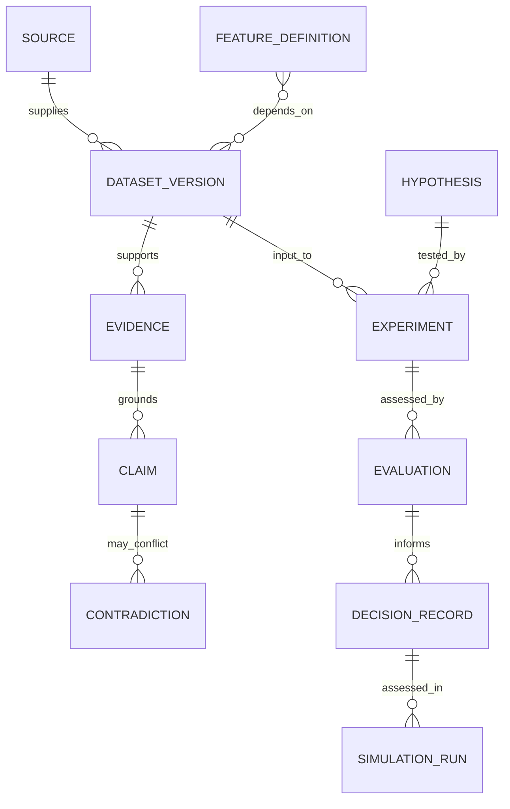

# TIM V2 Domain Model

Status: planning contract. Domain objects are schemas before implementations;
their owner approves changes and their records carry the common interface
envelope defined in `interfaces.md`.

| Domain | Responsibility and primary objects | Depends on | Boundary / owner |
|---|---|---|---|
| Research | hypotheses, notes, papers, reviews, open questions | Knowledge, Dataset | Research owner; cannot promote itself |
| Knowledge | claims, facts, evidence, sources, observations, contradictions | Dataset, Governance | Knowledge owner; model text is non-canonical |
| Dataset | registry, schema, hash, quality, lineage, validity | Infrastructure | Dataset owner; no data duplication |
| Experiment | reproducible hypothesis runs and manifests | Research, Dataset | Research owner; no implicit execution |
| Evaluation | validation, robustness, bias and benchmarks | Experiment, Feature | Evaluation owner; blocks on invalid input |
| Feature | definitions and dependency DAGs | Dataset, Research | Feature owner; no computation in V2.0 |
| Signal | candidate interpretations of features | Feature | Signal owner; no order authority |
| Market | market observations and calendars | Dataset | Market-data owner |
| Orderflow | orderflow observations and derived contracts | Dataset, Market | Domain owner; evidence only |
| Market Structure | structure observations and labels | Dataset, Market | Domain owner; evidence only |
| Macro | macro evidence and temporal releases | Dataset, Knowledge | Domain owner; provenance required |
| MMT | MMT-oriented research claims/models | Research, Dataset | Domain owner; hypothesis status explicit |
| Risk | constraints, exposures and gate decisions | Evaluation, Governance | Risk owner; fail closed |
| Simulation | replay, scenario and stress contracts | Decision, Dataset | Simulation owner; no live adapter |
| Decision | recommendations, rationale and approvals | Evaluation, Risk, Knowledge | Governance owner; no direct execution |
| Execution | future isolated external boundary | Decision, Risk, Security | Execution owner; absent from V2.0 |
| Governance | approvals, policy, ownership, decision history | Knowledge | Governance owner; explicit authorization only |
| Memory | scoped, expiring retained context | Knowledge, Security | Memory owner; not a truth store |
| Agents | bounded roles and task evidence | Routing, MCP, Governance | Agent owner; least privilege |
| Infrastructure | storage, eventing, configuration adapters | Security, Configuration | Platform owner; no science logic |
| Observability | logs, metrics, traces, audit events | Infrastructure | Operations owner; not scientific evidence |
| Configuration | schemas, resolver, effective-config hash | Security, Governance | Platform owner; secrets external |
| Security | identity, authorization, integrity, sandboxing | Infrastructure | Security owner; default deny |

## Core relationships

All relationships are versioned references, never a substitution for their
source artifacts. A fact is a claim that passed its domain’s validation policy;
confidence and temporal validity never disappear during promotion.
