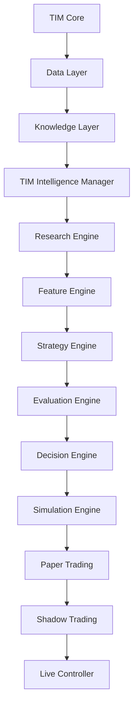

# TIM V2 Master Plan

Status: planning baseline
Implementation authorization: none
Frozen dependency: TIM-IM V1.0.0

## Mission

Create a governed research-to-decision architecture in which every material
output is traceable to versioned code, data identity, configuration, schema,
test evidence and an explicit operating mode.

## Target stack

The arrows represent governed information flow and promotion dependencies, not
automatic execution.

## Workstreams

| Workstream | Deliverable | Gate |
|---|---|---|
| Repository and release | tagged authoritative baseline | V2.0 |
| Knowledge | claim, evidence and provenance graph | V2.1 |
| Research | experiment lifecycle and reproducibility | V2.2 |
| Datasets | catalog, lineage, quality and temporal contracts | V2.3 |
| Market intelligence | orderflow and market-structure evidence | V2.4 |
| Evaluation | leakage-safe scientific evaluation | V2.5 |
| Decision | governed recommendation and decision records | V2.6 |
| Simulation | deterministic scenario and portfolio simulation | V2.7 |
| Paper | isolated non-live execution rehearsal | V2.8 |
| Shadow | live-data decision observation without orders | V2.9 |
| Autonomous Research | bounded hypothesis/experiment assistance | V3.0 |

## Delivery principles

- schemas and contracts precede implementations;
- every module defaults to read-only or no-op at external boundaries;
- tests precede capability promotion;
- each milestone has rollback and recovery evidence;
- model output is non-canonical until validated;
- runtime data is external to Git; manifests and schemas are versioned;
- one-way promotion gates prevent accidental escalation to Live.

## Governance

All V2 implementation requires a decision record, named owner, scoped branch,
test plan, security review and milestone exit criteria. Scientific behavior
requires independent validation evidence. Execution behavior additionally
requires risk, operational and human authorization.

## Migration posture

V2 wraps and observes V1 before replacing any interface. Adapters provide
compatibility; migrations are additive and reversible. TIM Core and TIM-IM V1
remain available as reference implementations throughout the V2 transition.

## Definition of Ready

Implementation may start only when the relevant interface, owner, data
contract, threat model, validation plan, rollback path and acceptance criteria
are approved.

## Definition of Done

A milestone is done only when code, schemas, migrations, tests, provenance,
security evidence, operational documentation and rollback verification are
complete and the prior mode remains recoverable.
