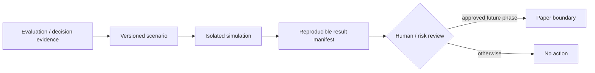

# TIM V2 Simulation Platform

Simulation is an isolated future evaluation domain. V2.0 creates no simulator,
broker integration, order submission or live mode.

Planned run types are replay, historical simulation, paper trading, shadow
trading, scenario testing, stress tests, chaos tests and failure injection.
Every future `SimulationRun` must reference a frozen scenario, dataset, model/
decision version, configuration, seed, time semantics, risk assumptions,
environment identity, output artifacts and termination reason.

Paper and shadow remain distinct: paper uses simulated execution, shadow
observes live inputs without submitting orders. Any future live boundary is a
separate authorization and cannot be inferred from a simulation result.
