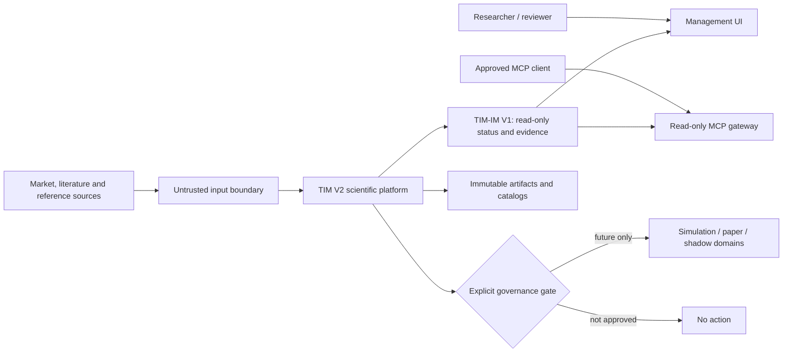

# TIM V2 System Context

Status: architecture contract; no runtime is introduced by this document.

TIM V2 is a scientific, evidence-first platform. TIM-IM V1.0.0 is a frozen,
read-only management and knowledge-status dependency; it is neither rewritten
nor used as an execution surface.

## Trust and ownership boundaries

| Boundary | Owner | Input | Output | Default failure behavior |
|---|---|---|---|---|
| External sources → ingest | Dataset owner | untrusted bytes/metadata | quarantined or validated observations | quarantine/record gap |
| Dataset → research | Dataset + research owners | immutable dataset manifest | bounded research input | reject missing provenance |
| Research → knowledge | Research + knowledge owners | claims/results with evidence | reviewable knowledge objects | mark unsupported |
| Evaluation → decision | Evaluation + governance owners | evaluation package | decision record | block promotion |
| TIM V2 → TIM-IM | TIM-IM owner | typed, read-compatible status/evidence reference | read model only | abstain/degrade read-only |
| Any domain → execution | Security + risk owners | future governed request | no present implementation | fail closed |

No model, agent, UI or MCP caller receives implicit write or execution
authority. Event time, observation time and processing time remain distinct.
