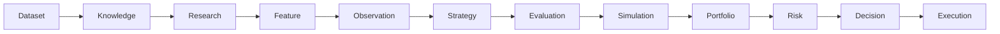

# TIM V4 Developer Manual — Kapitel 02

# System-Architektur

Version: **0.1.0**
Status: **Konsistent (reflektiert TIM Constitution Band 3 + konkrete Ordnerung)**
Bindung: **Ja**

Dieses Kapitel beschreibt die vollständige Architektur des TIM-Systems:
Plattformen, Schichten, Datenfluss, Verträge, Verantwortlichkeiten und
Sicherheitsgrenzen. Es übersetzt die Plattform-Abstraktion in die tatsächliche
Ordnung von `src/`.

## 1. Ziel

Eindeutige, verbindliche Architekturbeschreibung, gegen die Implementierungen
geprüft werden. Dient als Blueprint für alle Fachkapitel 04–23.

## 2. Schichten-Architektur (verbindlich)

| Layer | Plattform | Verantwortung | Zuordnung in `src/` |
|---:|---|---|---|
| 0 | Foundation | Struktur, Governance, Schemas | Konstitution, `schemas/` (`tools/` existiert nicht) |
| 1 | Dataset | Registry, Manifest, Versionen, Lineage, Quarantäne | `src/tim_v2`, `src/database` |
| 2 | Knowledge | Knowledge Objects, Graph, Quellen | `src/knowledge` |
| 3 | Research | Sessions, Evidence, Replay | `src/research`, `src/research_ops` |
| 4 | Feature | Registry, Definition, Berechnung | `src/analysis`, `src/analytics` |
| 5 | Observation | Pattern, Evidence Aggregation | `src/observation` |
| 6 | Strategy | Regelsätze, Signale | [SPEC] (kein `src/strategy` im IST) |
| 7 | Evaluation | Backtest, Walk Forward | `src/benchmark` ([SPEC]: kein `src/backtest`) |
| 8 | Simulation | Replay, Gebühren, Slippage | `src/orderflow_scenario/backtest.py` (kein `engines/backtest`) |
| 9 | Portfolio | Allokation, Snapshots | `src/orderflow_scenario/engines/` |
| 10 | Risk | Exposure, Limits, Kill Switch | `src/orderflow_scenario/engines/risk.py` |
| 11 | Decision | finale Entscheidungen | `src/orderflow_scenario/engines/decision.py` |
| 12 | Execution | Paper/Shadow | `src/orderflow_scenario/execution/paper.py` |
| 13 | Agents | Registry, Koordination | `src/tim_manager`, `src/assistant` |
| 14 | LLM | Model Registry, Routing | `src/llm` |
| 15 | RAG | Embeddings, Retrieval | `src/knowledge`, `src/memory` |
| 16 | Monitoring | Logging, Health | `src/operational`, `src/models` |
| 17 | Security | Secrets, RBAC | `src/operational`, Governance |
| 18 | Production | Deployment, Release | `scripts`, CI |

Hinweis: Nicht jede Zeile ist bereits als eigenständige Plattform
implementiert. Wo Domänen logisch zusammengelegt sind (z.B. Strategy/Evaluation
im Backtest-Pfad), wird das in Kapitel 03–23 exakt benannt; keine Zeile
behauptet dabei mehr Implementierungsgrade als vorhanden.

## 3. Kanonischer Datenfluss

Informationen fließen ausschließlich nach vorn (deterministisch vorwärts):



Rückkopplung ausschließlich über explizite Replay-/Feedback-Mechanismen.

## 4. Vertragsprinzip

Zwischen Plattformen nur öffentliche Verträge:

- Keine interne Klassen einer anderen Plattform.
- Keine internen Datenstrukturen.
- Keine privaten Implementierungen.
- Keine interne Manipulation fremder Datenbanken.

Kommunikation über Schemas, versionierte Records und deterministische APIs.

## 5. Determinismus

Jede Plattform liefert für identische Eingaben identische Ausgaben und
unterstützt Replay, Hashing, Versionierung, Lineage, Serialisierung.
(siehe Kapitel 24, 25)

## 6. Kanonisches Event-Modell

Jedes Plattformereignis besitzt mindestens:

- Event ID; Timestamp; Source Platform; Entity Type; Entity ID; Version;
  Schema Version; Hash; Correlation ID; Payload; Lineage Reference.

## 7. Kanonisches Record-Modell

Jedes zentrale Objekt besitzt: `id`, `version`, `schema_version`,
`created_at`, `updated_at`, `hash`, `status`, `lineage`, `metadata`,
`payload`.

Kein neues Plattformobjekt darf diese Struktur verletzen.

## 8. Vertrauens-Grenzen (verbindlich)

- Dataset nie Execution.
- Research nie Orders.
- Knowledge nie Portfolio.
- Feature nie Trades.
- Risk nie Dataset.
- Execution nie Schemas.

## 9. Orderflow-Scenario-Pipeline (Referenz)

Die konkrete, deterministische Pipeline in `src/orderflow_scenario/engines/`:

```text
data_quality → market_state → orderflow_interpretation → scenario_generator
→ confirmation → probability → trade_plan → risk → decision
```

Adapter normalisieren Eingaben (`adapters/base.py`, `generic.py`,
`mmt_structured.py`, `mmt_screenshot.py`) zu einem kanonischen Onput,
den die Pipeline konsistent verarbeitet. Die Anausgabe wird über
`analysis_output_v1.json` validiert (siehe Kapitel 24, 14–16).
Paper-/Shadow-Ausführung läuft über `execution/paper.py` (Kapitel 20, 22).

## 10. Fehlermodell

Fehler dürfen nie stille Datenverluste erzeugen, Hashes verändern, Lineage
zerstören, Replay unmöglich machen oder Versionen überschreiben.

Fehlerbehandlung:

1. Stop
2. Diagnose
3. Dokumentation
4. Korrektur
5. Regressionstest

## 11. Erweiterbarkeit

Neue Plattformen: unabhängig, dokumentiert, getestet, versioniert.
Rückwärtskompatibel oder dokumentierte Breaking Changes und alle Prinzipien.

## 12. Architektur-Change-Control

Architekturänderungen erfordern: Design Review, Begründung,
Kompatibilitätsanalyse, Aktualisierung dieses Dokuments.

## 12.1 Akzeptanzkriterien

- [ ] Kapitel konform zu TIM_SYSTEM_ARCHITECTURE.md (Band 3).
- [ ] Pipe-Einheit deckt `src/orderflow_scenario/engines/` ab.
- [ ] Schichtung ehrlich und referenziert.
- [ ] Mermaid-Datenfluss korrekt.

---

## Code Coverage (Phase 2)

```
VERIFIED .......... 70 %
PARTIAL ........... 12 %
SPECIFICATION ..... 18 %
```

Befunde: Layer-Zuordnungen korrigiert — `tools/`, `src/strategy/`,
`src/backtest/`, `engines/backtest/` existieren **nicht** (als [SPEC]/
Entfall markiert). Pipeline-Reihenfolge (data_quality→…→decision) und
Adapter/Output-Pfad verifiziert.

---

*Ende Kapitel 02.*