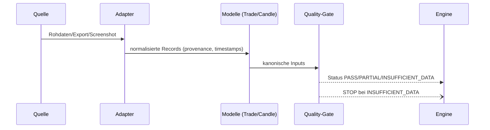

# TIM V4 Developer Manual — Kapitel 05

# Data Platform

Version: **0.1.0**
Status: **Teilweise konsistent (IST erfasst; Teile [SPEZIFIKATION])**
Verbindlichkeit: **Ja**

Dieses Kapitel dokumentiert die reale Datenplattform von TIM: Datenquellen,
Adapter, Datenmodelle, Normalisierung, Zeitstempel, Provenienz und
Versionierung. Es trennt strikt zwischen **IMPLEMENTIERT**, **GEPLANT
[SPEZIFIKATION]** und **OFFENEN LÜCKEN**.

## 1. Zweck

Die Datenplattform ist die Grundlage für alle weiterverarbeitenden Plattformen.
Dieses Kapitel beschreibt, woher Daten kommen, wie sie normalisiert werden und
wie Provenance, Zeitstempel und Versionierung die Nachvollziehbarkeit
(Kernwert 3) sichern.

## 2. Reale Implementierung

### 2.1 Datenquellen

- **Binance WebSocket** (`src/data_ingestion/binance_ws.py`): Streaming von
  Aggregate-Trades.
- **Catchup / Nachladepfad** (`src/data_ingestion/catchup.py`,
  `src/data_ingestion/ingress.py`): historische Nachholdaten.
- **Durable Ingestion** (`src/data_ingestion/durable.py`): robuste,
  wiederanlaufbare Eingangspipeline (V2-Vertrag).
- **Weitere passive Quellen** (`src/sources/passive.py`).

### 2.2 Kanonische Marktmodelle

`src/models/market_data.py`:

- `Trade`: symbol, price, quantity, event_time, trade_id, buyer_is_maker.
  (Hinweis: **kein** `provenance`-Feld im IST.)
- `Candle`: symbol, timeframe, open/high/low/close, volume, trade_count,
  open_time, close_time, closed. (Hinweis: **kein** `provenance`-Feld im IST.)
- `Observation`: symbol, timeframe, observed_at, rule_id, provenance
  (Default `PUBLIC_MARKET_DATA`).

`Trade`/`Candle`/`Setup` sind `frozen dataclasses` (`slots=True`);
`Observation` ist `@dataclass(slots=True)`, aber **nicht** frozen.
Deterministisch, keine Seiteneffekte.

### 2.3 Provenance und Zeitstempel

- `provenance` trägt im IST nur die `Observation` (Default
  `PUBLIC_MARKET_DATA`); `Trade`/`Candle` führen dieses Feld **nicht**
  (siehe 2.2) — Lineage auf Trade/Candle ist [SPEZIFIKATION].
- Das Qualitäts-Framework verlangt Zeitzonen-kontextbewusste Zeitstempel
  (aware), sonst `NAIVE_TIMESTAMP` (siehe Kapitel 06).
- Zeitwerte werden in Engines injiziert, nicht per `datetime.now()`
  (Kapitel 04, Abschnitt 5).

### 2.4 Adapter (Normalisierung)

Die Orderflow-Scenario-Pipeline normalisiert provider-spezifische Formate in
kanonische Records:

- `src/orderflow_scenario/adapters/base.py` — `AdapterInput`, `AdapterResult`.
  `structured` unterscheidet geparste Exporte von Screenshot-Daten;
  `estimated_prices` listet abgeschätzte Preise.
- `src/orderflow_scenario/adapters/generic.py` — generischer Parser.
- `src/orderflow_scenario/adapters/mmt_structured.py` — strukturierte
  MMT-Exporte.
- `src/orderflow_scenario/adapters/mmt_screenshot.py` — Screenshot-Metadaten,
  markiert Werte explizit als geschätzt und erfindet keine fehlenden Werte.

### 2.5 Input-Pipeline (Szenario)

```text
Datenquelle → Adapter → kanonische Records → DataQualityGate → Pipeline-Engines
```

Nähere Beschreibung in Kapitel 02 (Abschnitt 9) und den Fach-Engines
(Kapitel 07 ff.).

## 3. Datenfluss




## 4. Öffentliche Schnittstellen (IST)

- `DataQualityInputs`, `DataQualityGate` (`engines/data_quality.py`).
- `AdapterInput`, `AdapterResult` (adapter base).
- Kanonische Modelle: `Trade`, `Candle`, `Observation`.

Fach-Engines schreiben nicht direkt in die Datenebene; Zugriff nur über die
definierten Verträge (Kapitel 02, Abschnitt 4).

## 5. Datenmodell-Schemas

Kanonisches Record-Modell (`id`, `version`, `schema_version`, `created_at`,
`updated_at`, `hash`, `status`, `lineage`, `metadata`, `payload`) gemäß
Kapitel 02, Abschnitt 7. Genaue Schemas und Validierung siehe Kapitel 24.

[SPEZIFIKATION] Ein gepflegtes, versioniertes Schema-Verzeichnis für
Trade/Candle ist noch nicht etabliert. Aktuell prüfen
`src/orderflow_scenario/schemas/` und `src/quality/framework.py`.

## 6. Invarianten

- Kein Record ohne Provenance (erzwungen, Kapitel 06).
- Zeitstempel in Engine-Berechnungen sind aware; naive sind fehlerhaft.
- Screenshot-Daten werden nie vollvertraut (`structured=False`).
- Daten fließen nur vorwärts; Rückkopplung über Replay.

## 7. Fehlerfälle

| Fall | Verhalten |
|---|---|
| fehlender Preis | Gate → INSUFFICIENT_DATA |
| naiver Zeitstempel | Framework → NAIVE_TIMESTAMP |
| doppelte Records | Framework → DUPLICATE_RECORD |
| Screenshot, niedriger Vertrauen | partielle, Confidence-Abzug |
| Quelle nicht erreichbar | Durable Ingestion, Wiederanlauf |

## 8. Tests

- Qualitäts-Framework: `src/quality/framework.py`.
- Tests IST: `tests/test_data_quality.py`, `tests/test_durable_ingestion_*v2.py`,
  `tests/test_orderflow_scenario_data_quality.py`, `tests/test_durable_*v2.py`.

## 9. Bekannte Einschränkungen des IST

- Der Quality-Gate wirft `PASS`, `PARTIAL`, `INSUFFICIENT_DATA` (siehe Kapitel 06).
- Screenshot-/OCR-Pfad bietet KEINE Garantie für vollständige Genauigkeit.
- Adapter/V2lite auf Biase auf Binance + MMT fokussiert; weitere Quellen-Registry
  fehlt.

## 10. Offene Lücken (IST vs. SOLL)

| Bereich | IST | SOLL |
|---|---|---|
| Eingabequellen | Binance + MMT-Adapter | erweiterbare Quellen-Registry [SPEZIFIKATION] |
| Schema-Versionierung | Modelle-based, Szenario-Schema | vollständige Schema-Registry [SPEZIFIKATION] |

## 11. Roadmap [SPEZIFIKATION]

- Offizielles Schema-Verzeichnis je Quelle (Trade, Candle, Observation) aus dem
  kanonischen Record-Modell.
- Provenance-Ableitung „quelle“ in den V2-Registries ergänzen.
- Screenshot-OCR-Versionierung und Anbindung der Confidence-Schwelle an den
  Gate.

---

## Code Coverage (Phase 2)

```
VERIFIED .......... 70 %
PARTIAL ........... 25 %
SPECIFICATION ..... 5 %
```

Befunde: `Trade`/`Candle` tragen im IST **kein** `provenance`-Feld; nur
`Observation` (korrigiert). `Observation` ist `@dataclass(slots=True)`, aber
**nicht** frozen (korrigiert). Adapter-Kanonik und Quell-Dateien
(binance_ws/catchup/durable/passive) verifiziert.

---

*Ende Kapitel 05.*