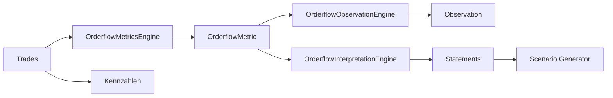

# TIM V4 Developer Manual — Kapitel 07

# Orderflow Engine

Version: **0.1.0**
Status: **Konsistent für IST; Erweiterungen [SPEZIFIKATION]**
Verbindlichkeit: **Ja**

Dieses Kapitel dokumentiert die Orderflow-Berechnung und -Interpretation in
TIM. Es trennt die **Metrik-Ebene** (aggregierte Trades) von der
**Interpretations-Ebene** (Deutung aggressiver Flows in Statements). Es trennt
strikt IMPLEMENTIERT / GEPLANT [SPEZIFIKATION] / OFFENE LÜCKEN.

## 1. Zweck

Orderflow-Metriken und deren Interpretation liefern die empirische Grundlage
für Marktstruktur-, Szenario- und Entscheidungs-Engines. Keine Interpretation
darf ohne Metrik-Evidenz Handelsentscheidungen treffen.

## 2. Reale Implementierung

### 2.1 Metrik-Ebene: `src/orderflow/metrics.py`

Zentrale, deterministische Aggregation von Trades.

`OrderflowMetric` (frozen dataclass):

- `symbol`, `start`, `end`
- `count`, `buys`, `sells`
- `buy_volume`, `sell_volume`, `total_volume`
- `net_delta`, `cumulative_delta` (CVD)
- `avg_trade_size`, `max_trade_size`
- `trades_per_second`, `volume_per_second`
- `buy_sell_ratio`, `source_hash`

`OrderflowMetricsEngine.calculate(trades, start, end, *, opening_cvd, symbol)`:

- nur aggressive Trades (buyer_is_maker bestimmt Richtung);
- `net_delta = buy_volume - sell_volume`;
- `cumulative_delta = opening_cvd + delta`;
- deterministischer `source_hash`.

`OrderflowMetricsEngine.series(...)`: Bucketisierung in `bucket_seconds`.

`OrderflowMetricsService`: asynchron, liest über `AggTradeReader` (Protocol)
aus und berechnet Serien.

### 2.2 Observations-Ebene (`src/orderflow/observations.py`)

`OrderflowObservation`, `OrderflowObservationEngine` (Ratio-Schwellen) und
`OrderflowResearchCaseEngine` (überführt Observations in ResearchCases).

### 2.3 Interpretations-Ebene (`src/orderflow_scenario/engines/orderflow_interpretation.py`)

`OrderflowInputs` (frozen): net_delta, aggressive_buy/sell_volume,
total_volume, open_interest_trend, open_interest_with_price,
delta_divergence, taker_buy_sell_ratio, volume_bubbles, extra_notes,
candles, trades.

Konstruktionsinvarianten: negative Volumina (`aggressive_buy_volume`,
`aggressive_sell_volume`, `total_volume`) → `ValueError`; ungültige
`open_interest_trend` → `ValueError`. `net_delta` ist vorzeichenbehaftet
(negativ = aggressive Verkäufer) und wird nicht begrenzt.

`OrderflowInterpretationEngine.evaluate(inputs)` → `OrderflowInterpretation`.

#### Interpretation-Schritte (IST)

1. **Beobachtungen**: aggressive Seite aus net_delta; aggressive_buy_share.
2. **Preis-Response**: close-to-close FLAT/UP/DOWN (Schwelle 0.1%).
3. **Flow vs. Preis**: INTERPRETATION/HYPOTHESIS (z.B.
   `aggressive_buyers_drive_price_up`,
   `passive_sellers_absorb_market_buys`).
4. **Absorptions-Hypothese**: PASSIVE_SELLERS / PASSIVE_BUYERS; bei
   `delta_divergence` CONFIRMATION (weight 0.9).
5. **Open Interest**: Mapping (RISING_WITH_PRICE_UP → long_accumulation, ...).
6. **Volume-Bubbles**: OBSERVATION je Bubble.
7. **Refutation**: Preis widerspricht Hypothese → REFUTATION.
8. **Confidence** (IST-Formel):

```text
confidence = 0.55 + 0.05 * #OBSERVATION
           + 0.10 (wenn Absorptions-Hypothese)
           + 0.15 (wenn Absorption bestätigt)
           + 0.05 (wenn delta_divergence)
clamp in [0,1]
```

`OrderflowStatement.kind`: OBSERVATION | INTERPRETATION | HYPOTHESIS |
CONFIRMATION | REFUTATION.

## 3. Datenfluss



## 4. Öffentliche Schnittstellen

- `OrderflowMetricsEngine` (`metrics.py`).
- `OrderflowMetricsService` (async).
- `OrderflowObservationEngine`, `OrderflowResearchCaseEngine`.
- `OrderflowInterpretationEngine`, `OrderflowInputs`, `OrderflowInterpretation`.

## 5. Datenmodelle

- `OrderflowMetric`, `OrderflowObservation`, `OrderflowInterpretation`,
  `OrderflowStatement` (Typen aus `domain.py`: `OrderflowStatementKind`).
- Schema: durch Szenario-Schema (`analysis_output_v1.json`) und
  `DataQuality`-Pfad sichergestellt (Kapitel 24).

## 6. Invarianten

1. Aggressive Seite eindeutig aus dem Vorzeichen von `net_delta`
   (+ BUYERS / − SELLERS / 0 NEUTRAL); nie beides.
2. Kein negativer Volumens-Input.
3. Jede Interpretationen referenziert Evidenz (`evidence_refs`).
4. Statements sind typisiert (OBS vs INT vs HYPO etc.).
5. Confidence in [0,1].

## 7. Fehlerfälle

- Negatives Volumen → `ValueError`.
- Ungültiger OI-Trend → `ValueError`.
- Fehlende Trades → fehlende Observations, Confidence niedrig (kein
  automatisches NO_TRADE; das entscheidet der Gate/Pipeline).

## 8. Tests

- `tests/test_orderflow_metrics.py` (grün, Stand: Ist-Lauf)
- `tests/test_orderflow_observations.py` (1 Fehlschlag **umgebungsbedingt**:
  `SecretProviderError` macOS Keychain, `config/secrets.py:132` — kein
  Engine-Defekt)
- `tests/test_orderflow_validation.py` (grün)
- `src/orderflow/validation.py` (Validierung)

## 9. Bekannte Einschränkungen

- Absorptions-Bestätigung setzt `delta_divergence` voraus;
  eine eigenständige Order-Order-Book-Erkennung fehlt.
- „Cross-Exchange“-Liquid (open interest auf Exchange) wird über Felder
  getragen, nicht aus Rohdaten berechnet.

## 10. Offene Lücken

| Bereich | IST | SOLL |
|---|---|---|
| Order-Book-Erkennung | nur aus Metriken | Order-Book-Snapshot [SPEZIFIKATION] |
| Sweep-Erkennung | Szenario-komponente | market-structure-Detektion [SPEZIFIKATION] |
| Multi-Exchange Delta | mehrere Felder | geklärte Aggregation [SPEZIFIKATION] |

## 11. Roadmap [SPEZIFIKATION]

- Entkoppelte Absorptions-/Refutation-Rules als Regel-Registry.
- Order-Book-Eingang als separate Datenquelle (Kapitel 05).
- Offene-Interest-Aggregation für Multi-Exchange.

---

*Ende Kapitel 07.*