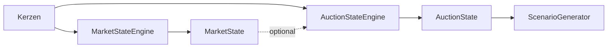

# TIM V4 Developer Manual — Kapitel 08

# Auction Market Engine

Version: **0.1.0**
Status: **Konsistent für IST (AuctionStateEngine); Erweiterungen [SPEZIFIKATION]**
Verbindlichkeit: **Ja**

Dieses Kapitel dokumentiert die Auction-Market-Theory-Klassifikation von TIM.
Sie ist aktuell als Teil von `src/orderflow_scenario/engines/market_state.py`
(`AuctionStateEngine`) implementiert und basiert auf deterministischen
Kerzenstruktur-Regeln und `AuctionStateKind`.

## 1. Zweck

Den Auktionszustand (Initiative, Rejection, Balance, Wert-Migration, ...)
deterministisch aus Kerzen klassifizieren, ohne eine Handelsrichtung zu
behaupten.

## 2. Reale Implementierung

### 2.1 Signatur

`AuctionStateEngine.evaluate(candles, market_state=None)` →
`AuctionStateModel`.

- `len(candles) < 2` → `AuctionStateKind.BALANCE`, confidence 0.2, evidence
  `insufficient_length`.
- Aus der letzten Kerze: body, total (high-low), upper/lower wick.

### 2.2 Kernklassifikation (IST)

| Bedingung | primärer Zustand |
|---|---|
| body/total > 0.7 | `INITIATIVE_ACTIVITY` |
| lower_wick > body und lower_wick > 0.5·total | `REJECTION` |
| upper_wick > body und upper_wick > 0.5·total | `REJECTION` |
| sonst | `BALANCE` |

Weitere IST-Regeln:

- **Range Extension**: Standardabweichung der letzten Bodys; wenn das
  Verhältnis der letzten drei zur älteren Gruppe > 1.5 → sekundär
  `RANGE_EXTENSION`.
- **Wert-Migration** (nur wenn `market_state` übergeben): TREND_UP /
  ACCEPTANCE_ABOVE / BREAKOUT_ATTEMPT → `VALUE_MIGRATION`; analog untere
  Richtung; FAILED_AUCTION → `FAILED_AUCTION`.
- **Confidence**: 0.7 × `market_state.confidence` (falls vorhanden), sonst 0.7.

## 3. Öffentliche Schnittstellen

- `AuctionStateKind` (StrEnum, `domain.py`).
- `AuctionStateEngine` (`market_state.py`).
- `AuctionStateModel` (domain): `primary`, `secondary`, `evidence`,
  `confidence`.

## 4. Zustände (`AuctionStateKind`)

`BALANCE`, `IMBALANCE`, `ACCEPTANCE`, `REJECTION`, `VALUE_MIGRATION`,
`FAILED_AUCTION`, `EXCESS`, `INITIATIVE_ACTIVITY`, `RESPONSIVE_ACTIVITY`,
`PRICE_DISCOVERY`, `RETURN_TO_VALUE`, `ROTATION`, `RANGE_EXTENSION`.

Nur eine Teilmenge wird aktuell von der Engine erzeugt (BALANCE, REJECTION,
INITIATIVE_ACTIVITY, RANGE_EXTENSION, VALUE_MIGRATION, FAILED_AUCTION);
die übrigen Werte sind deklarierte Klassifikatoren für spätere Regeln
[SPEZIFIKATION].

## 5. Datenfluss

## 6. Invarianten

1. Keine Handelsrichtung aus dem Auction-Zustand allein.
2. `REJECTION` erfordert eine ausgeprägte Wick > Body und > 0.5×total.
3. Confidence liegt in [0,1].
4. Weniger als 2 Kerzen → `BALANCE`, nie eine Trend-Einschätzung.

## 7. Fehlerfälle

| Fall | Verhalten |
|---|---|
| zu wenige Kerzen | `BALANCE`, evidence `insufficient_length`, conf 0.2 |
| fehlender market_state | Wert-Migration nicht abgeleitet |

## 8. Tests

**IST:** Im Szenario-Paket existiert aktuell nur eine reale Testdatei:
`tests/test_orderflow_scenario_data_quality.py` (Data-Quality-Gate). Für die
Auction-Engine gibt es **keine** eigene Testdatei.

[SPEZIFIKATION] Dedizierte Referenz-Ergebnisse und negative Testfälle für die
Auction-Klassifikation stehen aus.

## 9. Bekannte Einschränkungen

- Statische Schwellen (0.5 / 0.7 / 1.5) sind fest verdrahtet; keine
  Konfigurations-Exposition.
- Wert-Migration ist abhängig von der Market-State-Eingabe; eine eigenständige
  Regelbasis fehlt noch.

## 10. Offene Lücken

| Bereich | IST | SOLL |
|---|---|---|
| eigenständiges Modul | innerhalb market_state.py | eigenständiges Modul [SPEZIFIKATION] |
| Parameterisierung | fest verdrahtet | parametrisierte Regel-Registry [SPEZIFIKATION] |

## 11. Roadmap [SPEZIFIKATION]

- Auction-Ergebnis als eigener Vertrag (AuctionState) mit Schema (Kapitel 24).
- Synchronisation der Confidence mit Rückkopplung (Kapitel 25).

---

*Ende Kapitel 08.*