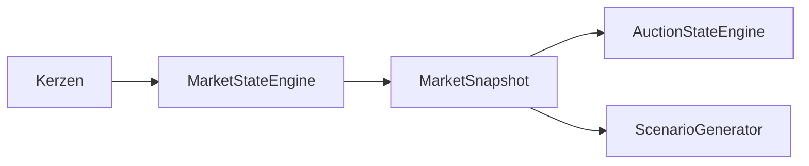

# TIM V4 Developer Manual — Kapitel 09

# Market Structure Engine

Version: **0.1.0**
Status: **Konsistent für IST (MarketStateEngine)**
Verbindlichkeit: **Ja**

Dieses Kapitel dokumentiert die Marktstruktur-Klassifikation von TIM. Sie ist
als `MarketStateEngine` in `src/orderflow_scenario/engines/market_state.py`
implementiert und erzeugt den `MarketState`-Vertrag für die Scenario-Engine.

## 1. Zweck

Das Markt-Regime (Trend, Balance, Breakout, Sweep, Exhaustion, Expansion /
Kompression) deterministisch aus Kerzen klassifizieren und die Grundlage für
Szenarien bilden. Die Engine beschreibt Struktur, nie allein
Handelsentscheidungen.

## 2. Reale Implementierung

### 2.1 Hilfsfunktionen (IST)

- `swing_points(candles, width=2)`: lokale High/Low-Swingpunkte.
- `_higher_highs_higher_lows` / `_lower_highs_lower_lows`: Struktur-Kennzeichnung.
- `_is_sweep(candles, kind)`: Liquidity-Sweep (Wick jenseits vorherigem Niveau
  mit Schluss zurück im Bereich).
- `_volatility_ratio`, `_range_percent`.

### 2.2 Kernklassifikation (`MarketStateEngine.evaluate`)

- `len(candles) < 2` → `UNCERTAIN`, conf 0.2, evidence `insufficient_length`,
  invalidation `more_history_required`.
- Volatilität: `vol_ratio >= 1.5` → sekundär `EXPANSION`; `<= 0.7` →
  `COMPRESSION`.
- Trend: HH+HL und close > mid → `TREND_UP`; LH+LL und close < mid →
  `TREND_DOWN`; sonst `BALANCE`.
- Breakout: close > range_high (und vorheriges <=) → `BREAKOUT_ATTEMPT`;
  analog `BREAKDOWN_ATTEMPT`.
- Acceptance/Rejection: oberhalb/unterhalb der Range je nach Schluss-Trend und
  Volatilität (ACCEPTANCE_* / REJECTION_*), mit Wick-Kriterium.
- Liquidity Sweep: `_is_sweep` → sekundär `LIQUIDITY_SWEEP_LOW/HIGH`.
- Exhaustion: Pin-Bar (body/total < 0.15 und vol_ratio >= 1.3) → `EXHAUSTION`.
- Konflikte: `mixed_structure` bei widersprüchliger Struktur.

Confidence: Basis 0.75; ×0.6 bei Konflikten; × max(0.5, min(1, len/50)).
Invalidation: TREND_UP/BREAKOUT → `close_below_last_low`;
TREND_DOWN/BREAKDOWN → `close_above_last_high`.

### 2.3 Ausgabe (`MarketStateModel`)

`primary` (MarketStateKind), `secondary` (tuple), `evidence`, `conflicts`,
`confidence`, `missing_data`, `invalidation_conditions`.

## 3. Öffentliche Schnittstellen

- `MarketStateKind` (StrEnum, `domain.py`) — 18 Werte.
- `MarketStateEngine` (`market_state.py`).
- `MarketStateModel` (`domain.py`).

## 4. Datenfluss



## 5. Invarianten

1. Keine Handelsrichtung allein aus der Marktstruktur; erst der
   Scenario-Generator kombiniert Struktur und Flow zu Handelsoptionen.
2. Confidence in [0,1]; `< 2` Kerzen → UNCERTAIN.
3. Struktur-Eigenschaft nur bei entsprechender Evidenz gesetzt.
4. Invalidation ist präzise benannt, nicht blockierend.

## 6. Fehlerfälle

| Fall | Verhalten |
|---|---|
| zu wenige Kerzen | UNCERTAIN, conf 0.2 |
| widersprüchliche Struktur | BALANCE/TREND + conflict `mixed_structure`, conf × 0.6 |

## 7. Tests

**IST:** Im Szenario-Paket existiert nur `tests/test_orderflow_scenario_data_quality.py`
(Data-Quality-Gate). Für die Marktstruktur-Engine gibt es keine eigene Testdatei;
exakte Ergebnis-Asserts fehlen im IST.

[SPEZIFIKATION] Parameter-Referenzen und eine eigenständige Fallpalette für die
Marktstruktur-Klassifikation stehen aus.

## 8. Bekannte Einschränkungen

- Fixe Schwellen- und Range-Kriterien sind fest verdrähtet.
- Sweep-Ableitung ist deterministisch, aber kerzenbasiert; Order-Book nicht
  eingebunden.

## 9. Offene Lücken

| Bereich | IST | SOLL |
|---|---|---|
| Order-Book-Signal | kerzenbasiert | Order-Book-Snapshot [SPEZIFIKATION] |
| Regel-Registry | feste Trigger | parameterisierte Regel-Registry [SPEZIFIKATION] |

## 10. Roadmap [SPEZIFIKATION]

- Auslagerung Swing-/Volatilitätslogik in eigenständiges Modul.
- Marktstruktur-Ergebnis als eigenständiger, versionierter Vertrag (K24).

---

## Code Coverage (Phase 2)

```
VERIFIED .......... 94 %
PARTIAL ........... 6 %
SPECIFICATION ..... 0 %
```

Befunde: `MarketStateKind` hat real **18** Werte (korrigiert); alle
Hauptfunktionen (`swing_points`, `_higher_highs_higher_lows`, `_is_sweep`,
`MarketStateEngine.evaluate`) verifiziert. Keine eigene Testdatei; nur
`test_orderflow_scenario_data_quality.py` deckt das Gate (LÜCKE).

---

*Ende Kapitel 9.*