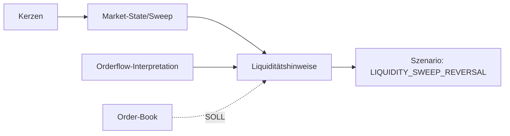

# TIM V4 Developer Manual — Kapitel 10

# Liquidity Engine

Version: **0.1.0**
Status: **IST-Elemente vorhanden; keine eigenständige Engine [SPEZIFIKATION]**
Verbindlichkeit: **Ja**

Dieses Kapitel dokumentiert die Liquiditäts-Erfassung in TIM im heutigen Stand.

**Klarstellung:** Es existiert **keine eigenständige "Liquidity Engine"** als
Modul. Liquiditätsrelevante Signale sind über die Marktstruktur (Sweeps),
die Orderflow-Interpretation und die Szenario-Eingaben verteilt. Dieses
Kapitel trennt deshalb strikt zwischen vorhandenem IST und geplanter SOLL.

## 1. Zweck

Liquiditätserkennung (Order-Book-Tiefe, Absorptionsfähigkeit, Sweeps) erfassen.
Ohne ein eigenständiges Modul dokumentiert dieses Kapitel, wie Liquidität heute
in TIM einfließt.

## 2. Reale Implementierung (IST)

### 2.1 Liquidity-Sweeps in der Marktstruktur

`_is_sweep(...)` in `src/orderflow_scenario/engines/market_state.py`:

- `LIQUIDITY_SWEEP_LOW`: letzte Kerze bricht unter vorheriges Tief, schließt
  aber oberhalb (close > Tief).
- `LIQUIDITY_SWEEP_HIGH`: analog oberhalb.

Schwerpunkt als sekundäre `MarketStateKind`-Werte und dienen als Hinweis für
potenzielle Liquiditätsjagd.

### 2.2 Szenario-Ableitung

Der Szenario-Generator nutzt Sweep-Kinds als Trigger für
`LIQUIDITY_SWEEP_REVERSAL` (Kapitel 11). Orderflow-Interpretation liefert
`open_interest`- und Absorptions-Statements, die die Szenario-Konfidenz prägen
(Kapitel 07).

### 2.3 Orderflow-Metriken

`buy_volume`, `sell_volume`, `net_delta`, `volume_per_second` liefern
volumenbasierte Liquiditäts-Indikatoren (Kapitel 07).

## 3. Fehlende Komponente (SOLL — [SPEZIFIKATION])

- Eigenständige Einheit mit Order-Book-Tiefe (bid/ask size).
- Open-Interest-Aggregation als eigener Cross-Exchange-Eingang.
- Order-Book-Datenquelle (Kapitel 05).

## 4. Datenfluss (IST + SOLLE)

[SPEZIFIKATION] Gestrichelter Order-Book-Pfad = Ziel, nicht IST.

## 5. Öffentliche Schnittstellen (IST)

- Kein öffentlicher Liquiditäts-Datenvertrag; Sweep wird als
  `MarketStateKind.LIQUIDITY_SWEEP_LOW/HIGH` transportiert.
- Orderflow-Metriken (Kapitel 07).

## 6. Invarianten (IST)

1. Sweep nur bei klarer Struktur (Wick + Rückkehr).
2. Liquidität nie als alleinige Handelsbegründung; nur sekundär/Trigger.
3. Ohne Order-Book-Modell keine Order-Book-Aussage.

## 7. Fehlerfälle

| Fall | Verhalten |
|---|---|
| zu wenige Kerzen für Sweep | Sweep wird nicht erkannt (keine Fehler) |
| Order-Book nicht verfügbar | kein Liquid-Pin-Modell (SOLL) |

## 8. Tests (IST)

**IST:** Im Szenario-Paket existiert nur `tests/test_orderflow_scenario_data_quality.py`;
Sweeps/Liquidität sind **nicht** durch ein eigenständiges Testverfahren abgesichert.
Keine eigene Liquiditäts-Testdatei vorhanden.

## 9. Bekannte Einschränkungen (IST)

- Keine Order-Book-Tiefe, nur volumenbasierte Indikatoren.
- Open-Interest ist Eingabefeld, keine berechnete Aggregation.
- Liquidity- und Absorptions-Urteile mangeln an eigener Engine.

## 10. Offene Lücken

| Bereich | IST | SOLL |
|---|---|---|
| Order-Book-Tiefe | fehlt | eigenständige Einheit [SPEZIFIKATION] |
| OI-Aggregation | Eingabefeld | cross-exchange berechnet [SPEZIFIKATION] |

## 11. Roadmap [SPEZIFIKATION]

- Order-Book-Datenquelle plus eigene Liquidität-Engine erstellen.
- Liquidität als eigenständiger versionierter Vertrag mit Schema (K24).

---

*Ende Kapitel 10.*