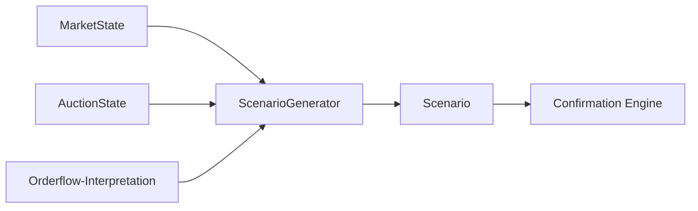

# TIM V4 Developer Manual — Kapitel 11

# Scenario Engine

Version: **0.1.0**
Status: **Konsistent für IST (ScenarioGenerator)**
Verbindlichkeit: **Ja**

Dieses Kapitel dokumentiert die Scenario-Engine von TIM. Sie kombiniert
Marktstruktur, Auktionszustand und Orderflow-Interpretation zu einem Satz
möglicher Szenarien mit Trigger-Levels, Ein-/Invalidations-Kriterien und
Scores. Sie ist als `ScenarioGenerator` in
`src/orderflow_scenario/engines/scenario_generator.py` implementiert.

## 1. Zweck

Aus dem Markt-Regime und Orderflow strukturierte, benannte Szenarien ableiten,
die die nachfolgenden Engines (Confirmation, Probability, Decision) mit
Evidenz-basierten Hypothesen füttern. Die Szenario-Engine erzeugt niemals
allein eine Order; sie liefert verwertbare Kandidaten.

## 2. Reale Implementierung

### 2.1 Eingaben

`ScenarioGenerator.generate(market_state, auction_state, orderflow, levels)`
→ `tuple[Scenario, ...]`.

Vorwerte für benachbarte Prüfungen: `near_range_high/low`, `delta_constructive`,
`delta_bearish`, `absorption_sellers/buyers`.

### 2.2 Szenario-Arten (IST)

Die Engine erzeugt heute konkret eine Teilmenge der deklarierten
`ScenarioType`-Werte:

- **A – BREAKOUT_ACCEPTANCE** (LONG): Breakout oberhalb Level mit
  akzeptierendem Flow; Retest-Verteidigung.
- **B – LIQUIDITY_SWEEP_REVERSAL** (LONG): definierte Liquidität unten
  gesweept, Preis hält nicht unten, Level wird reclaim.
- **C – REJECTION_FAILED_BREAKOUT** (SHORT): obere Liquidität getestet,
  Ablehnung.
- **D – BALANCE_ROTATION** (NEUTRAL): Rotation im Balance-Zustand.
- **E – VALUE_REVERSION** (perspektiv NEUTRAL): Reversion in Wert.

Jedes Szenario setzt eigene Score, `mandatory` / `optional` /
`invalidation`-Kriterien.

### 2.3 Szenario-Daten-Typen

Alle deklarierten Werte: BREAKOUT_ACCEPTANCE, LIQUIDITY_SWEEP_REVERSAL,
REJECTION_FAILED_BREAKOUT, BALANCE_ROTATION, TREND_PULLBACK, SHORT_SQUEEZE,
LONG_SQUEEZE, DELEVERAGING_MOVE, FAILED_AUCTION, EXHAUSTION_REVERSAL,
VALUE_REVERSION, LVN_TRAVERSAL, HVN_ROTATION, OPENING_DRIVE,
OPENING_REJECTION, BREAKOUT_TRAP, BREAKDOWN_TRAP. Nur eine Teilmenge wird
aktuell erzeugt; der Rest sind deklarierte Typen für Erweiterungen.

## 3. Datenfluss



## 4. Öffentliche Schnittstellen

- `ScenarioGenerator` (`scenario_generator.py`).
- `ScenarioType` (StrEnum, `domain.py`).
- `Scenario` (frozen dataclass, domain).

## 5. Datenmodelle

`Scenario`: scenario_id, scenario_type, direction, hypothesis,
evidence_for/against, mandatory/optional, invalidation, trigger_level,
entry_low/high, score (entry_model liegt im `trade_template`).

`Direction`: LONG / SHORT / NEUTRAL. `EntryModel`: LIMIT_RETEST,
MARKET_AFTER_CONFIRMATION, RECLAIM, u.a.

> **Befund (Phase 2):** `scenario_generator.py:161` referenziert `EntryModel.RETEST`,
> das im Enum **nicht** existiert (nur `LIMIT_RETEST`) — latenter `AttributeError`
> in einem Breakout-Branch. Fix: → `LIMIT_RETEST` (Roadmap V5-01).

## 6. Invarianten

1. Szenario erzeugt nie allein eine Order; nur Kandidaten.
2. Jedes Szenario trägt `invalidation`-Kriterien.
3. `trigger_level` bezieht sich auf Range-Level oder letzte Preis.
4. Richtung hängt von Marktstruktur + Flow ab (kein willkürliches Spamen).

## 7. Fehlerfälle

| Fall | Verhalten |
|---|---|
| fehlende Level (keine Range) | trigger = last_price fallback |
| inkonsistente Richtung | BALANCE → NEUTRAL-Szenarien (D/E) |

## 8. Tests

**IST:** Im Szenario-Paket existiert nur
`tests/test_orderflow_scenario_data_quality.py`; der Scenario-Generator wird
durch diese Datei **nicht** abgedeckt.

[SPEZIFIKATION] Dedizierte goldene Referenz-Ergebnisse je Szenario-Typ
stehen aus.

## 9. Bekannte Einschränkungen

- Nur eine Teilmenge der deklarierten Typen wird erzeugt; viele Typen sind
  noch ungenutzt (LVN/HVN/Opening/Squeeze/Trap).
- Das Szenario-Scoring ist heuristisch und nicht kalibriert
  (Abdeckung insgesamt: siehe Kapitel 25).

## 10. Offene Lücken

| Bereich | IST | SOLL |
|---|---|---|
| Szenario-Typen | 5 Kern-Typen erzeugt | volle Typen-Abdeckung [SPEZIFIKATION] |
| Score-Kalibrierung | fester Basiswert | kalibriert über Backtest [SPEZIFIKATION] |

## 11. Roadmap [SPEZIFIKATION]

- Ergänze restliche Szenario-Typen.
- Szenario-Ausgabe als eigener Schema-Vertrag (K24) und verifiziert durch die
  Backtest-Suite.

---

## Code Coverage (Phase 2)

```
VERIFIED .......... 93 %
PARTIAL ........... 7 %
```

Befunde: `ScenarioGenerator.generate` und die Szenario-Kerne (A Breakout,
B Sweep-Reversal, C Rejection, D/E Balance) verifiziert. **Fehler:**
`EntryModel.RETEST` existiert nicht (→ V5-01); `entry_model` liegt im
`trade_template`, nicht direkt am `Scenario`; Fallback-IDs „A"/„B" doppelt;
`max_scenarios` wird nicht gelesen. Keine eigene Testdatei (LÜCKE).

---

*Ende Kapitel 11.*