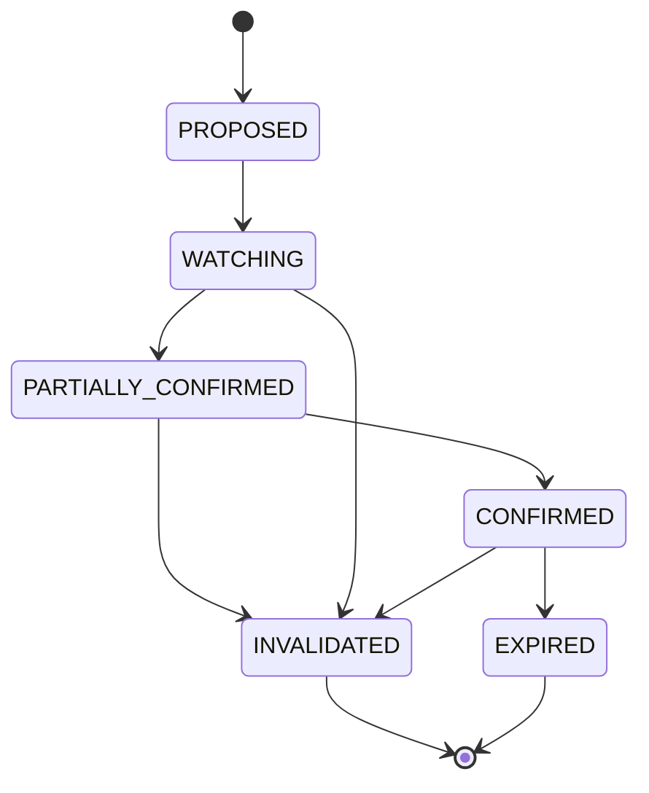
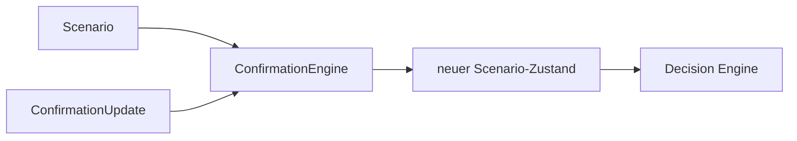

# TIM V4 Developer Manual — Kapitel 12

# Confirmation Engine

Version: **0.1.0**
Status: **Konsistent für IST (ConfirmationEngine)**
Verbindlichkeit: **Ja**

Dieses Kapitel dokumentiert die Bestätigungs-Engine von TIM. Sie bewegt ein
Szenario entlang eines deterministischen Zustandsautomaten auf Basis
erfüllter Pflicht- (mandatory), optionaler Kriterien und Invalidationen.

## 1. Zweck

Szenarien nicht vorzeitig handeln: Ein Szenario ist nur dann eine
Handelsoption, wenn die vordefinierten `mandatory_confirmations` erfüllt sind
und keine Invalidation eintrat.

## 2. Reale Implementierung

Referenz: `src/orderflow_scenario/engines/confirmation.py`.

### 2.1 `ConfirmationUpdate`

Trägt `fulfilled_mandatory`, `fulfilled_optional`, `invalidations`,
`expired_reason`, `observed_at`.

### 2.2 `ConfirmationEngine.apply(scenario, update)`

Berechnet `_next_state` und erzeugt einen `ScenarioConfirmationState`
(state, mandatory_fulfilled, mandatory_pending, optional_fulfilled,
invalidation_triggered, expired_reason, updated_at).

### 2.3 Zustandslogik (`_next_state`)

1. `expired_reason` gesetzt → `EXPIRED`.
2. Invalidation aus `scenario.invalidation` getroffen → `INVALIDATED`.
3. Keine Pending mandatory → `CONFIRMED`.
4. Keine erfüllten mandatory → `WATCHING`.
5. sonst → `PARTIALLY_CONFIRMED`.

Hinweis: PROPOSED ist der Szenario-Ausgangszustand; die Engine startet
Übergänge ab WATCHING/PARTIALLY_CONFIRMED, da `PROPOSED` beim Szenario-Bau
gesetzt ist.

## 3. Öffentliche Schnittstellen

- `ConfirmationEngine`, `ConfirmationUpdate`.
- `ConfirmationState` (StrEnum): PROPOSED, WATCHING, PARTIALLY_CONFIRMED,
  CONFIRMED, INVALIDATED, EXPIRED.
- Prädikate für bestimmte Szenario-Arten (breakout/reversal/rejection)
  in derselben Datei.

## 4. Datenfluss

## 5. Invarianten

1. Zustandsübergang ist deterministisch (nur aus Update + Scenario).
2. Kein Update erzeugt eine Order.
3. `CONFIRMED` erfordert alle mandatory erfüllt.
4. `INVALIDATED`/`EXPIRED` schließen weitere Bestätigung aus.

## 6. Fehlerfälle

| Fall | Verhalten |
|---|---|
| kein Szenario | kein Übergang (Aufrufer verantwortlich) |
| doppeltes Update | deterministisch; Zustand wird neu berechnet |
| expired und invalidation | EXPIRED hat Vorrang (Reihenfolge in `_next_state`) |

## 7. Tests

**IST:** Im Szenario-Paket existiert nur
`tests/test_orderflow_scenario_data_quality.py`; die Confirmation-Engine hat
keine eigene Testdatei.

[SPEZIFIKATION] Dedizierte Confirmation-Zustandsmatrix als parametrisierte
Test-Matrix steht aus.

## 8. Bekannte Einschränkungen

- `PROPOSED`→`WATCHING` Übergang erfolgt implizit (keine separate Engine-Transition), da Ausgangszustand PROPOSED beim Szenario-Bau ist.

## 9. Offene Lücken

| Bereich | IST | SOLL |
|---|---|---|
| Confirmation-Matrix-Tests | Teil-Pfade | vollständige Matrix [SPEZIFIKATION] |
| Timeout/Expiry-Ableitung | manuelles expired_reason | automatische Altersprüfung [SPEZIFIKATION] |

## 10. Roadmap [SPEZIFIKATION]

- Vollständige parametrisierte Zustandsmatrix-Tests.
- Automatische Expiry über `observed_at`-Altersschwellen.

---

*Ende Kapitel 12.*