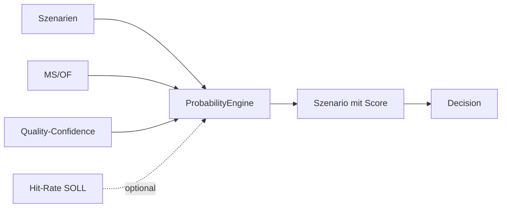

# TIM V4 Developer Manual — Kapitel 13

# Probability Engine

Version: **0.1.0**
Status: **Konsistent für IST (ProbabilityEngine)**
Verbindlichkeit: **Ja**

Dieses Kapitel dokumentiert die Wahrscheinlichkeits-Engine von TIM. Sie
gewichtete jedes Szenario mit einer Vertrauens-Score in [0,1]. Sie verwaltet
bewusst, dass es sich um eine Regelbewertung und nicht um eine
"predictive-accuracy"-Statistik handelt ("never overclaims").

## 1. Zweck

Jedem Szenario eine gewichtete Vertrauensgröße liefern, mit klarer Trennung:
- **UNCALIBRATED_CONFIDENCE** (Regel-basiert, ohne Empirie), und
- **EMPIRICALLY_CALIBRATED / MODEL_BASED**, wenn historische Treffer- oder
  Ähnlichkeitsdaten vorliegen.

## 2. Reale Implementierung

Referenz: `src/orderflow_scenario/engines/probability.py`.

### 2.1 Eingaben (`ProbabilityEngineInput`)

- `scenario`, `market_state`, `auction_state`, `orderflow`
- `data_quality_confidence`, `empirical_hit_rate`,
  `historical_similarity`, `regime`

### 2.2 Bewertung (`_score`)

Fall 1 — **Empirisch kalibriert** (beide `empirical_hit_rate` und
`historical_similarity` vorhanden):

```text
score = empirical_hit_rate*0.6 + historical_similarity*0.4
typ = EMPIRICALLY_CALIBRATED
```

Fall 2 — **Heuristische Gewichtung** (sonst, startet bei 0.30):

- LONG: TREND_UP/BREAKOUT/ACCEPTANCE_ABOVE/LIQ_SWEEP → +0.12;
  aggressive BUYERS → +0.08; SELLERS → −0.06.
- SHORT: TREND_DOWN/BREAKDOWN/ACCEPTANCE_BELOW/REJECTION_ABOVE → +0.12;
  SELLERS → +0.08; BUYERS → −0.06.
- +0.04 × min(#evidence_for, 3); −0.05 × min(#evidence_against, 2).
- `absorption_confirmed` → +0.06; „accumulation“-OI-Interpretation → +0.03.
- Gewichtung mit `data_quality_confidence`:
  `score *= (dq*0.5 + 0.5)`.

`_bounded` kappt auf [0,1]. `ProbabilityType` wird aus `historical_similarity`
und `empirical_hit_rate` gesetzt.

## 3. Öffentliche Schnittstellen

- `ProbabilityEngine`, `ProbabilityEngineInput`.
- `ProbabilityType` (StrEnum): EMPIRICALLY_CALIBRATED, MODEL_BASED,
  UNCALIBRATED_CONFIDENCE, u.a.

## 4. Datenfluss



## 5. Invarianten

1. Score immer in [0,1].
2. Ohne Empirie → `UNCALIBRATED_CONFIDENCE` (kein statistischer Anspruch).
3. Die Engine erzeugt keine Orders; ändert nur Szenario-Scores.
4. Datenqualität kann Score dämpfen, nie anheben.

## 6. Fehlerfälle

| Fall | Verhalten |
|---|---|
| nur `historical_similarity` | MODEL_BASED (partielle Kalibrierung) |
| keine Inputs | Score 0.30 bzw. 0 (leere Sequenz → leere Ausgabe) |

## 7. Tests

**IST:** Im Szenario-Paket existiert nur
`tests/test_orderflow_scenario_data_quality.py`; die Probability-Engine hat
keine eigene Testdatei.

[SPEZIFIKATION] Kalibrierungs- und Validierungs-Benchmarks gegen historische
Treffer stehen aus.

## 8. Bekannte Einschränkungen

- Regel-Heuristik ist nicht gegen echte Treffer kalibriert; Werte sind
  Vertrauen, keine frequentistische Wahrscheinlichkeit.
- Empirische Kalibrierung hängt an vorhandenen Offline-Trefferdaten.

## 9. Offene Lücken

| Bereich | IST | SOLL |
|---|---|---|
| Kalibrier-Daten | keine | integrierte Verteilungen [SPEZIFIKATION] |
| Validierung | unit-level | statistische Kalibrierungs-KPI |

## 10. Roadmap [SPEZIFIKATION]

- Evaluierung der Kalibrierung über Backtest/Replay (Kapitel 18, 25).
- True-Score-Kennzahlen (Brier, Calibration-F: Curve) für die Szenario-Typen.

---

*Ende Kapitel 13.*