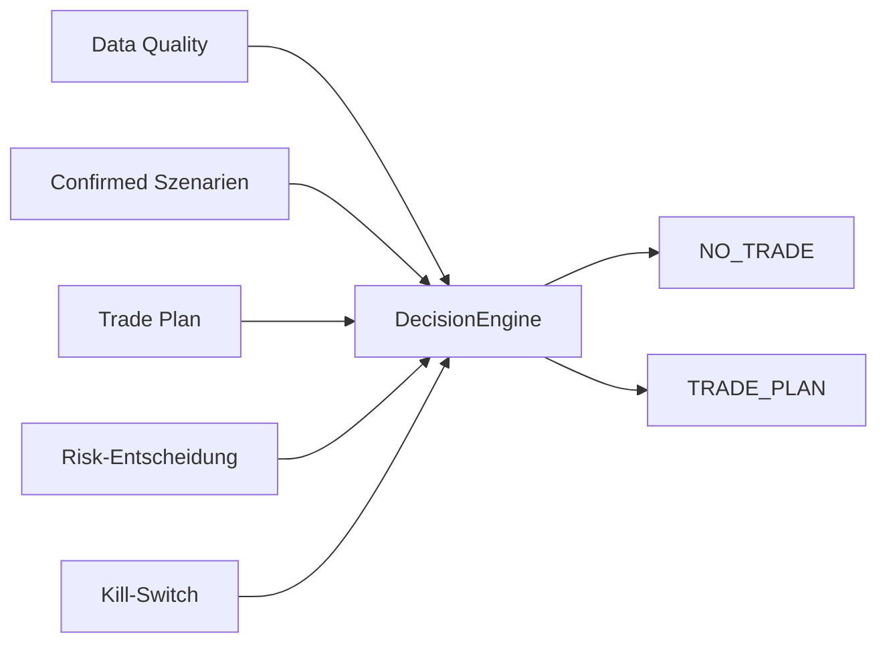

# TIM V4 Developer Manual — Kapitel 14

# Trade Decision Engine

Version: **0.1.0**
Status: **Konsistent für IST (DecisionEngine)**
Verbindlichkeit: **Ja**

Dieses Kapitel dokumentiert die finale Entscheidungs-Engine von TIM. Sie
kombiniert Data Quality, Bestätigung, Trade Plan und Risiko-Entscheidung zu
einem deterministischen Ergebnis (`NO_TRADE` oder `TRADE_PLAN`). Sie gehört
zur Decision Platform und setzt Kapitalschutz (safety by design) um.

## 1. Zweck

Die letzte deterministische Hürde vor einem (Paper/Shadow-)Trade-Plan:
Nur wenn Qualität, Szenario-Bestätigung, Plan und Risiko-Freigabe
zusammenkommen, wird ein Trade-Plan als `TRADE_PLAN`-Entscheidung geliefert.
Alles andere ergibt `NO_TRADE`.

## 2. Reale Implementierung

Referenz: `src/orderflow_scenario/engines/decision.py`.

### 2.1 Eingaben (`DecisionEngineInput`)

`data_quality`, `scenarios`, `trade_plan`, `risk`, `mode`, 
`kill_switch_enabled`, `config`, `orderflow`.

Konstruktionsinvariante: `mode` muss in
{OBSERVE, RESEARCH, SIMULATE, PAPER, SHADOW} sein, sonst `ValueError`.

### 2.2 Entscheidungslogik (`decide`)

**NO_TRADE-Gründe (reason_codes):**

- `KILL_SWITCH_ACTIVE`, wenn disabled
- `INSUFFICIENT_DATA`
- `DATA_QUALITY_TOO_LOW` (PARTIAL und conf < minimal)
- `NO_SCENARIO_CONFIRMED`
- `RISK_REJECTED`
- `TRADE_PLAN_NOT_BUILDABLE` (bestätigt, aber kein Plan)

Pfad:
```text
wenn reason_codes oder kein trade_plan oder kein risk
   oder risk.status != APPROVED:
       → NO_TRADE (+ next_observation)
sonst:
    status = PAPER_APPROVED/SHADOW_APPROVED je nach vetting_mode
    → TRADE_PLAN (mit trade_plan)
```

Das Flag `kill_switch_enabled=False` (aktiver Kill-Switch) blockiert damit die
Ausführung zwingend → NO_TRADE.

## 3. Öffentliche Schnittstellen

- `DecisionEngine`, `DecisionEngineInput`, `Decision`.
- `DecisionStatus` (StrEnum): NO_TRADE, TRADE_PLAN, ... .
- `TradeStatus`, `RiskStatus` (domain).

## 4. Datenfluss



## 5. Invarianten

1. Outcome ist deterministisch aus den Eingaben.
2. Aktivierter Kill-Switch → immer NO_TRADE (Kapitalschutz).
3. Risiko-Zustand muss APPROVED für einen Trade sein.
4. Ohne bestätigtes Szenario ist kein Trade möglich.
5. Keine Live-Orders; nur Paper/Shadow-Status.

## 6. Fehlerfälle

| Fall | Verhalten |
|---|---|
| ungültiger mode | `ValueError` bei Input-Konstruktion |
| Risiko abgelehnt | NO_TRADE + RISK_REJECTED |
| kein bestätigtes Szenario | NO_TRADE + NO_SCENARIO_CONFIRMED |

## 7. Tests

**IST:** Im Szenario-Paket existiert nur
`tests/test_orderflow_scenario_data_quality.py`; die Decision-Engine hat keine
eigene Testdatei.

[SPEZIFIKATION] Dedizierte Entscheidungs-Matrix (alle Reason-Kombinationen)
steht aus (Kapitel 25).

## 8. Bekannte Einschränkungen

- `vetting_mode` bestimmt Paper/Shadow; Live-Status ist nicht durch diese
  Engine erzeugt.
- Ohne Trade-Plan werden nur Wartebeobachtungen gefüllt, kein Trade.

## 9. Offene Lücken

| Bereich | IST | SOLL |
|---|---|---|
| Decision-Matrix-Tests | teilweise | vollständige Kombinationsmatrix [SPEZIFIKATION] |
| Live-Status | von Engine nicht erzeugt | reservierte Freigabe-Pfade außerhalb [SPEZIFIKATION] |

## 10. Roadmap [SPEZIFIKATION]

- Vollständige Entscheidungsmatrix sowie Abbildung von
  DEGRADED/UNSUPPORTED (einheitlich mit Kapitel 06).
- Explizite Trennung von zulässigen Live-Freigaben und Betriebsmodus
  [SPEZIFIKATION].

---

*Ende Kapitel 14.*