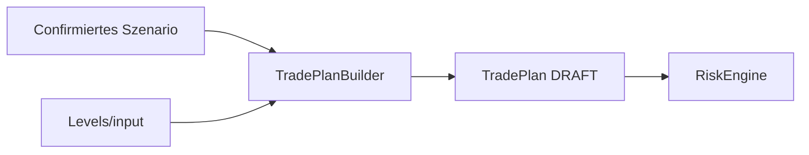

# TIM V4 Developer Manual — Kapitel 15

# Trade Plan Engine

Version: **0.1.0**
Status: **Konsistent für IST (TradePlanBuilder)**
Verbindlichkeit: **Ja**

Dieses Kapitel dokumentiert die Trade-Plan-Engine von TIM. Sie erzeugt aus
einem **bestätigten** Szenario und aktuellen Markt-Levels einen
deterministischen DRAFT-Trade-Plan (Entry-Zone, Stop, Ziele, Reward/Risk,
Grade) für die Risiko-Engine.

## 1. Zweck

Einen strukturierten, invalidatierbaren Trade-Plan mit Entry-, Stop- und
Ziel-Levels erzeugen — und nur für bestätigte, richtungsorientierte Szenarien.
Die Engine baut keinen Live-Auftrag und setzt Sicherheits- und
Positionsgrößen-Entscheidungen bewusst später an (Risiko-Engine).

## 2. Reale Implementierung

Referenz: `src/orderflow_scenario/engines/trade_plan.py`.

### 2.1 `TradePlanInputs`

tragen scenario, last_price, entry/exit-Model-Details, symbol, venue,
market_type, timeframe, market_state, entry_model, exact_entry,
minimum_reward_risk, timestamp.

### 2.2 `TradePlanBuilder.build(inputs)`

Ablauf (deterministisch):

1. Nur `scenario.state == CONFIRMED` → sonst `None`.
2. `direction == NEUTRAL` → `None`.
3. Zeitenbrüche: `trigger = scenario.trigger_level or last`;
   `entry_low/high` aus Szenario-Zone (Fallback auf trigger/last).
4. Stop, Ziele long/short über `_stop_*`/`_targets_*`.
5. `stop_distance <= ZERO` → `None`.
6. Expected RR < `minimum_reward_risk` → `None`.
7. Grading über `_grade`.
8. Trade-Plan dataclass bauen (DRAFT-Status).

Vorgabegrößer: account_risk=0, position_size=0, leverage=1,
liquidation_distance=None → **bewusst** leer; die Risk-Engine berechnet die
Positionsgröße aus Risiko-Budget (sizzing first, leverage technisch).

## 3. Öffentliche Schnittstellen

- `TradePlanBuilder`, `TradePlanInputs`.
- `TradePlan` (frozen dataclass, domain).
- `TradeStatus` (DRAFT, ... ), `Grade`, `ExecutionSensitivity`.

## 4. Datenfluss

## 5. Invarianten

1. Nur `CONFIRMED` und nicht-NEUTRAL erzeugen einen Plan.
2. `stop_distance > 0` zwingend.
3. Expected RR ≥ Minimum zwingend.
4. Plan ist DRAFT; keine Order.
5. Positionsgrößen/Leverage gehören der Risk-Engine.

## 6. Fehlerfälle

| Fall | Verhalten |
|---|---|
| nicht konfirmiert | `None` |
| NEUTRAL-Richtung | `None` |
| stop_distance ≤ 0 | `None` |
| RR zu niedrig | `None` |

## 7. Tests

**IST:** Im Szenario-Paket existiert nur
`tests/test_orderflow_scenario_data_quality.py`; der TradePlanBuilder hat
keine eigene Testdatei.

[SPEZIFIKATION] Golden-Referenz-Pläne je Szenario-/Grad-Kombination stehen
aus.

## 8. Bekannte Einschränkungen

- Stop-/Ziel-Berechnung nutzt Struktur-/Level-Eingaben; die Maximal-Haltezeit
  ist textlich definiert, nicht als numerischer Parameter verfügbar.

## 9. Offene Lücken

| Bereich | IST | SOLL |
|---|---|---|
| Max hold time | Text-Feld | numerischer Parameter [SPEZIFIKATION] |
| Plan-Templates | fest verdrahtet | konfiguriert [SPEZIFIKATION] |

## 10. Roadmap [SPEZIFIKATION]

- Numerische Verfallszeit/Maximal-Haltezeit aus Konfiguration.
- Referenz-Plan-Proben je EntryModel-Kategorie ergänzen.

---

*Ende Kapitel 15.*