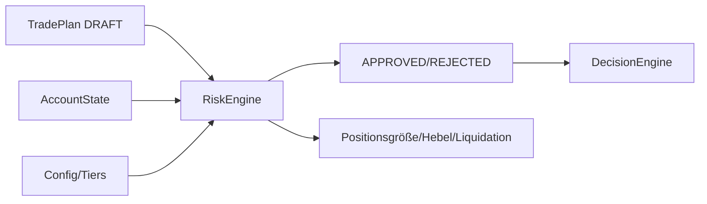

# TIM V4 Developer Manual — Kapitel 16

# Risk Engine

Version: **0.1.0**
Status: **Konsistent für IST (RiskEngine)**
Verbindlichkeit: **Ja**

Dieses Kapitel dokumentiert die Risiko-Engine von TIM. Sie prüft einen
DRAFT-Trade-Plan und Kontostand deterministisch gegen Limits und liefert
APPROVED/REJECTED inkl. Positionsgröße, Leverage, Liquidationsabstand und
Execution-Sensitivity. Sie gehört zur Risk Platform (Kapitalschutz vor
Performance).

## 1. Zweck

Verhindern, dass Kapital unkalkuliert gefährdet wird:
Positionsgröße wird **aus dem Risiko-Budget abgeleitet** (sizing first),
Leverage bleibt ein technischer, tier-begrenzter Parameter.

## 2. Reale Implementierung

Referenz: `src/orderflow_scenario/engines/risk.py`.

### 2.1 `RiskEngine.evaluate(plan, account, tier_name?)`

`AccountState`: equity, free_margin, consecutive_losses, event_risk_flagged,
positions.

### 2.2 Prüfungen (IST) — jeder findet einen `reason`-Code

1. Plan muss `TradeStatus.DRAFT` sein (`plan_not_draft`).
2. Fee-Modell: nicht-negative bps (`invalid_fee_model`).
3. Stop: `stop_distance>0` und strukturell
   (`invalid_stop_distance`, `stop_not_structural`).
4. Reward/Risk ≥ Minimum (`reward_risk_below_minimum`).
5. Account-Budget: Tages-/Wochen-Grenze, max. Verluste
   (`daily_loss_limit_reached`, `weekly_loss_limit_reached`,
   `max_consecutive_losses_reached`).
6. Positionsgröße aus Risiko-Budget
   (`position_size_not_positive`, `position_exceeds_account_fraction`).
7. Gebühren/Slippage gegen Reward
   (`fees_destroy_reward_risk`).
8. Margin: `insufficient_margin`.
9. Leverage ≤ Tier-Max und gesamt ≤ 50x außer `allow_leverage_above_50x`
   (`leverage_exceeds_tier_limit`, `leverage_above_50x_not_allowed`).
10. Liquidations-Abstand (`liquidation_distance_too_small`).
11. Event-Risiko (`event_risk_flagged`).
12. Trade im BALANCE-Markt (`trade_in_balance`).
13. Korrelation zu bestehenden Positionen (`correlation_exceeds_limit`).

→ `approved = not reasons`; Status APPROVED/REJECTED.

### 2.3 Outputs

`RiskEngineOutput` mit `RiskDecision(status, reason_codes, details,
approved_risk_fraction, approved_position_size, approved_leverage,
liquidation_price, liquidation_buffer_ok)`.

Sensitivity: HIGH bei Hebel ≥ 20x, oder (Hebel > 10x und event_risk);
sonst NORMAL.

## 3. Öffentliche Schnittstellen

- `RiskEngine`, `RiskEngineOutput`, `AccountState`.
- `RiskDecision`, `RiskStatus` (APPROVED/REJECTED), `ExecutionSensitivity`.
- Konfiguration: `OrderflowScenarioConfig.tier()`, `risk_limits`, `fee_model`.

## 4. Datenfluss



## 5. Invarianten

1. Positionsgröße aus Risiko-Budget, nie aus Hebel zuerst.
2. Leverage ≤ Tier-Max und (default) ≤ 50x.
3. Ohne strukturellen Stop kein APPROVED.
4. Tages-/Wochen-Verlust-Grenzen sind verbindlich.
5. `AccountState`-Validierung in `__post_init__` (> Prüft `equity`/`free_margin`;
   `open_positions` werden dort nicht validiert).

## 6. Fehlerfälle

| Fall | Verhalten |
|---|---|
| Hebel > Tier | REJECTED + leverage_exceeds_tier_limit |
| Margin reicht nicht | REJECTED + insufficient_margin |
| Verlustgrenzen erreicht | REJECTED + *loss_limit_reached |
| Korrelation überschritten | REJECTED + correlation_exceeds_limit |

## 7. Tests

**IST:** Im Szenario-Paket existiert nur
`tests/test_orderflow_scenario_data_quality.py`; die Risk-Engine hat keine
eigene Testdatei.

[SPEZIFIKATION] Dedizierte Risk-Matrix-Tests (alle Limits-Kombinationen)
stehen aus.

## 8. Bekannte Einschränkungen

- Event-Risk-Flag wird als Eingabe getragen (kein Modell).
- Liquidationsberechnung nutzt vereinfachtes Modell (siehe `_liquidation_price`).

## 9. Offene Lücken

| Bereich | IST | SOLL |
|---|---|---|
| Risk-Matrix-Tests | teilweise | vollständige Limits-Matrix [SPEZIFIKATION] |
| Liquidation-Modell | vereinfacht | exchanges-spezifisch [SPEZIFIKATION] |

## 10. Roadmap [SPEZIFIKATION]

- Vollständige Risk-Prüf-Matrix in Tests.
- Exchanges-spezifisches Margin-/Liquidationsmodell.

---

## Code Coverage (Phase 2)

```
VERIFIED .......... 95 %
PARTIAL ........... 5 %
```

Befunde: alle 13 Prüfregeln und `RiskEngine.evaluate`/`_account_risk`/
`_liquidation_price` verifiziert; Leverage ≤ 50x außer
`allow_leverage_above_50x` bestätigt. Korrigiert: `open_positions` werden im
`__post_init__` nicht validiert (nur `equity`/`free_margin`). Keine eigene
Testdatei (LÜCKE).

---

*Ende Kapitel 16.*