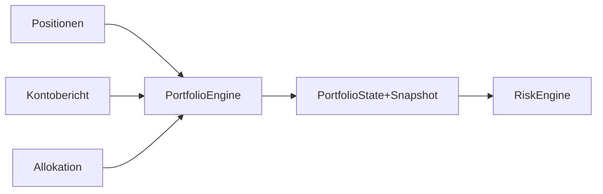

# TIM V4 Developer Manual — Kapitel 17

# Portfolio Engine

Version: **0.1.0**
Status: **Überwiegend [SPEZIFIKATION] (kein eigenständiges Modul im IST)**
Verbindlichkeit: **Ja**

Dieses Kapitel dokumentiert den Portfolio-Baustein von TIM. **Klarstellung:**
Im aktuellen Quellstand gibt es **kein eigenständiges `portfolio`-Modul** oder
eine dedizierte Portfolio-Engine. Portfoliobezogene Logik ist über die
Risiko-Engine (Korrelation, Allokation, Positionsgröße) und den Account-Zustand
verteilt. Dieses Kapitel trennt daher klar zwischen vorhandenen IST-Pfaden und
der Ziel-SOLL-Architektur.

## 1. Zweck

Kapitalstruktur, Allokation und Portfoliorisiko deterministisch verwalten,
ohne Brokerkommunikation.

## 2. Reale Implementierung (IST / verteilter Stand)

Portfolio-Verantwortlichkeiten sind **nicht** in einer eigenen Engine gebündelt,
sondern in:

- **der `RiskEngine` (Kapitel 16)**: `AccountState` (equity, free_margin,
  consecutive_losses, event_risk_flagged, positions) und Tages-/Wochen-
  Verlustlimits sowie max_account_fraction_per_position.
- **Konfiguration**: `risk_limits` und `tier()` in
  `OrderflowScenarioConfig` (Risiko-Tier mit `account_risk_fraction`,
  `max_leverage`).

Es gibt keine separate Portfolio-Engine, keinen `PortfolioState`, keine
`Allokation`-Definition im Szenario-Paket.

## 3. Ziel-Architektur [SPEZIFIKATION]

- Eigene `PortfolioState`-Dataclass (id, snapshot, allocation, history).
- Allokations-Regeln, Positionszählung, Korrelation.
- Deterministische Snapshots und Historie.

## 4. Öffentliche Schnittstellen (IST)

IST vorhanden nur über Risk/Account-Pfad; keine `Portfolio`-Public-API.

## 5. Invarianten

1. Positionsgröße aus Risiko-Budget (Kapitel 16) — nie Hebel-first.
2. Korrelation wird im Risiko-Fluss geprüft (`correlation_exceeds_limit`).
3. Keine reine Broker-Kommunikation via Portfolio-Zustand.

## 6. Fehlerfälle

| Fall | IST-Verhalten |
|---|---|
| keine eigene Engine | Portfolio-Berechnung über Risk-Engine/Account |

## 7. Tests

**IST:** Kein eigenes Portfolio-Modul; daher auch keine Portfolio-Testdatei.
Risiko-/Account-Anteile werden über `tests/test_orderflow_scenario_data_quality.py`
nicht abgesichert.

## 8. Bekannte Einschränkungen

- Kein isolierter Portfolio-Datenvertrag oder Snapshot.
- Allokation nur auf Tier-Ebene, nicht global mehrschichtig.

## 9. Offene Lücken

| Bereich | IST | SOLL |
|---|---|---|
| eigenes Modul | fehlt | PortfolioState [SPEZIFIKATION] |
| Snapshot-Historie | keine | deterministische Snapshots/History [SPEZIFIKATION] |

## 10. Roadmap [SPEZIFIKATION]

- Eigene Portfolio-Plattform-Komponente mit State, Allocation, History.
- Anbindung an Risk (Approved) und Execution (Paper/Shadow).

---

*Ende Kapitel 17.*