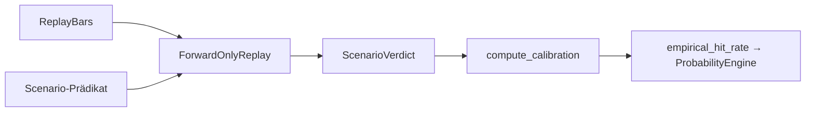

# TIM V4 Developer Manual — Kapitel 18

# Backtest Engine

Version: **0.1.0**
Status: **Konsistent für IST (ForwardOnlyReplay)**
Verbindlichkeit: **Ja**

Dieses Kapitel dokumentiert das Backtest-/Kalibrierungs-Fundament von TIM.
Es ist forward-only (kein Look-Ahead) und als `ForwardOnlyReplay` in
`src/orderflow_scenario/backtest.py` implementiert.

## 1. Zweck

Szenario-Wahrscheinlichkeiten und Trade-Gradings empirisch kalibrieren, ohne
Look-Ahead: Entscheidungs feature zum Zeitpunkt t nutzen nur Daten, die strikt
vor t verfügbar sind. Alle hypothetischen Ergebnisse sind vorläufig und dürfen
nicht als profitable Strategie beansprucht werden, ohne Out-of-Sample-Beweis.

## 2. Reale Implementierung

Referenz: `src/orderflow_scenario/backtest.py`.

### 2.1 Datenmodell

- `ReplayBar`: timestamp, open, high, low, close (frozen).
- `ScenarioVerdict`: scenario_lead, hit, direction, realized_r.
- `CalibrationResult`: scenario_type, n_observed, n_hits, Hit-Rate,
  method (`forward_only_replay`), note (Out-of-Sample-Vorbehalt).

### 2.2 `ForwardOnlyReplay`

- Konstruktor validiert `entry_fraction` und `target_r` nur auf `> 0`
  (sonst `ValueError`); es gibt **keine** Normierung auf `≤ 1`.
- `evaluate(bars, scenario, *, reach_target, reach_stop, direction)`:
- `len(bars) < 3` → `scenario_lead=False` (kein Verdict).
- Entscheidung auf `bars[:-1]` (kein Look-Ahead auf letzte Bar).
- Wenn keine Scenario-Lead → kein Verdict.
- `_hit` auf letzter Bar: konservativ (Treffer und Stop in gleicher Bar →
  als Verlust gezählt, `-1`).
- `lead_bars`: alle Bars außer der letzten.
- `compute_calibration`: Hit-Rate = hits / observed (nur Scenario-Leads),
  note erinnert an Out-of-Sample-Pflicht.

### 2.3 Durchlauf-Prinzip (IST)

```text
für t: wenn scenario(bars[:t-1]) == True → lead
   ziehe Ergebnis der Bar t (konservativ)
Sammle Verdicts → compute_calibration
```

## 3. Datenfluss



## 4. Öffentliche Schnittstellen

- `ForwardOnlyReplay` (evaluate, lead_bars).
- `compute_calibration`, `ReplayBar`, `ScenarioVerdict`, `CalibrationResult`.

## 5. Invarianten

1. Kein Look-Ahead: Entscheidung nur auf `bars[:-1]`.
2. Konservative Treffer-Logik bei Stop-vor-Target (gleiche Bar → Verlust).
3. Alle Ergebnisse vorläufig; Kalibrierung verlangt Out-of-Sample-Testperiode.
4. `entry_fraction`/`target_r` positiv.

## 6. Fehlerfälle

| Fall | Verhalten |
|---|---|
| < 3 Bars | `scenario_lead=False`, hit=False |
| ungültige Parameter | `ValueError` |
| Treffer und Stop in derselben Bar | konservativ −1 |

## 7. Tests

**IST:** Im Szenario-Paket existiert nur `tests/test_orderflow_scenario_data_quality.py`;
der Backtest-Harness (`ForwardOnlyReplay`) hat keine eigene Testdatei.

[SPEZIFIKATION] Dedizierte Replay-/Kalibrierungs-Tests (Forward-Only, Hit-Logik)
stehen aus.

## 8. Bekannte Einschränkungen

- Nur Hit-/R-Auswertung; keine vollständige Portfolio-/Slippage-Simulation
  hier (z.T. in Execution, Kapitel 20/21).
- Out-of-Sample-Beweis fehlt (explizit deklariert).

## 9. Offene Lücken

| Bereich | IST | SOLL |
|---|---|---|
| Gebühren/Slippage im Replay | fehlt hier | Integration Execution (K20/21) |
| Walk-Forward-Setup | nur forward-only | organisierter Walk-Forward [SPEZIFIKATION] |

## 10. Roadmap [SPEZIFIKATION]

- Gebühren/Slippage-Logik in das Replay integrieren.
- Walk-Forward- und Out-of-Sample-Trennung; Reporting der Resultate.

---

## Code Coverage (Phase 2)

```
VERIFIED .......... 92 %
PARTIAL ........... 8 %
SPECIFICATION ..... 0 %
```

Befunde: `ReplayBar`/`ScenarioVerdict`/`CalibrationResult`/`ForwardOnlyReplay`/
`compute_calibration` verifiziert; konservatives `_hit` (beide Ziele in einer
Bar → miss), `bars[:-1]` ohne Look-Ahead bestätigt. Konstruktor-Aussage
korrigiert (nur `>0`-Check, keine Normierung auf `≤1`). Keine eigene
Testdatei (LÜCKE).

---

*Ende Kapitel 18.*