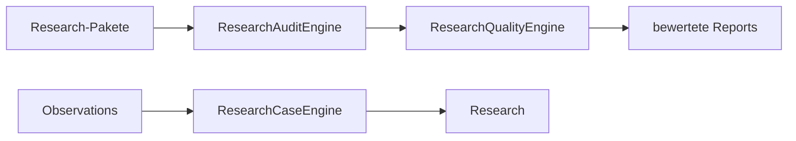

# TIM V4 Developer Manual — Kapitel 19

# Research Engine

Version: **0.1.0**
Status: **IST-Elemente (research_ops); eigene Research-Engine [SPEZIFIKATION]**
Verbindlichkeit: **Ja**

Dieses Kapitel dokumentiert die Research-Funktionen von TIM. Es gibt
**keine** eigenständige "Research Engine" als ein Modul im
Orderflow-Szenario-Paket; Research ist über `src/research/` (module_a,
module_b), `src/research_ops/` (audit, quality, snapshot) und die
Orderflow-Research-Case-Engine verteilt. Dieses Kapitel trennt IST und SOLL.

## 1. Zweck

Wissenschaftliche, reproduzierbare Research-Sessions mit Evidence, Replay und
Provenienz erzeugen — und sicherstellen, dass Research **nie** direkt
Aufträge erzeugt (Trust-Boundary Kapitel 02).

## 2. Reale Implementierung (IST)

### 2.1 `src/research_ops/audit.py` — ResearchAuditEngine

- `canonical`/`digest`: deterministische Digests.
- `ResearchAuditEngine.audit(as_of)`: prüft Report-Metadaten, Hättes,
  deklarierte Hash über `_validate_*`-Methoden.

### 2.2 `src/research_ops/quality.py` — ResearchQualityEngine

`assess(root, audit, *, as_of)` → strukturierte Qualitätsbewertung des
Research-Pakets.

### 2.3 `src/research_ops/snapshot.py`

Snapshot-Prozessprotokoll (Reproduzierbarkeit).

### 2.4 `src/research/module_a`, `src/research/module_b`

- module_a: `agent.py`, `graph.py`, `prompts.py`, `tools.py`.
- module_b: `agent.py`, `config.py`, `reports/`.

### 2.5 Orderflow-Research-Cases

`src/orderflow/observations.py`: `OrderflowResearchCaseEngine` überführt
Observations in `ResearchCase` — hier wird der Bogen zur Orderflow-Beobachtung
geschlagen (Kapitel 07).

## 3. Ziel-Architektur [SPEZIFIKATION]

- Eine einheitliche `ResearchEngine` mit Session-, Evidence- und
  Replay-Vertrag.
- Reports validiert gegen Schemas (Kapitel 24).
- Provenienz/Hashes deterministisch (IST-Ansatz in research_ops).

## 4. Öffentliche Schnittstellen (IST)

- `ResearchAuditEngine`, `ResearchQualityEngine` (`research_ops/`).
- `OrderflowResearchCaseEngine` (`orderflow/observations.py`).
- `ResearchCase` (domain).

## 5. Invarianten

1. Research erzeugt nie Aufträge (Trust-Boundary).
2. Digests/Hashes deterministisch (canonical encoding).
3. Reports werden auf Metadaten + deklarierte Hashes geprüft (Audit).

## 6. Fehlerfälle

| Fall | IST-Verhalten |
|---|---|
| Report ohne gültige Metadaten | ResearchAudit → Issue |
| deklarierter Hash mismatch | ResearchAudit → Issue |

## 7. Tests

- `tests/test_research_*.py`, `tests/test_research_operations.py`,
  `tests/test_research_*_modu*.py`, `tests/test_goathub_knowledge.py`
  (vorhanden im Repo; genaue Liste in Kapitel 25).
- Anknüpfung an die Orderflow-Beobachtung erfolgt über
  `OrderflowResearchCaseEngine` (IST).

## 8. Bekannte Einschränkungen

- Kein einheitlicher Szenario-Research-Vertrag; mehrere Adapter/Engines.
- Research-Ursprung aus Orderflow ist über Observation, nicht über eine
  zentrale Engine gebündelt.

## 9. Offene Lücken

| Bereich | IST | SOLL |
|---|---|---|
| einheitliche ResearchEngine | über mehrere Orte verteilt | eine Engine [SPEZIFIKATION] |
| Szenario-Verdikt in Research | nicht verknüpft | Replay+Kalibrierung integrieren [SPEZIFIKATION] |

## 10. Roadmap [SPEZIFIKATION]

- ResearchEngine mit Session/Job/Evidence-Contract vereinheitlichen.
- Szenario-Kalibrierung (Kapitel 18) mit Research-Reports verknüpfen.

---

*Ende Kapitel 19.*