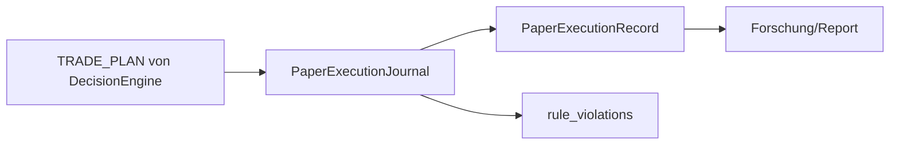

# TIM V4 Developer Manual — Kapitel 20

# Paper Engine

Version: **0.1.0**
Status: **Konsistent für IST (PaperExecutionJournal)**
Verbindlichkeit: **Ja**

Dieses Kapitel dokumentiert das Paper-/Shadow-Trade-Journal von TIM. Es ist
ausdrücklich ein **Journal**, kein **Order-** oder Ausführungssystem: Es kann
nicht ordnen, hält keine API-Keys und berührt keine Exchange. Gebühren und
Slippage werden über das konfigurierte Fee-Model modelliert.

## 1. Zweck

Trade-Pläne, deren Evaluierung und hypothetische Ergebnisse dokumentieren —
als Forschungsgrundlage (Provenance `TEST_ONLY_PAPER_RESEARCH`) und als
Validierungs-Pfad bevor irgendeine Ausführung erwogen wird.

## 2. Reale Implementierung

Referenz: `src/orderflow_scenario/execution/paper.py`.

### 2.1 `PaperExecutionInput` (frozen)

`plan`, `fill_price`, `exit_price`, `outcome_fraction`, `fee_bps` (default 6),
`slippage_bps` (default 2), `observed_at`.

Invarianten (→ `ValueError`): `fill_price > 0`; `exit_price > 0` falls
gesetzt; `fee_bps/slippage_bps ≥ 0`.

### 2.2 `PaperExecutionRecord`

Felder: record_id, plan, fill_price, exit_price, gross_fraction,
fee_fraction, slippage_fraction, net_fraction, rule_violations, provenance,
limitation, created_at. In `to_dict`: `live_execution=False` (fest).

### 2.3 `PaperExecutionJournal.record(entry)`

Berechnung:
```text
fee_fraction = fee_bps / 10000
slippage_fraction = slippage_bps / 10000
gross_fraction = outcome_fraction (falls gesetzt)
               | (exit−fill)/fill  (LONG) bzw. (fill−exit)/fill (SHORT)
               | 0 (falls kein Exit/PnL)
net_fraction = gross − fee − slippage
provenance = "TEST_ONLY_PAPER_RESEARCH"
limitation = "Hypothetical evaluation only; not an order, fill, signal,
              or profitability claim."
```

`_check_rules` erzeugt `rule_violations`:
- Hebel > 50x → `high_leverage_needs_shadow_validation`.
- Sensitivität HIGH und vetting != SHADOW →
  `high_execution_sensitivity_requires_shadow`.
- `fill_price` außerhalb Entry-Zone → `fill_below_entry_zone` /
  `fill_above_entry_zone`.

`records()` / `clear()`: In-Memory Journal.

## 3. Datenfluss



## 4. Öffentliche Schnittstellen

- `PaperExecutionInput`, `PaperExecutionRecord`, `PaperExecutionJournal`.
- Keine Broker-/Auth-Schnittstelle (kein API, keine Keys).

## 5. Invarianten

1. Journal kann keine Orders platzieren.
2. `live_execution` ist dauerhaft `False`.
3. Gebühren/Slippage sind nicht negativ.
4. Hypothetisches Ergebnis trägt Provenienz und Einschränkung.

## 6. Fehlerfälle

| Fall | Verhalten |
|---|---|
| fill_price ≤ 0 | `ValueError` |
| neg. Gebühr | `ValueError` |
| violates Regel | in rule_violations dokumentiert (kein Block) |

## 7. Tests

**IST:** Es existiert keine eigene Testdatei für das Paper-Journal im
Szenario-Paket (nur `test_orderflow_scenario_data_quality.py` deckt den DQ
Gate).

[SPEZIFIKATION] Dedizierte Journal-Tests (Net-PnL, Violations, Idempotenz)
stehen aus.

## 8. Bekannte Einschränkungen

- In-Memory-Only Journal (kein dauerhafter Speicher/Historie über Prozess
  hinaus) im IST.

## 9. Offene Lücken

| Bereich | IST | SOLL |
|---|---|---|
| Persistenz des Journals | In-Memory | durable Storage/DB [SPEZIFIKATION] |
| Journal-Tests | fehlen | dedizierte Tests [SPEZIFIKATION] |

> **Hinweis (Phase 2):** Daneben existiert eine zweite Paper-Implementierung
> `src/paper/automation.py` (`PaperAutomation`, `PaperPolicy` mit fee_bps=6.0,
> slippage_bps=2.0, getestet in `test_paper_automation.py`). Sie ist
> eigenständig vom Journal (siehe ARCHITECTURE_REVIEW §3 — Duplikationsrisiko).

## 10. Roadmap [SPEZIFIKATION]

- Dauerhafte Speicherung (v2-Persistenz, Kapitel 05).
- Journal mit Shadow-/Replay-Anbindung und vollständigen Tests.

---

## Code Coverage (Phase 2)

```
VERIFIED .......... 100 %
```

Befunde: `PaperExecutionInput`/`PaperExecutionRecord`/`PaperExecutionJournal`
(record/_check_rules/records/clear), `live_execution=False`, fee/slippage
(6/2 bps) verifiziert. Ergänzt: `src/paper/automation.py` als zweite
Paper-Engine (Duplikat). Keine eigenen Journal-Tests (LÜCKE).

---

*Ende Kapitel 20.*