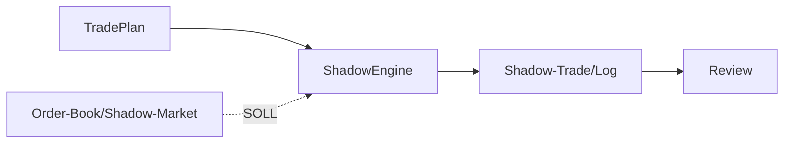

# TIM V4 Developer Manual — Kapitel 21

# Shadow Engine

Version: **0.1.0**
Status: **IST-Elemente (Vetting-Mode, Journal); eigenständige SHADOW [SPEZIFIKATION]**
Verbindlichkeit: **Ja**

Dieses Kapitel dokumentiert die Shadow-Ausführung von TIM. **Klarstellung:**
Im Quellstand gibt es **keine eigenständige Shadow-Engine/Shadow-Modul**.
Shadow verha ten ist über `VettingMode.SHADOW`, `TradeStatus.*SHADOW*` und das
Paper-Journal (`execution/paper.py`) abgedeckt — Shadow ist eine
„Shadow-Validierung“ mit erhöhtem Anspruch, kein separates Ausführungssystem.

## 1. Zweck

Einen Trade-Kandidaten mit höheren Anforderungen (Validierung hoher
Sensitivität/Leverage) simulieren, bevor irgendeine weitergehende Freigabe
denkbar ist.

## 2. Reale Implementierung (IST)

### 2.1 Modelltypen

- `VettingMode.NONE/PAPER/SHADOW` (domain).
- `TradeStatus.SHADOW_APPROVED`, `ACTIVE_SHADOW` (domain).
- `config.py`: nur OBSERVE/RESEARCH/SIMULATE/PAPER/SHADOW zulässig;
  in PAPER/SHADOW-Mode muss `vetting_mode != NONE` sein (sonst `ValueError`).
  (Sicherheits-Konfigurations-Invariante.)

### 2.2 Im Paper-Journal

`execution/paper.py` (`_check_rules`):
- Hebel > 50x → `high_leverage_needs_shadow_validation`.
- `execution_sensitivity == HIGH` und `vetting_mode != SHADOW` →
  `high_execution_sensitivity_requires_shadow`.

Es gibt kein separates Shadow-Output/Signatur; Shadow-Kandidaten laufen als
Paper-Records mit höheren Violation-Kriterien.

## 3. Ziel-Architektur [SPEZIFIKATION]

- Eigene Shadow-Engine mit Schatten-Buch und Replay-Abschluss.
- Trennung von Paper (keine Maßnahme) und Shadow (immer beobachtend/mock).

## 4. Öffentliche Schnittstellen (IST)

- `VettingMode`/`Mode`/`TradeStatus` (domain).
- Keine eigene Shadow-Analyse-API; nur Vetting-Flags + Journal.

## 5. Invarianten

1. Shadow erzeugt nie Live-Orders.
2. Hohe Sensitivität/Leverage verlangt Shadow-Vetting (Regel).
3. `vetting_mode` in Paper/Shadow-Mode gesetzt (Config).

## 6. Fehlerfälle

| Fall | Verhalten |
|---|---|
| PAPER/SHADOW ohne vetting_mode | `ValueError` bei Konfigurationserzeugung |
| hohe Sensitivität ohne Shadow | Paper-Journal-Violation |

## 7. Tests

**IST:** keine dedizierte Shadow-Testdatei; Journal-/Vetting-Codes getestet
über Pipeline-/Config-Pfade (siehe oben, Kapitel 25-Liste).

## 8. Bekannte Einschränkungen

- Kein eigenes Shadow-Modul bzw. Mock-Book; Shadow ist eine
  Vetting-Mode-Semantik.
- Kein Schatten-Portfolio und keine Replay-Auswertung.

## 9. Offene Lücken

| Bereich | IST | SOLL |
|---|---|---|
| eigene Shadow-Engine | fehlt | vollständige Engine [SPEZIFIKATION] |
| Shadow-Book/Replay | fehlt | Marktsimulations-Fake [SPEZIFIKATION] |

## 10. Roadmap [SPEZIFIKATION]

- Shadow-Engine als eigene Komponente mit Book-/Replay-Sim.
- Auswertung & Reporting von Shadow-Runs für Review (Kapitel 22).

---

*Ende Kapitel 21.*