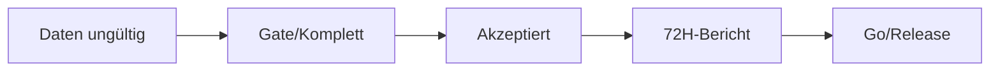

# TIM V4 Developer Manual — Kapitel 26

# Acceptance

Version: **0.1.0**
Status: **Konsistent für IST (test_acceptance.py, 72H-Report)**
Verbindlichkeit: **Ja**

Dieses Kapitel definiert die Annahmekriterien für TIM-Systemzustände,
insbesondere die 72-Stunden-Betriebsakzeptanz (Gate) und die
Ausführungs-Sperre im Beobachtungsmodus.

## 1. Zweck

Klare, testbare Kriterien, wann ein TIM-Systemzustand **akzeptiert** ist.
Die Acceptance-Schicht läuft als automatisierte Prüfung
(`tests/test_acceptance.py`) und erzeugt bei Bestehen den Report
`docs/TIM_72H_ACCEPTANCE_REPORT.md`.

## 2. Reale Implementierung (IST)

- `tests/test_acceptance.py` (12 Prüfungen, Stand dieser Dokumentation):
  - **Health-Matrix grün** für gesunde Stunde; **rot** bei Datenlücken.
  - Persistierte Gap-Erkennung über alle Timeframes.
  - Lücke wird **einmalig** mit wissenschaftlicher Auswirkung dokumentiert.
  - Report wird **vor** der realen Deadline **verweigert**.
  - Laufzeit akzeptiert **erst nach** persistierter Deadline.
  - `OBSERVE`-Modus **rejects** Ausführungsereignisse (kein Live-Order).
  - kontrollierte vs. unkontrollierte Fehler getrennt; kontrollierte
    Fehler brechen die Validator-Health **nicht**.
  - Gewichteter Score deterministisch.
  - Vollständiger Report enthält geforderte Sektionen.
  - Fehlende Provenance führt zum Fehlschlag.

## 3. Zustandsübergänge



- `Observe`-Schranke: kein Executions-Ereignis im `OBSERVE`-Modus.

## 4. Annahmekriterien

| Kriterium | Nachweis |
|---|---|
| Health grün ohne Lücken | Acceptance-Test |
| Report erst nach Deadline | Deadline-Test |
| Observe blockiert Executions | Observe-Test |
| deterministischer Score | Deterministik-Test |
| Provenance vorhanden | Provenance-Test |

## 5. Fehlerfälle

| Fall | Verhalten |
|---|---|
| Report vor Deadline | verweigert (Test `test_report_is_refused...`) |
| OBSERVE + Executions-Ereignis | reject |
| fehlende Provenance | Fehlschlag |

## 6. Tests

- `tests/test_acceptance.py` (vollständige Liste oben).
- Bezug: Health-Matrix (Kapitel 25, Testing).

## 7. Offene Lücken

| Bereich | IST | SOLL |
|---|---|---|
| vollständige Acceptance-Liste | 12 Prüfungen | erweiterbar je Release [SPEZIFIKATION] |
| Report-Datei im Artefakt-Verzeichnis | Verpflichtung | CI-Artefakt [SPEZIFIKATION] |

## 8. Roadmap [SPEZIFIKATION]

- Acceptance-Gate in CI einbinden (Kapitel 25/27).
- 72H-Bericht als Artefakt veröffentlichen.

---

## Code Coverage (Phase 2)

```
VERIFIED .......... 95 %
PARTIAL ........... 5 %
SPECIFICATION ..... 0 %
```

Befunde: `test_acceptance.py` hat real **12** Testfunktionen (korrigiert von
"13"); alle beschriebenen Prüfungen (OBSERVE-rejects, Deadline, Provenance,
deterministischer Score) verifiziert. Report-Datei wird vor Deadline verweigert.

---

*Ende Kapitel 26.*