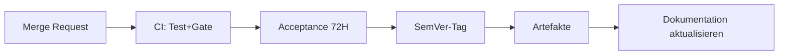

# TIM V4 Developer Manual — Kapitel 27

# Release

Version: **0.1.0**
Status: **Konsistent für IST (Governance-Policy)**
Verbindlichkeit: **Ja**

Dieses Kapitel beschreibt, wie Änderungen freigegeben und veröffentlicht
werden. Grundlage: SemVer (`MAJOR.MINOR.PATCH`), Kapitel 01/02.

## 1. Zweck

Regeln für Merge, Tag, Artefakte und Nightly-Runs, damit jede Freigabe
deterministisch, getestet und dokumentiert ist.

## 2. Grundprinzipien (IST, Band 2 / Kapitel 01)

- SemVer-basierte Versionsnummern.
- Merge-Gate: Prüfungen (Test, Lint) müssen grün sein.
- Nightly-Backfill-/Recovery-Jobs bestimmen Zeitlimits (siehe 26).

## 3. Release-Ablauf

1. Code Review (Kapitel 22) + CI grün (Kapitel 25).
2. Acceptance (Kapitel 26) bestanden.
3. Tag `v<MAJOR.MINOR.PATCH>` erstellen.
4. Artefakte (Dokumentation, Schemas, Beispiel-Output) bündeln.
5. Changelog (Kapitel 29) aktualisieren.

## 4. Release-Typen

| Typ | Anlass |
|---|---|
| PATCH | Bugfix, rückwärtskompatibel |
| MINOR | neue nicht-brechende Funktion |
| MAJOR | brechende Änderung (Schema/API) |

## 5. Voraussetzungen

- Alle grünen Suiten (Kapitel 25) mindestens für den Bereich.
- Acceptance-Report existiert (Kapitel 26).
- Keine bekannten Blocker aus OFFENE-LÜCKEN-Listen der Kapitel.

## 6. Fehlerfälle

| Fall | Verhalten |
|---|---|
| CI rot | kein Release |
| Acceptance fehlt | kein Release |
| Schema-Änderung | MAJOR + Migrationsnotiz (24) |

## 7. Offene Lücken

| Bereich | IST | SOLL |
|---|---|---|
| automatisierte CI-Pipeline | teilw. vorhanden | vollständiges Release-Gate [SPEZIFIKATION] |
| Artefakt-Publishing | manuell | automatisiert [SPEZIFIKATION] |

## 8. Roadmap [SPEZIFIKATION]

- CI Release-Gate (Test + Acceptance + Lint) automatisieren.
- Artefakt-Repositorium (Schemas, Beispiel-Outputs) anlegen.

---

*Ende Kapitel 27.*